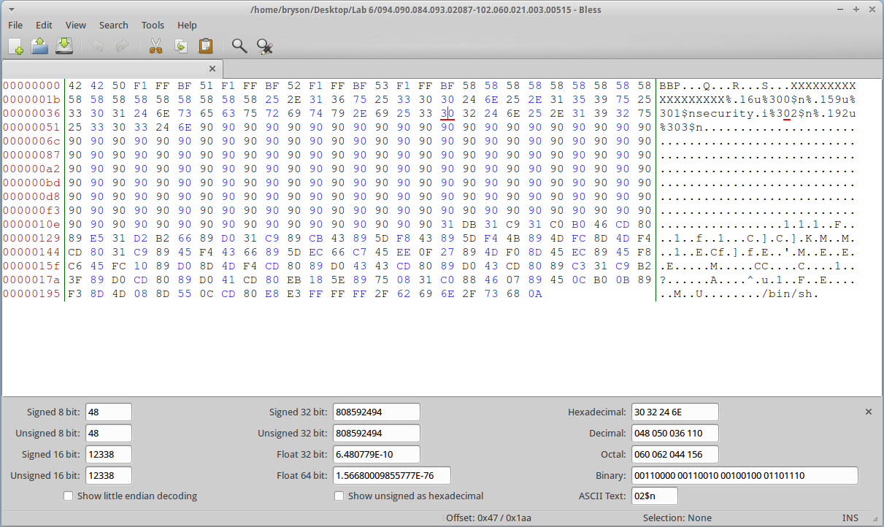

---
tags:
  - File Analysis
  - Linux
  - Open Source Software
  - Tools
---
**Bless** is a free hex editor available on Linux platforms. It is fully
functional and easy-to-use.

The following are the main features:

* Efficient editing of large data files and block devices.
* Multilevel undo - redo operations.
* Customizable data views.
* Fast data rendering on screen.
* Multiple tabs.
* Fast find and replace operations.
* A data conversion table.
* Advanced copy/paste capabilities.
* Highlighting of selection pattern matches in the file.
* Plugin based architecture.
* Export of data to text and html (others with plugins).
* Bitwise operations on data.
* A comprehensive user manual.

## Installation Instructions

Bless can be installed by using the command: *sudo apt-get install bless*

## External Links

* [Bless on GitHub](https://github.com/afrantzis/bless)
