---
tags:
  - Mobile
---
Step 1. Remove the back panel which holds the battery in place.

Step 2. Remove the SIM and SD Memory Card.

Step 3. Flip phone and remove the Vendor plate

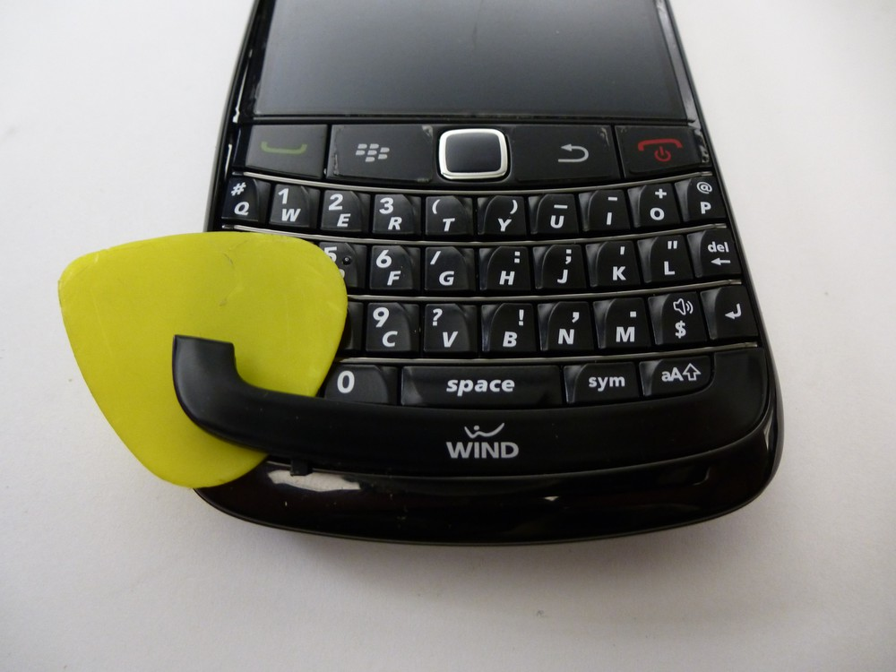{width="300"}

Step 4. Using a torx-5 screw driver remove the 2 visible screws under the
vendor.

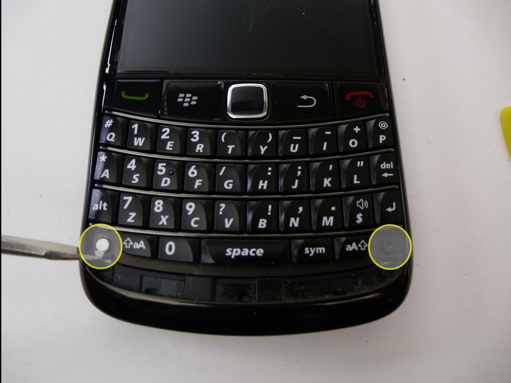{width="300"}

Step 5. Use a guitar pick or pry tool to remove the outer bezel.

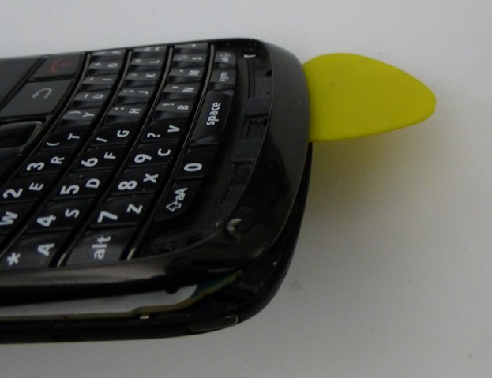{width="300"}

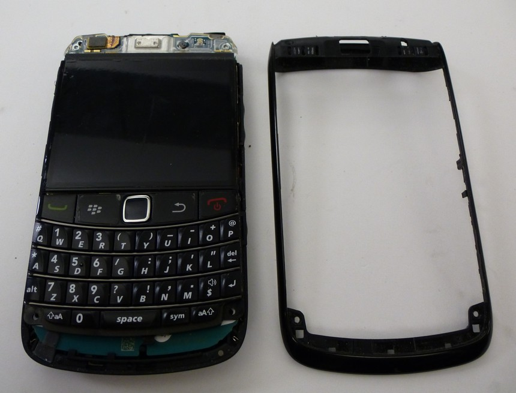{width="300"}

Step 6. Gently remove the keyboard to 4 additional torx-5 screws to be
removed.

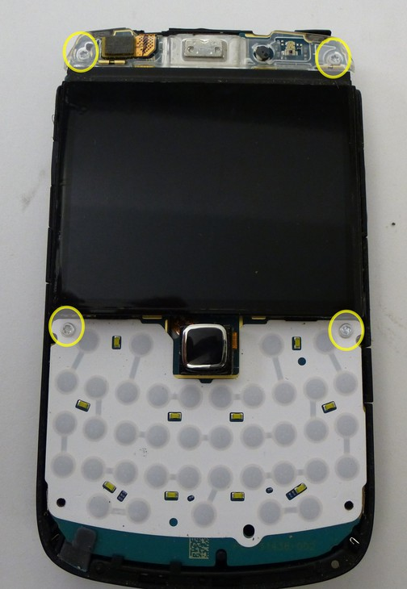{width="300"}

Step 7. Release the flex cable in the top left corner and remove the
LCD/Motherboard from the housing.

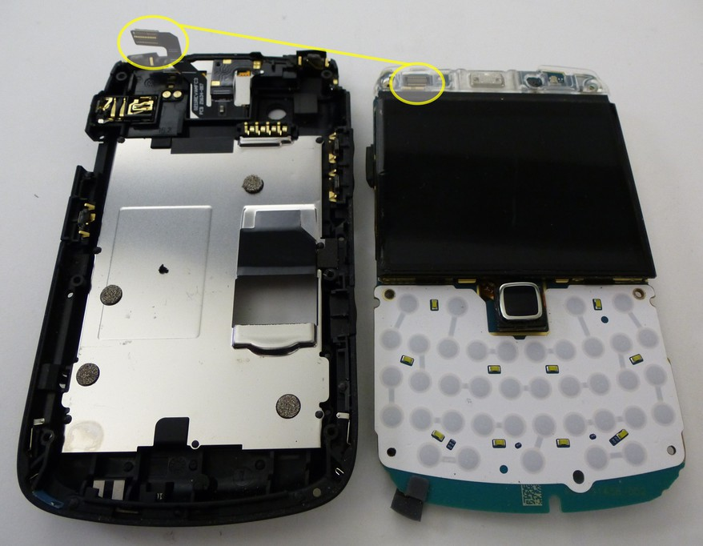{width="300"}

Step 8. Release the LCD and pointer flex cables and remove the LCD from the
Motherboard.

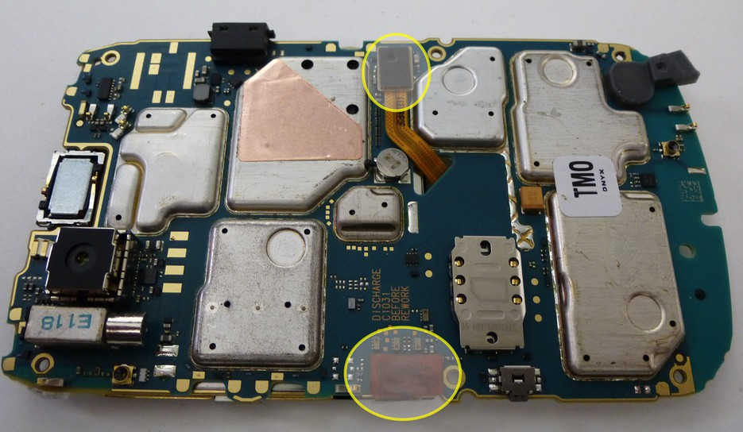{width="300"}

Step 9. The tear down is now complete

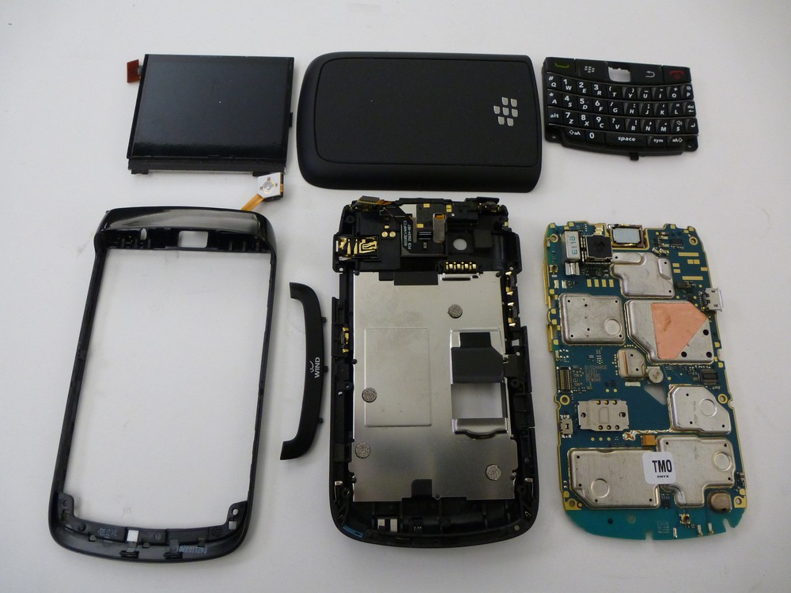{width="300"}

## NAND Removal

Step 1. The NAND is located beneath the heat shield to the left of the USB
port.

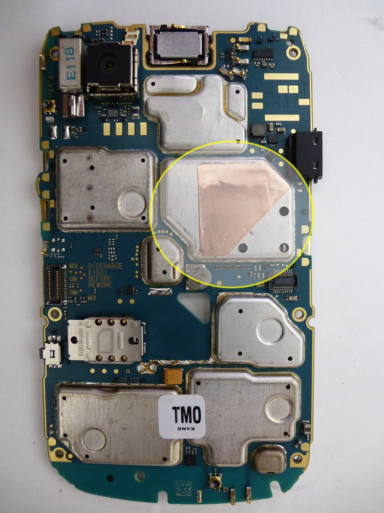{width="300"}

Step 2. Place the main board in a stand or holder and position it under a
heat gun or device the blows super hot air. We use a Wagner "model
XYZ" positioned approximately 2 1/2" - 3" inches away from the main
board.

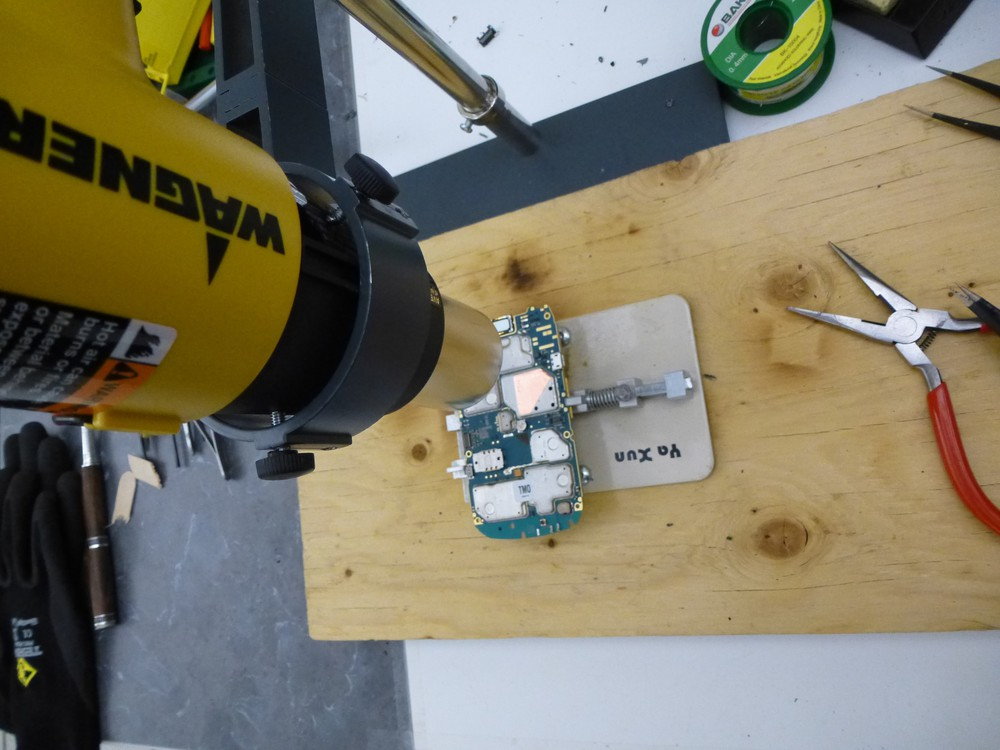{width="300"}

Step 3. Monitoring the temperature the heat shield will come off easily
between 190-200 Centigrade.

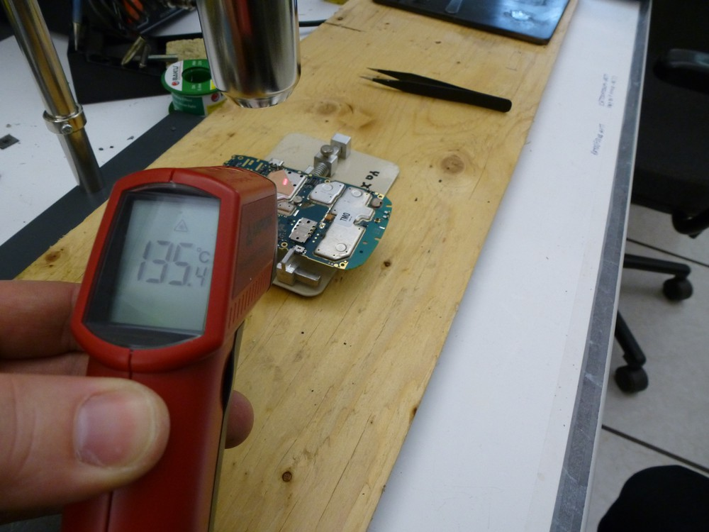{width="300"}

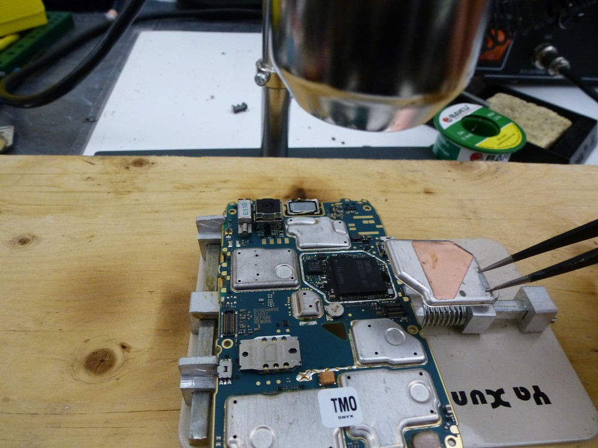{width="300"}

Step 4. Continue working under the high heat. In the 9780's I've worked on
there is typically a black epoxy that has been applied to the NAND.
Using a razor under the high heat this epoxy can be easily cut into.
Once the epoxy has been cut and with the temperature around 215
Centigrade the NAND will be easily removed from the main board.

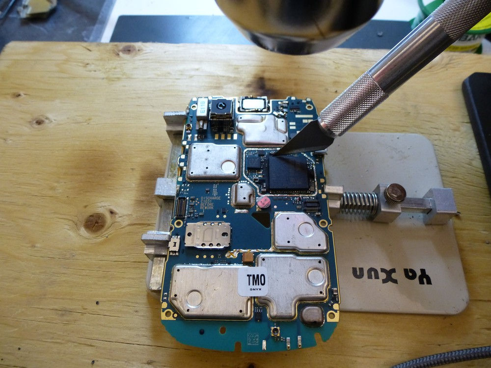{width="500"}

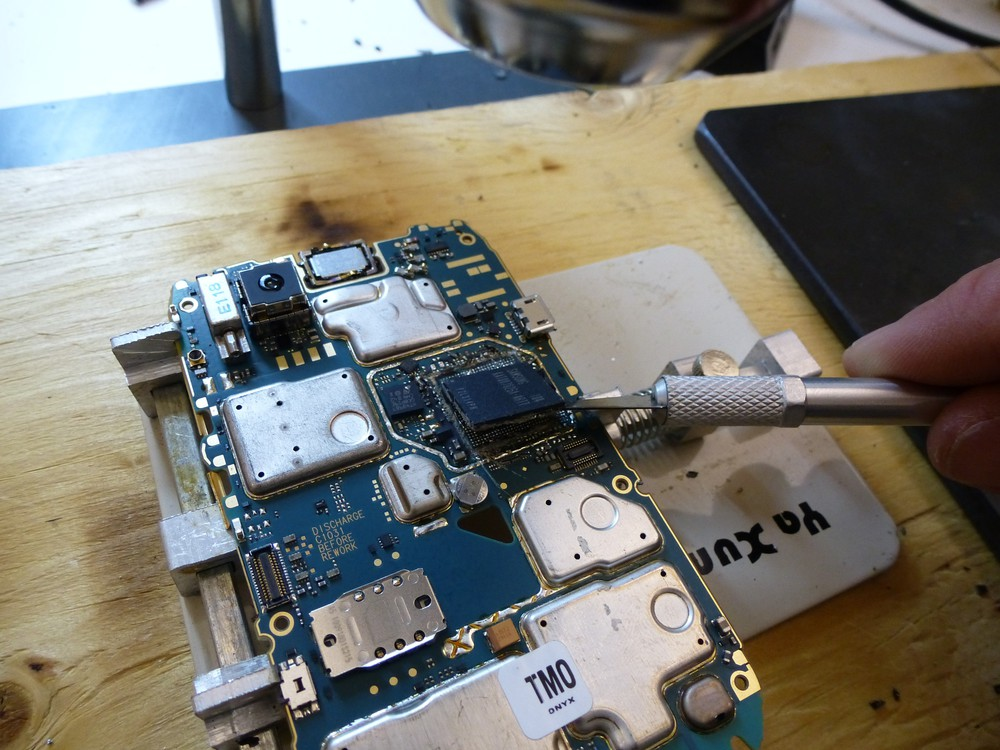{width="500"}

The BlackBerry Bold 9780 uses a stacked die 152 pin BGA, this includes a
NAND stacked on a controller which is soldered to the main board. We are
interested in the NAND and therefore must separate it from the
controller. This is accomplished with the use of high heat (heat gun), a
20 x 20 x 0.5cm steel plate and a 10cm razor blade.

Step 5. Position the steel plate under the heat gun. The plate will heat up
and hold the heat be mindful not to burn yourself.

Step 6. Transfer the NAND+Controller to the plate and allow the chip to take
in some heat \~1min

Step 7. Using long tweezers to hold the chip and the 10cm razor begin
slicing away the epoxy that is surrounding the chip with a sharp
razor the epoxy will slice easily allowing you to see a tiny gap
between the NAND and the controller.

{width="300"}

{width="300"}

{width="300"}

{width="500"}

{width="500"}

Step 8. The razor can then be used to separate the two.

{width="500"}

{width="500"}

Step 9. Using liquid flux, or flux paste and a soldering iron scrape the
remaining epoxy off the NAND and clean it up real nice to prep for a
NAND read.

{width="300"}

{width="300"}

{width="300"}
