---
tags:
  - Mobile
---
Step 1. Remove the back panel.

Step 2. Remove the SIM and SD Memory Card.

Step 3. Using a torx-6 screw driver remove the 2 visible screws on the back
of the phone.

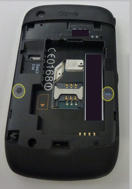{width="300"}

Step 4. Remove the screen protector using a plastic shim or guitar pick.

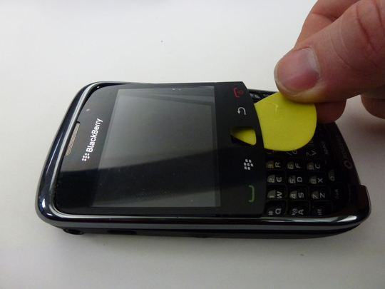{width="300"}

Step 5. Use the shim to detach the top-plate/cover from the device.

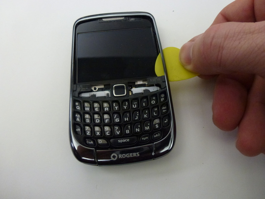{width="300"}

Step 6. Remove 4 additional torx-6 screws.

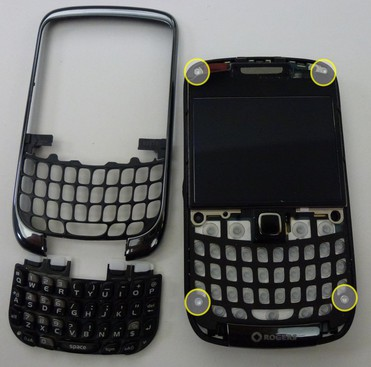{width="300"}

Step 7. Detach vendor plate and remove 2 more torx-6 screws.

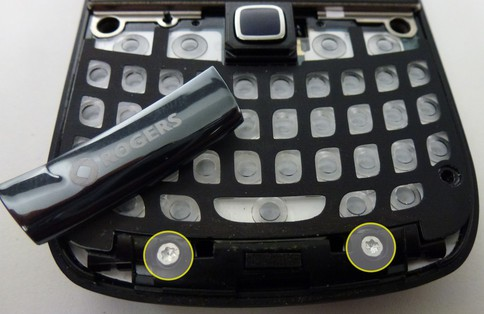{width="300"}

Step 8. Separate back plate from the main board.

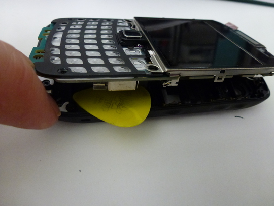{width="300"}

Step 9. The tear down is now complete

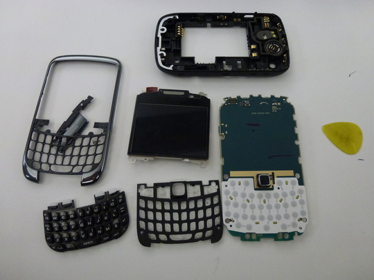{width="300"}

## NAND Removal

Step 1. Peel off the vendor sticker on the back side of the main circuit
board

Step 2. The NAND is located beneath the heat shield directly above the Micro
SD card slot.

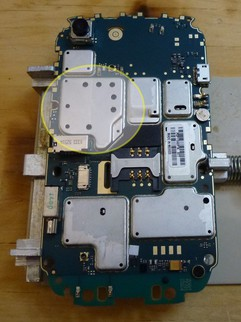{width="300"}

Step 3. Place the main board in a stand or holder and position it under a
heat gun or device the blows super hot air. We use a Wagner "model
XYZ" positioned approximately 2 1/2" - 3" inches away from the main
board.

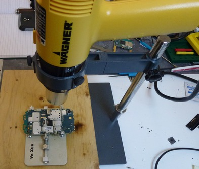{width="300"}

Step 4. Monitoring the temperature the heat shield will come off easily
between 190-200 Centigrade.

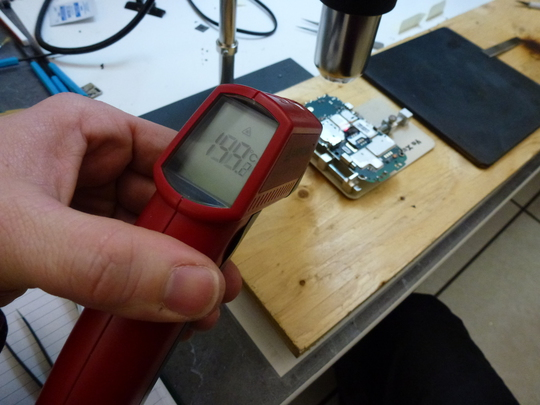{width="300"}

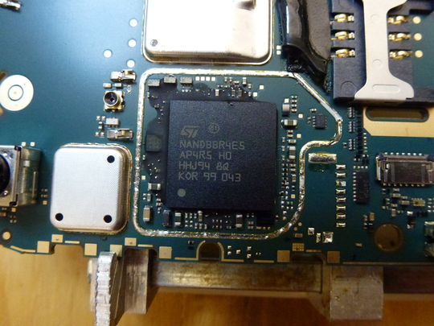{width="300"}

Step 5. Continue working under the high heat. In the 9300's I've worked on
there is typically a black epoxy that has been applied to the NAND.
Using a razor under the high heat this epoxy can be easily cut into.
Once the epoxy has been cut and with the temperature around 215
Centigrade the NAND will be easily removed from the main board.

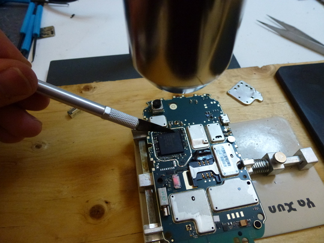{width="300"}

The BlackBerry Curve 9300 uses a stacked die 152 pin BGA, this includes
a NAND stacked on a controller which is soldered to the main board. We
are interested in the NAND and therefore must separate it from the
controller. This is accomplished with the use of high heat (heat gun), a
20 x 20 x 0.5cm steel plate and a 10cm razor blade.

Step 6. Position the steel plate under the heat gun. The plate will heat up
and hold the heat, try not to burn yourself.

Step 7. Transfer the NAND+Controller to the plate and allow the chip to take
in some heat \~1min.

Step 8. Using long tweezers to hold the chip and the 10cm razor begin
slicing away the epoxy that is surrounding the chip with a sharp
razor the epoxy will slice easily allowing you to see a tiny gap
between the NAND and the controller.

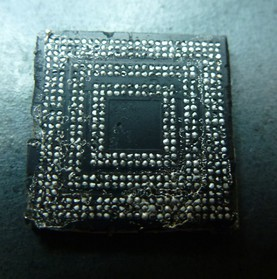{width="300"}

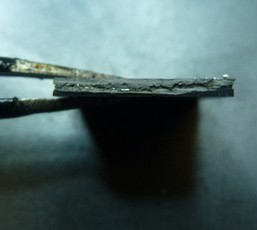{width="300"}

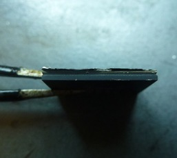{width="300"}

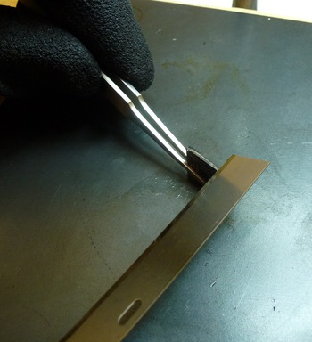{width="450"}

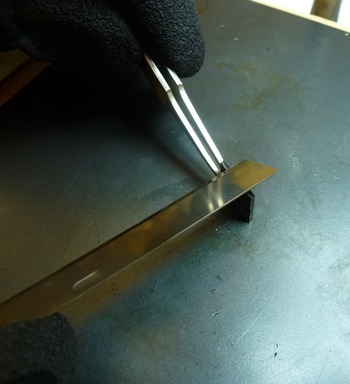{width="450"}

Step 9. The razor can then be used to separate the two.

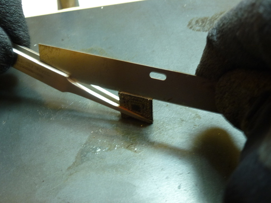{width="450"}

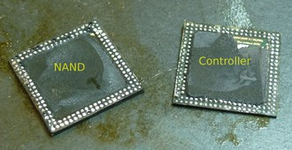{width="450"}

Step 10. Using liquid flux, or flux paste and a soldering iron scrape the
remaining epoxy off the NAND and clean it up real nice to prep for a
NAND read.

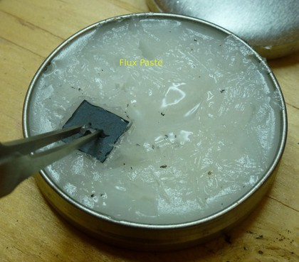{width="300"}

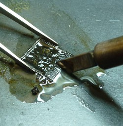{width="300"}

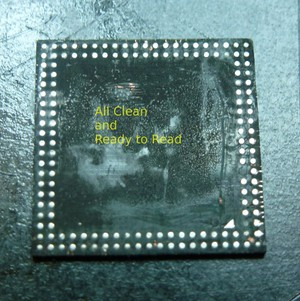{width="300"}
