---
tags:
  - Mobile
---
The hardware used in the BlackBerry 9315's and 9320's are almost
identical. The following link describes the differences between the
models.

Step 1. Remove the back panel.

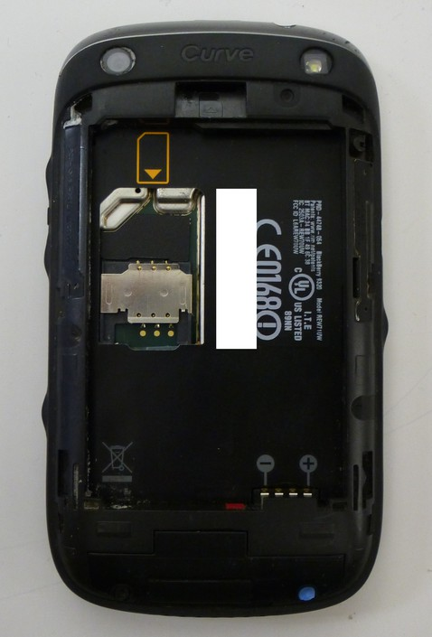{width="300"}

Step 2. Remove the SIM and SD Memory Card.

Step 3. Using a torx-6 screw driver remove the 2 visible screws on the back
of the phone.

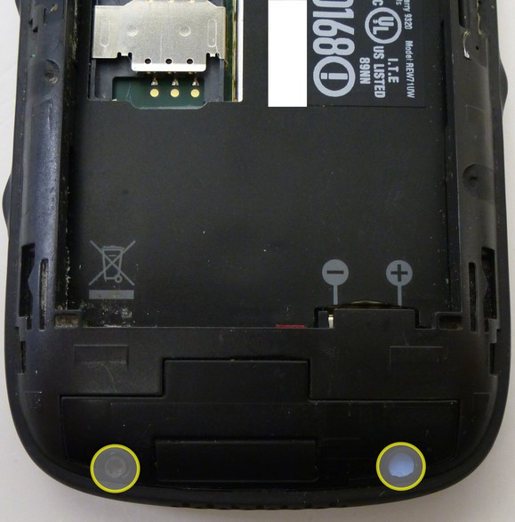{width="300"}

Step 4. Remove the screen protector using a shim, guitar pick, or prying
tool.

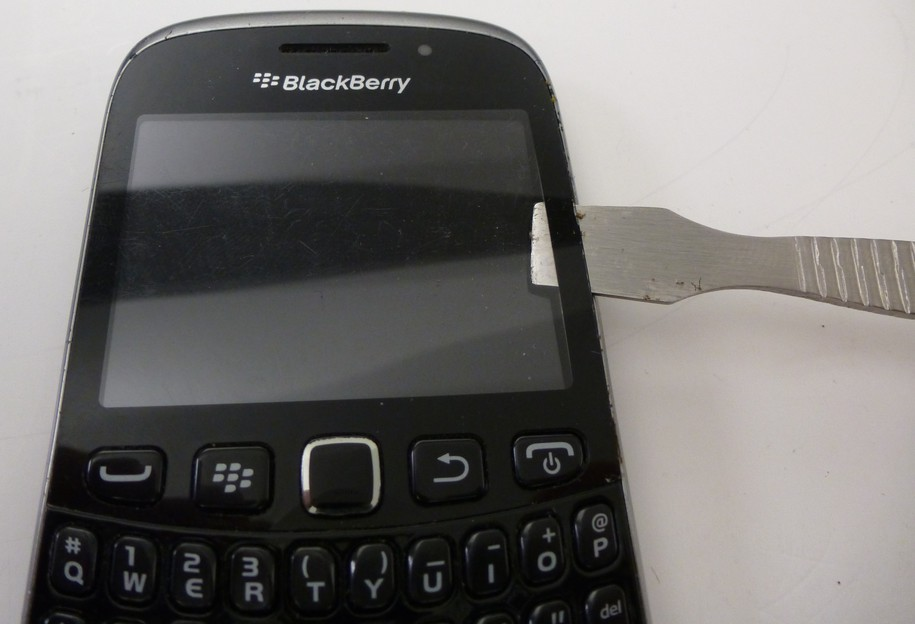{width="300"}

Step 5. Remove 2 torx-5 screws.

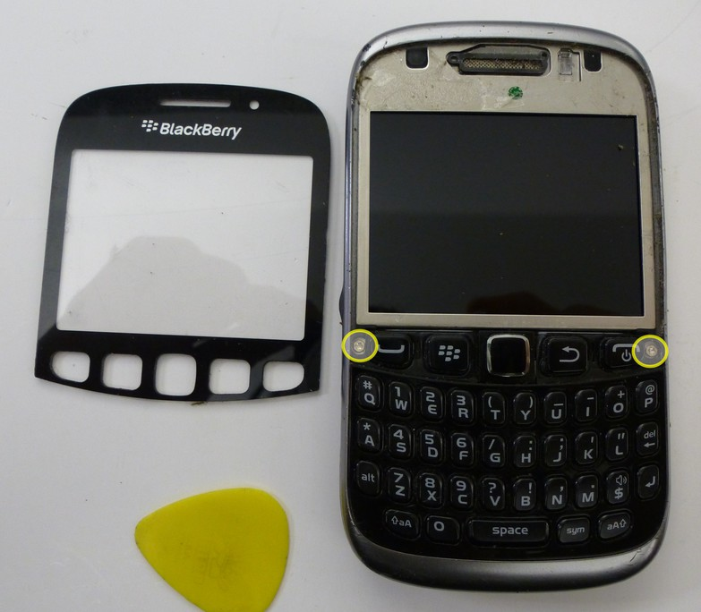{width="300"}

Step 6. Use the shim to detach the outer bezel/keyboard from the device.

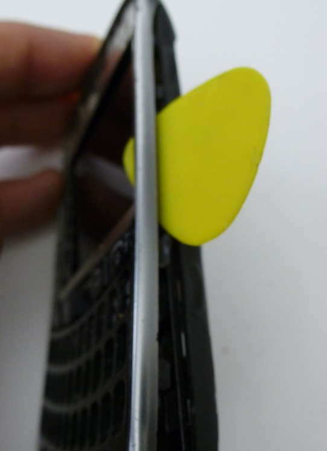{width="300"}

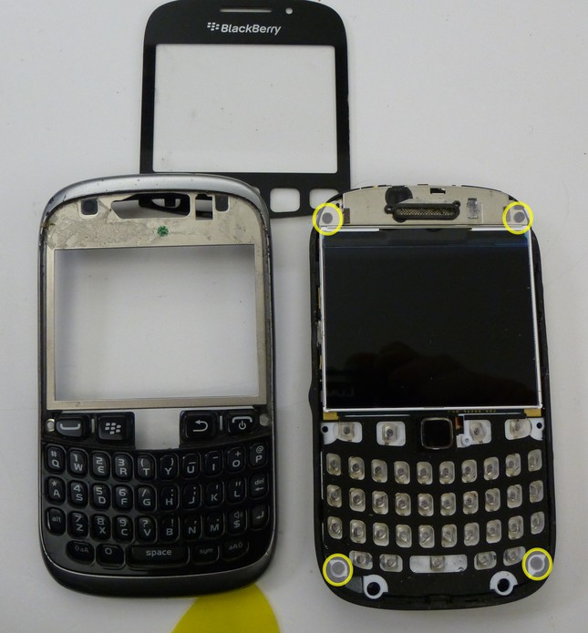{width="300"}

Step 7. Remove 4 additional torx-6 screws. The main board will now easily be
separated from the back plate

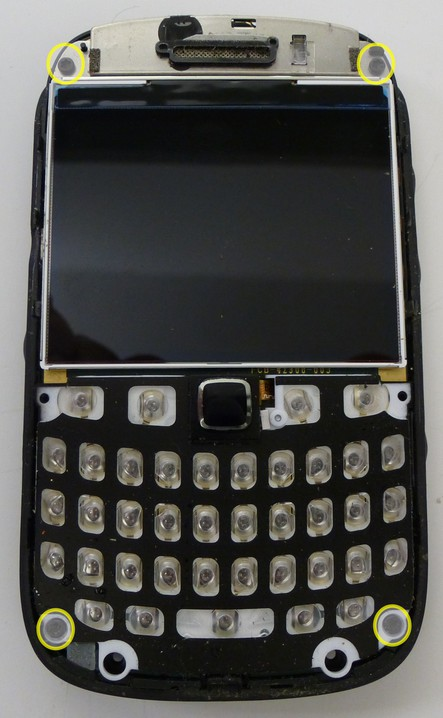{width="300"}

Step 8. Peel off the vendor sticker.

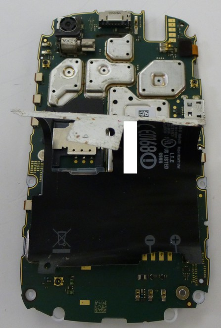{width="300"}

Step 9. Remove the plastic cover protecting the track pad ribbon cable, and
disconnect the track pad.

Step 10. Remove the final torx-4 screw located beneath the plastic protector,
to remove the plastic keyboard overlay.

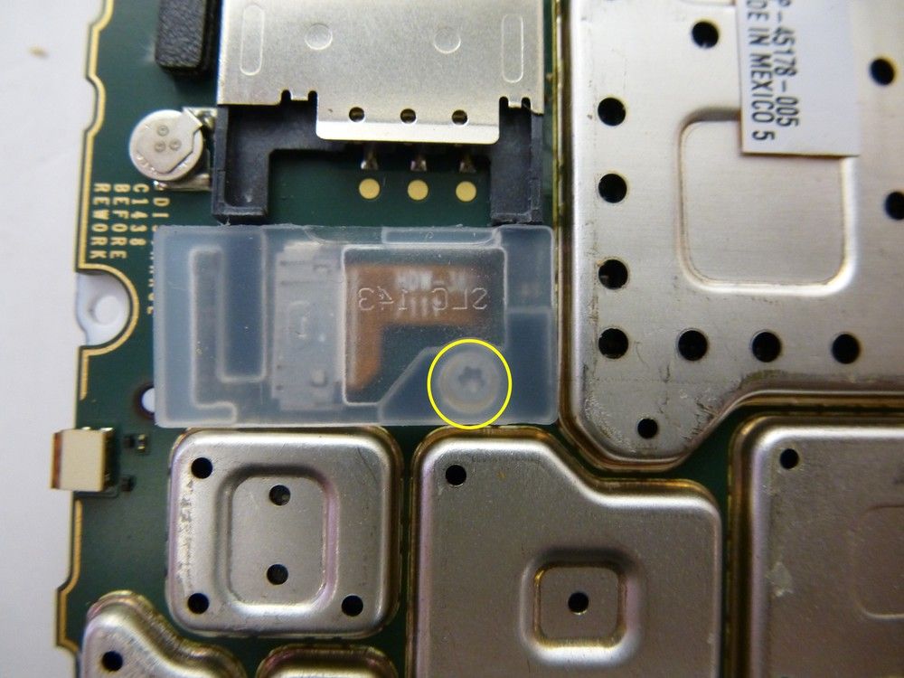{width="300"}

Step 11. Disconnect the ribbon cable connected to the LCD. Then using a pick
separate the display from the main board.

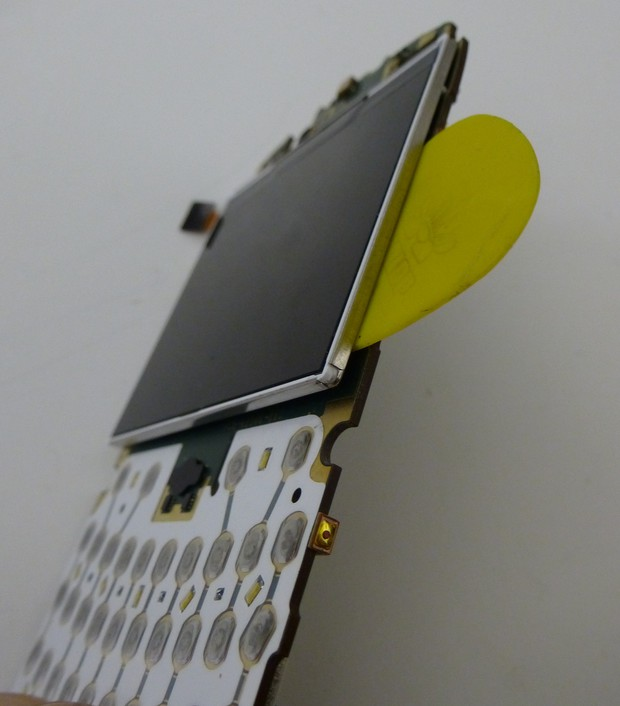{width="300"}

Step 12. The tear down is now complete

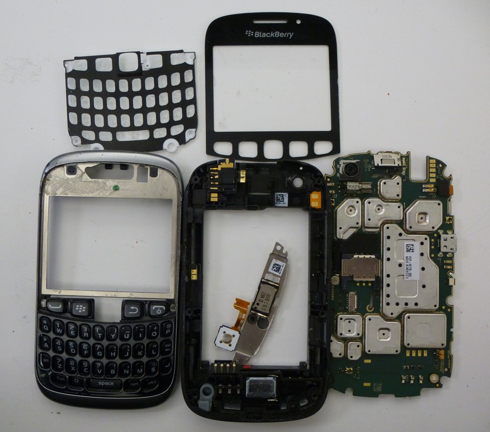{width="300"}

## eMMC Removal

Step 1. The eMMC is located beneath the heat shield directly above the Micro
SD card slot.

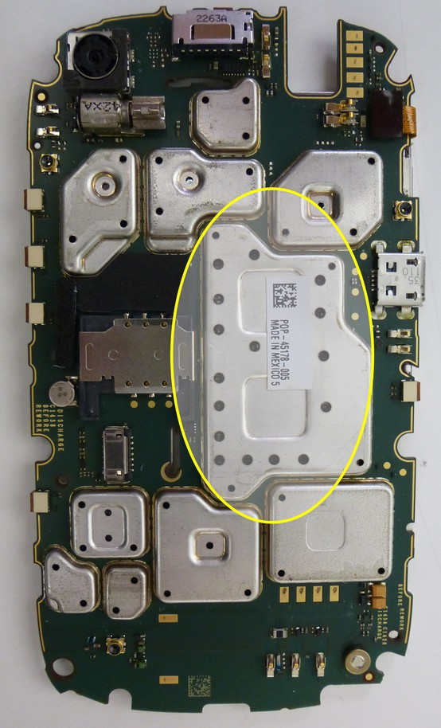{width="300"}

Step 2. Place the main board in a stand or holder and position it
approximately 2 1/2" - 3" inches away from a heat gun or device the
blows super hot air.

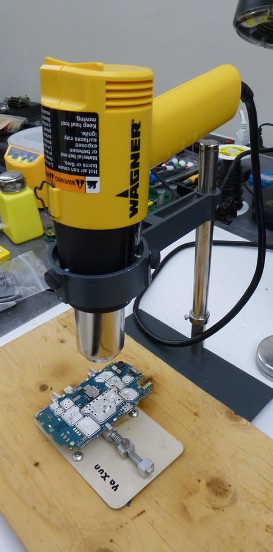{width="300"}

Step 3. Monitoring the temperature the heat shield will come off easily
between 190-200 Centigrade.

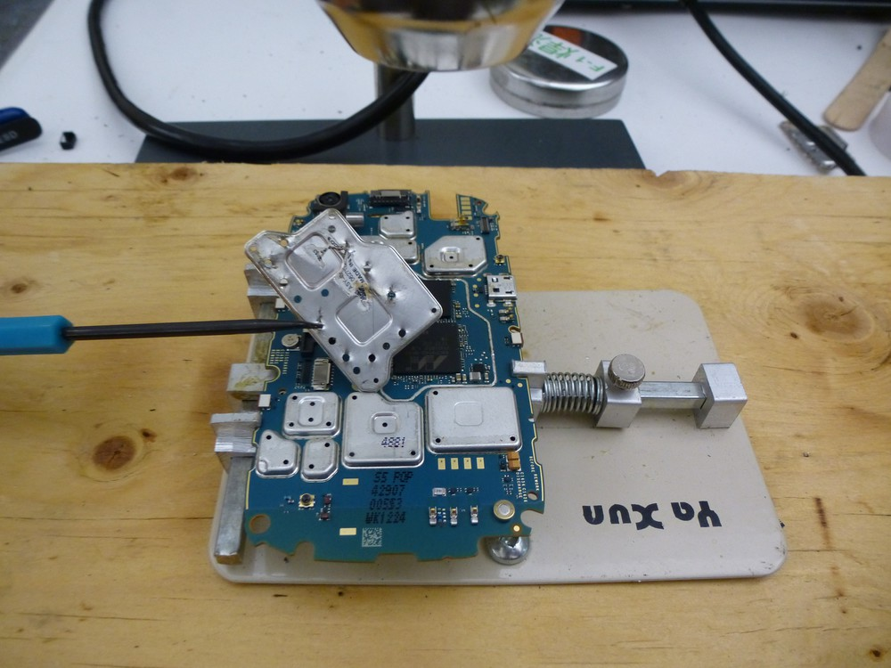{width="300"}

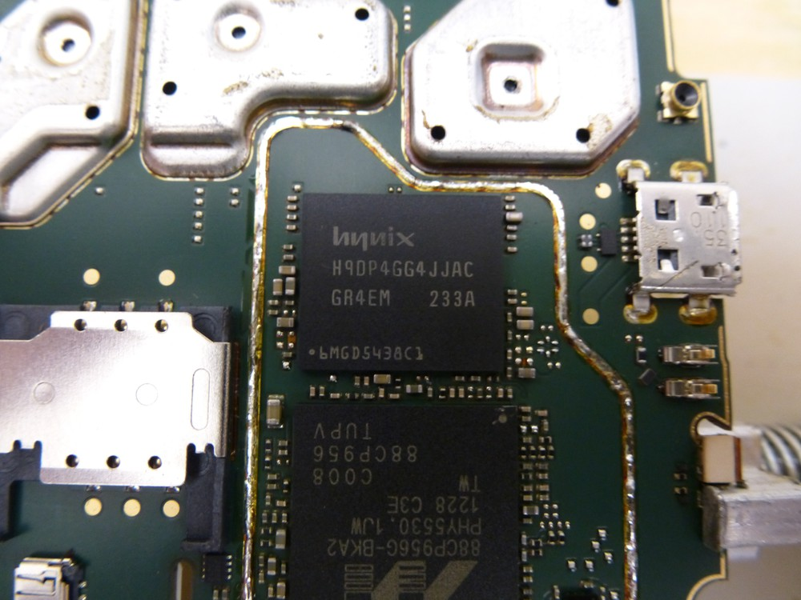{width="300"}

Step 4. Continue working under the high heat. With the 9315/9320's I've
worked on the eMMC has been ready to lift off of the main board
using tweezers immediately after removing the heat shield.

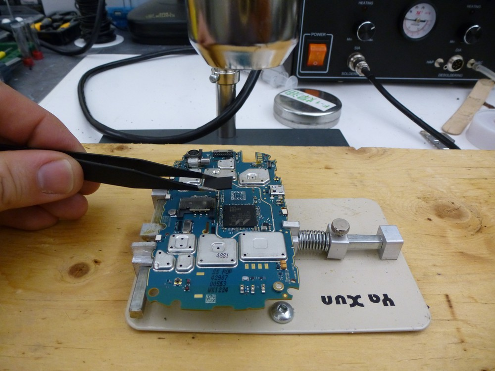{width="300"}

Step 5. Using liquid flux, or flux paste and a soldering iron clean the pads
on the eMMC in preparation for a read

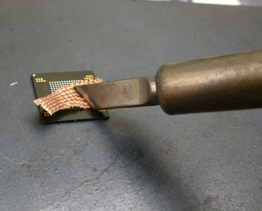{width="300"}

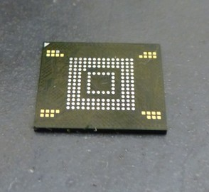{width="300"}

Step 6. The eMMC is now ready to read using the appropriate
adapter/programmer and software.

At the time of this writing (2013OCT29) the eMMC that was removed in
this example was read using an UP828 programmer via the "VBGA169E"
adapter and using the "eNAND_H9DP4GG4JJACGR-4EM/459MB" device settings.
The resulting image was then parsed via the Cellebrite Physical Analyzer
(V. 3.8.5.108).
