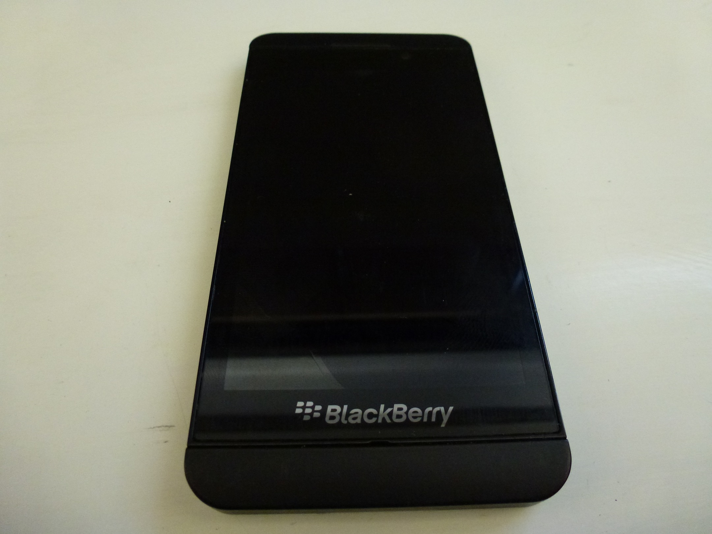
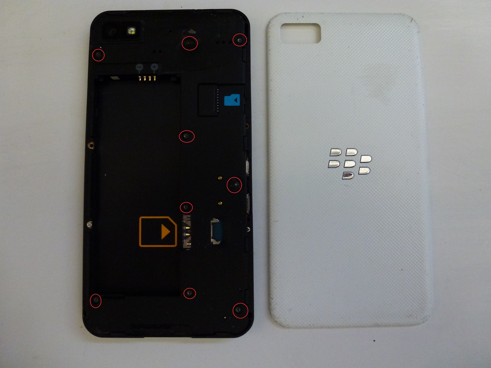
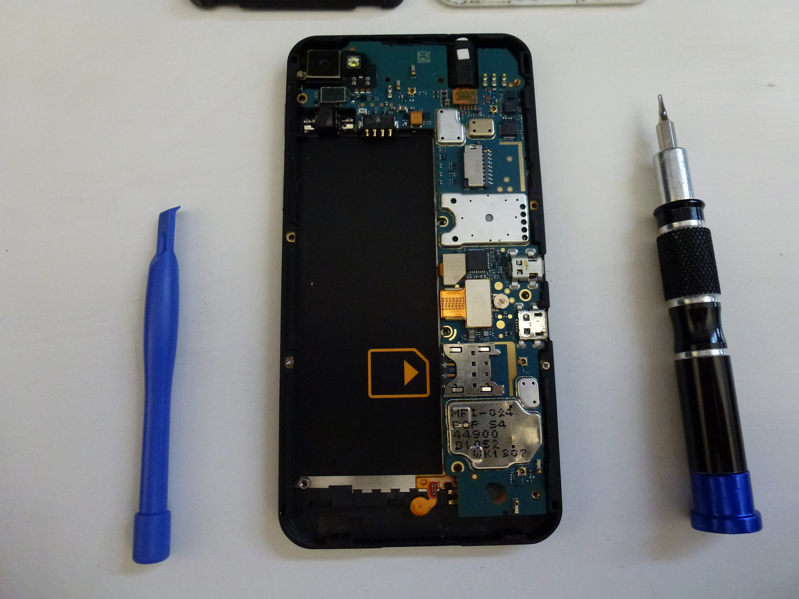
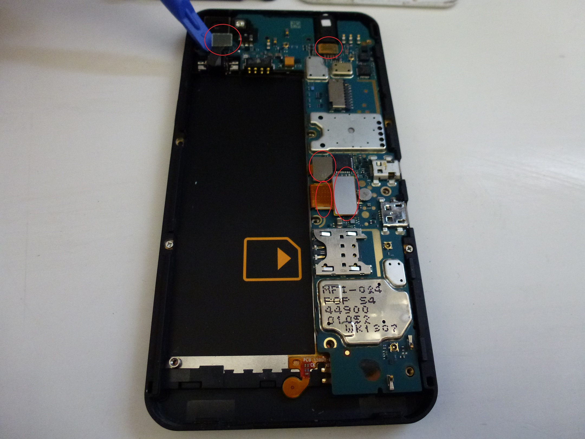
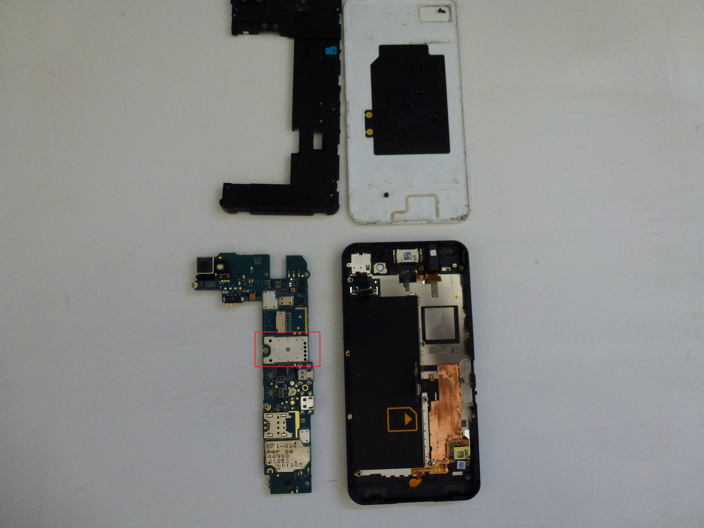
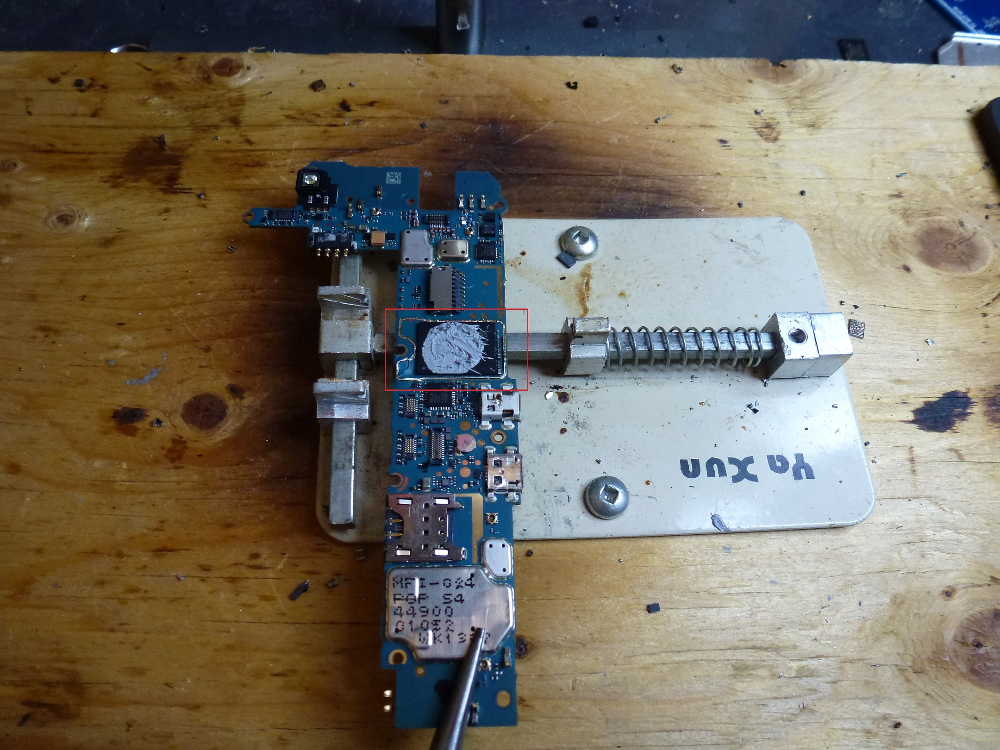
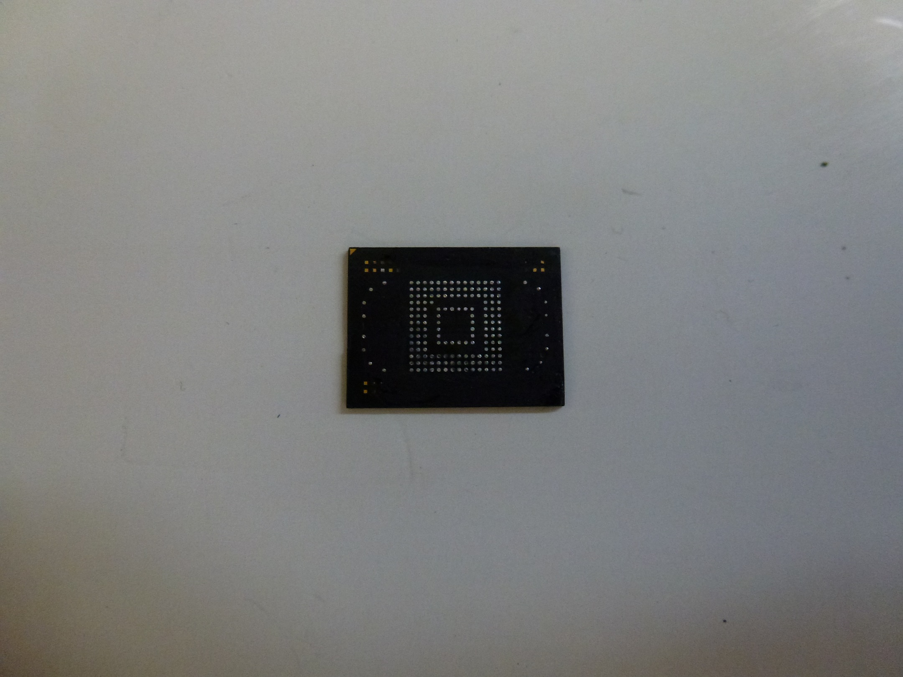
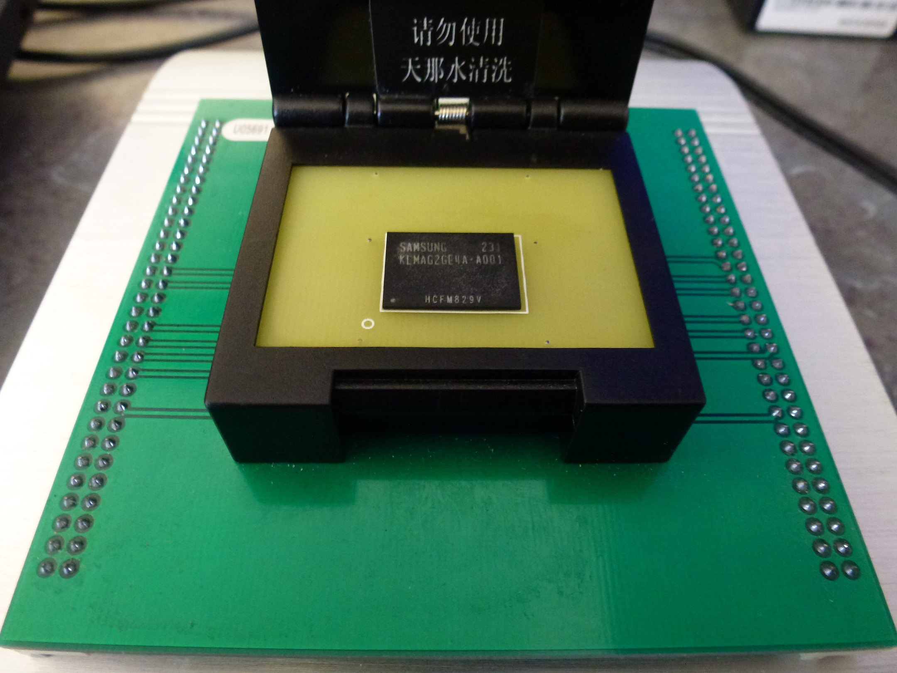

---
tags:
  - Mobile
---
{width="600"}

Step 1. Remove the back panel.

Step 2. Remove the Battery, SIM and SD Memory Card.

Step 3. Using a torx-4 screw driver, remove the visible screws on the back
of the phone.

{width="600"}

Step 4. Un-clip the back panel using a shim, guitar pick, or prying tool.
This will expose the mainboard.

{width="600"}

Step 5. Un-clip all connectors (5) from the mainboard, and simply lift the
board out of the phone.

{width="600"}

{width="600"}

Step 6. Remove the shield to expose the memory module. There will be epoxy
on the chip so take your time, use adequate heat, and gently remove
the chip from the board.

{width="600"}

Step 7. Prepare the chip for reading. Again, take your time to carefully
remove the epoxy without applying too much direct heat, and
consistently adding flux paste.

{width="600"}

Step 8. The chip is now ready to be read. The chip in our test phone is a
Samsung KLMAG2GE4A-A001. It was read using an UP-828 Programmer with
the VBGA169E adapter. The resulting .bin was parsed in UFED Physical
Analyzer.

{width="600"}
