---
tags:
  - Mobile
---
## JTAG LG Nexus 4

The LG Nexus 4 is an Android based smartphone. At the time of this
writing (2013Nov28), I am unaware of any method other than JTAG to
acquire a physical image of the NAND on a locked LG Nexus 4.

For the purpose of this document, a LG Nexus 4 was disassembled, read
via JTAG, reassembled.

### Getting Started

What you need to dump the NAND:

1. A [RIFF Box](https://www.riffbox.org/)
2. Soldering skills and fine tip soldering iron (a JTAG jig is
   available for this device).
3. Optional: JTAG Molex Adapter Set by MOORC.
4. A DC Power supply capable of supplying 3.8V/2.1A output. The power
   supply used for this was an U8002A DC Power Supply.

### NAND Dump Procedure

1. Disassemble the phone down to the PCB.
2. Connect the RIFF JTAG Box to the PC via USB.
3. Connect the RIFF JTAG Box to the PCB via the JTAG pins.
4. Connect the PCB to the DC power supply.
5. Start the "RIFF BOX JTAG" software.
6. Enable the power on the DC power supply.
7. Power the phone via the power button.
8. Dump the NAND via the RIFF Box software.

Instructions for disassembly can be found on Internet and are summarized
as follows:

* Using a Torx-5 (T5) screw driver remove the 2 screws from the bottom
  of the phone.
* Use a pry tool (guitar pick) to remove the back cover.

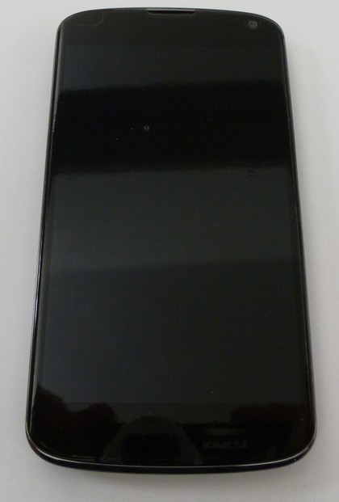{width="500"}

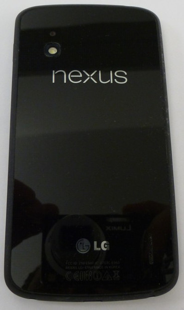{width="445"}

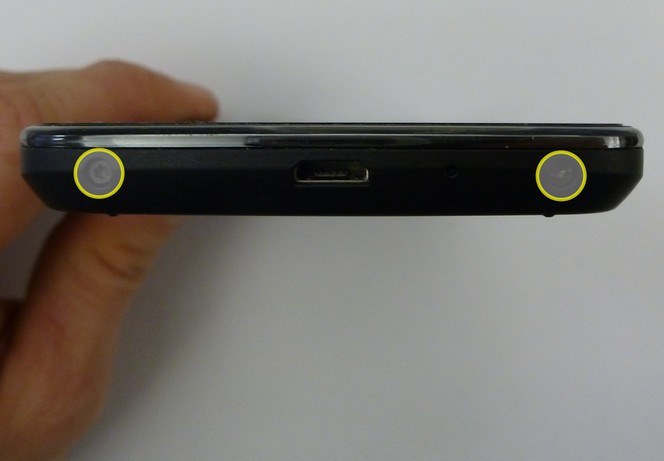{width="450"}

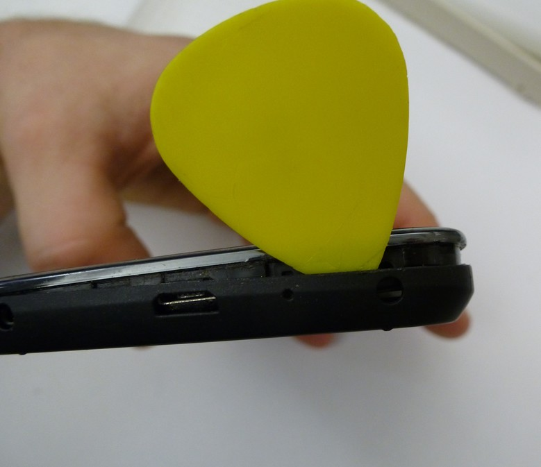{width="450"}

* Using a Philips (PH00) screw driver, remove the 9 screws securing the
  plastic shield on the backside of the phone as well as the 2 screws
  securing the battery connector.

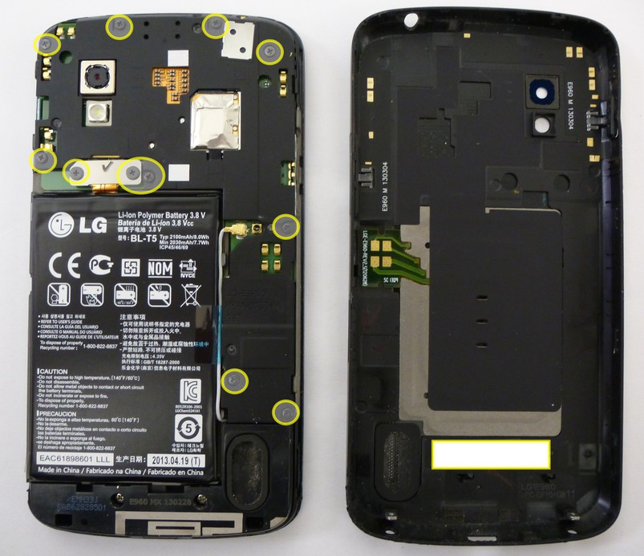{width="1000"}

* Once the plastic shield has been removed, you can see the JTAG
  connection port located next to the power button. This JTAG port has a
  Molex connector installed and as such it is possible to use a JTAG jig
  to connect to the device. However, on this phone I soldered 0.040
  gauge magnet wire directly to the Molex pins as I did not have a JTAG
  jig available.

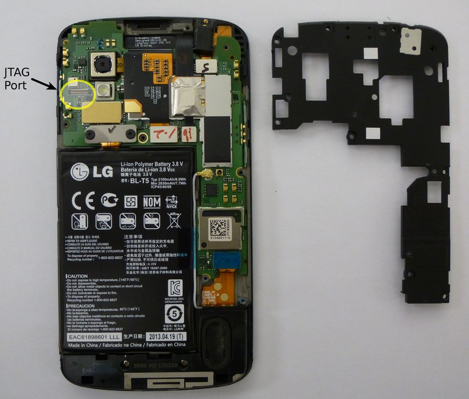{width="500"}

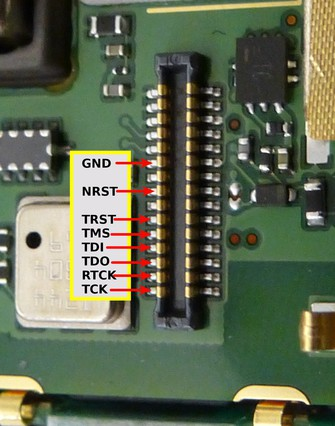{width="500"}

''Alternatively, if you have the JTAG Molex adapter set, you can use the
JTAG Molex adapter to connect the phone directly to the RIFF box sans
soldering as follows.

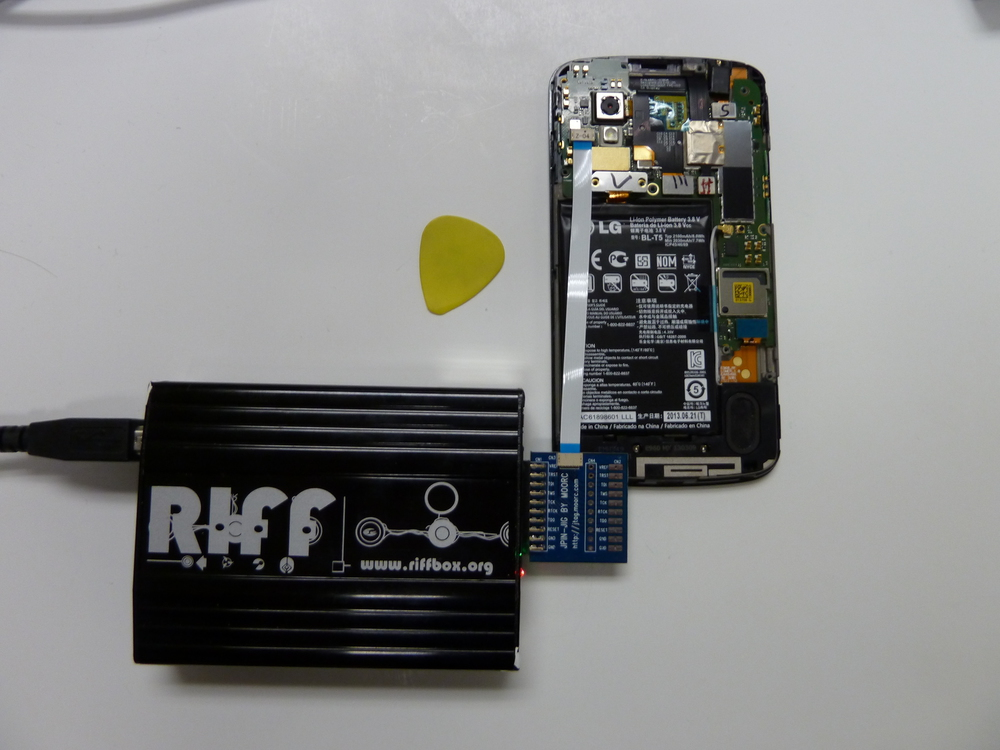{width="500"}

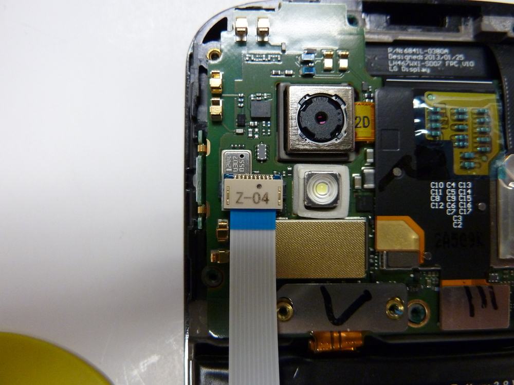{width="500"}

**NOTE:** Initially we attempted to read the phone using power supplied
via the phone's battery and the USB port. The results were inconsistent
with the phone disconnecting throughout the read which resulted in read
failures. We opted to use a DC power supply which provided a much more
stable connection to the device.

* The battery on the Nexus 4 uses a blade style connector. In order to
  connect to the power supply, we used a pair of Pomona Micro Grabbers
  attached to an RJ45 cable inserted into an RJ45 receptacle that was
  connected to our DC power supply. See the picture for more detail.

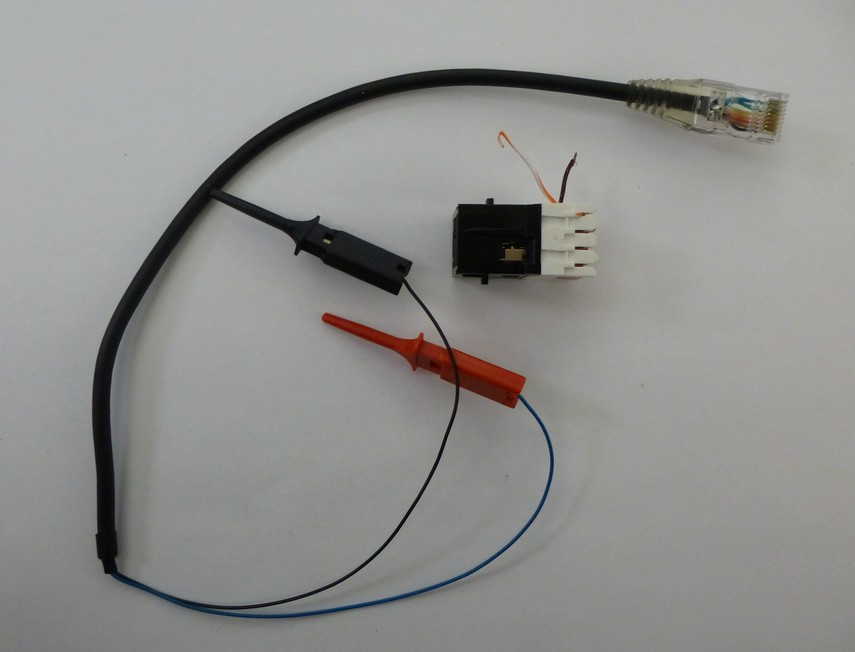{width="500"}

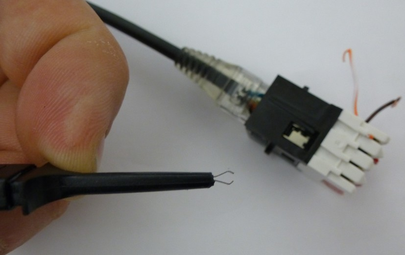{width="500"}

* Connect the PCB battery terminal connections to the DC power supply.
  The positive (+) connection is the outermost pin 1 and the negative
  (-) connection is pin 3. You can configure your power supply to match
  the battery specifications which in this case is 3.8V and 2.1A but do
  not apply power at this time. During the JTAG procedure the phone will
  draw about 0.4A.

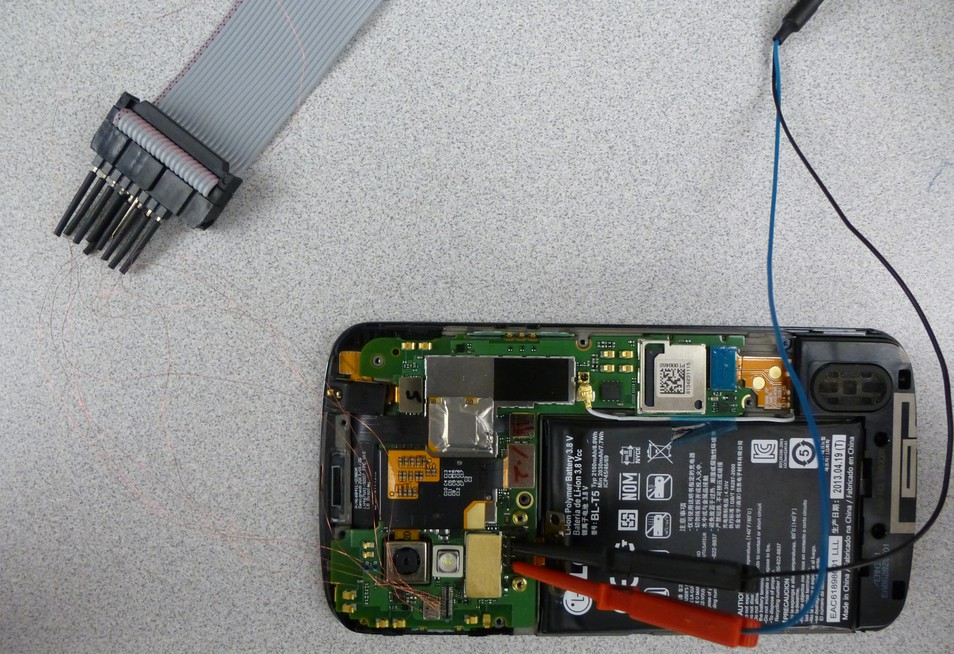{width="1000"}

* Now we can start the RIFF JTAG software, configure it for the LG E960,
  and connect the phone to the RIFF box. See the picture for more
  detail.

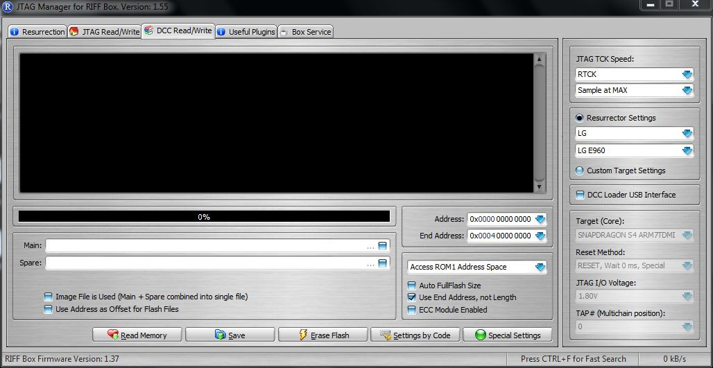{width="1000"}

* Apply power from the DC power supply to the phone and turn the phone
  on using the button on the side of the PCB. After powering the phone
  on, select "READ" under the "DCC Read/Write" tab. If all goes well the
  "READ" button will become the "STOP" button and the phone will begin
  reading. If not, the RIFF software provides troubleshooting steps that
  should be taken to assist in diagnosing some of the issues you may
  experience.

**NOTE:** In the event of read errors the RIFF software keeps track of
where the failure occurred and gives you option to restart the read
where it left off.
