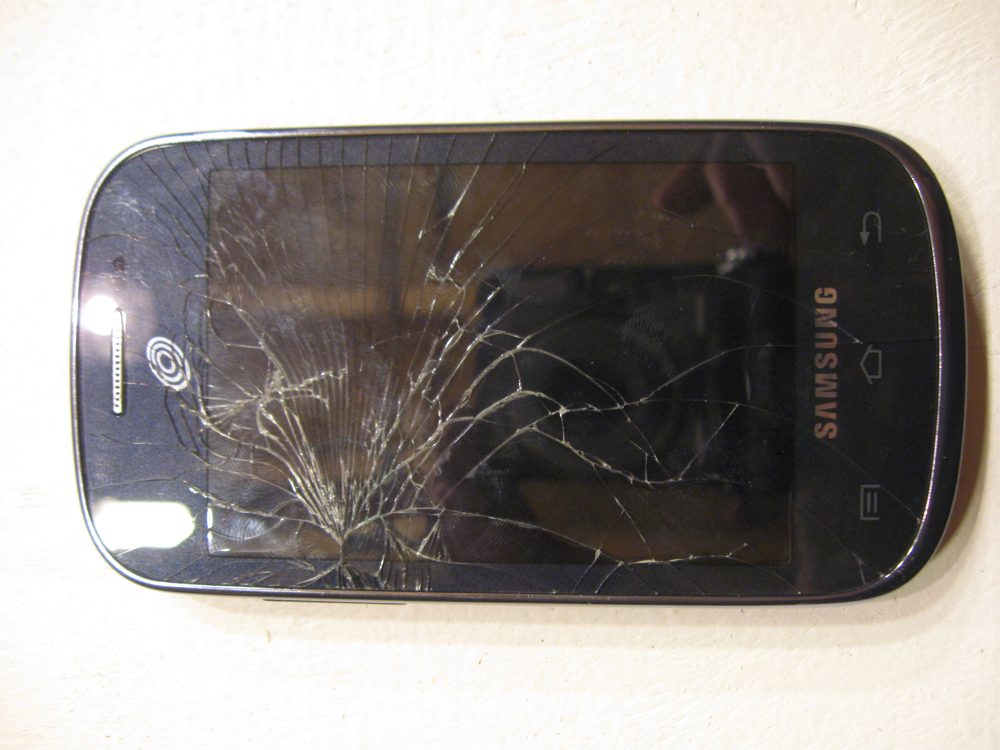
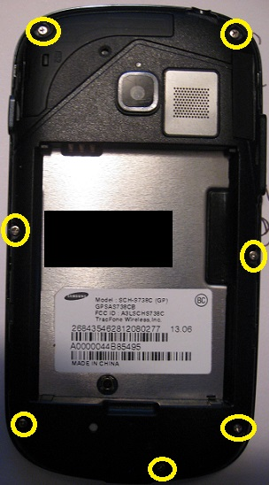
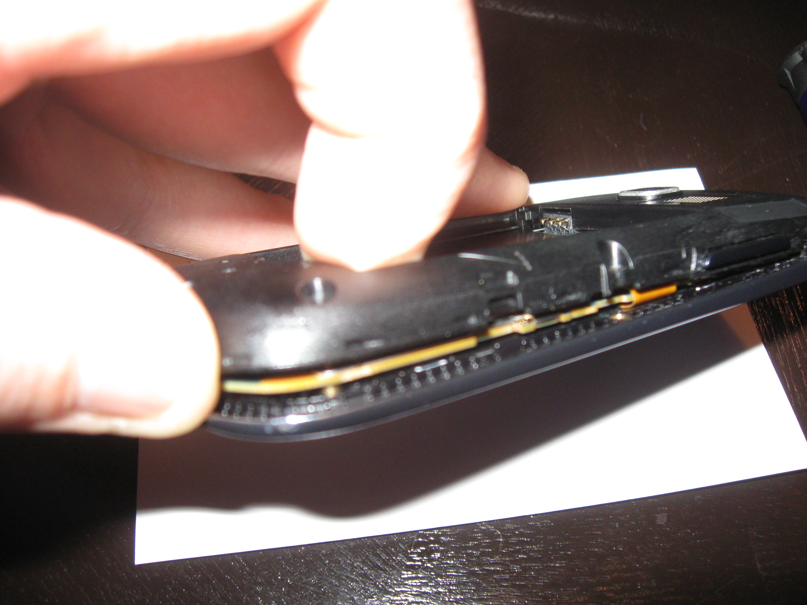
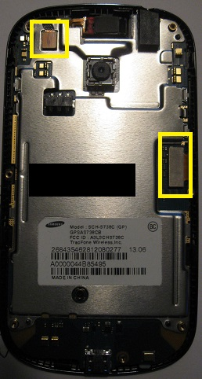
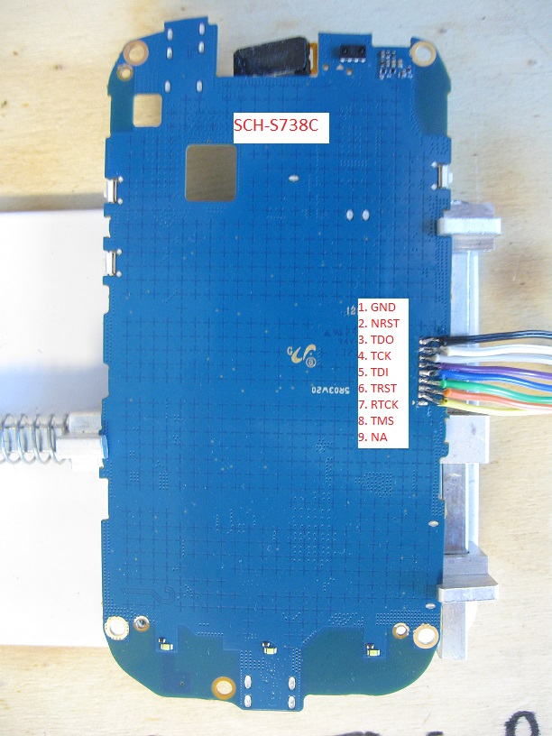
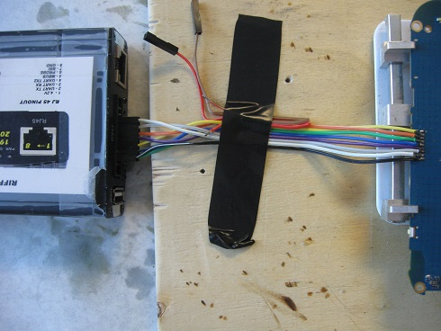
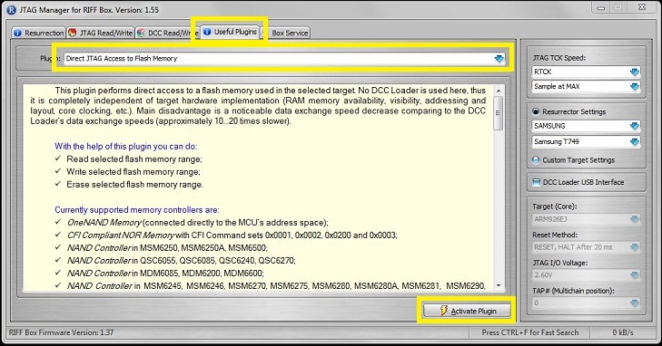
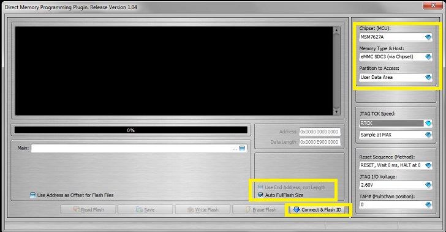
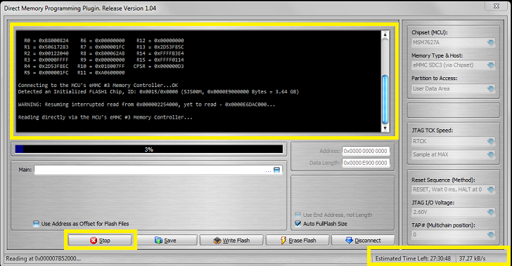

---
tags:
  - Mobile
---
## Samsung Galaxy Centura SCH-S738C

This phone is supported by the Tracfone network and uses a Qualcomm
MSM7625A 800 MHz Snapdragon (S1) Processor. The phone has 4 GB of
internal storage with a Samsung KMSJS000KM B308 MoviNAND flash memory
chip. This phone is unsupported by RIFF Box for the JTAG process but can
be imaged with the direct access plugin.

{width="300"}

### Getting Started

What you need:

1. Riff Box
2. USB to Micro USB cord

### NAND Dump Procedure

1. Remove the rear cover, exposing the 7 phillips head screws.
2. Remove the screws and the rear plastic casing with a plastic pry
   tool.
3. Remove the two molex connectors attached on the right and top of the
   printed circuit board.
4. Remove the printed circuit board from the screen casing exposing the
   nine TAPS on the reverse side. Note the small copper carrot
   indicating the direction of the TAPS.
5. Connect the RIFF box to the JTAG pins.
6. Connect the PCB to a Micro USB cord and power via a power supply.
7. Start the "RIFF box" software.
8. Power the PCB.
9. Dump the NAND.

{width="300"}

{width="300"}

{width="300"}

The TAPS order is as follows:

1. 1=GND
2. 2=NRST
3. 3=TDO
4. 4=TCK
5. 5=TDI
6. 6=TRST
7. 7=RTCK
8. 8=TMS
9. 9=N/A

{width="400"}

Tests have shown for the best results and fewer read errors, use short
wires directly to the RIFF box ribbon interface.

{width="400"}

After the wires are connected to the board, the phone is powered by the
USB connection. Plug the Micro USB into the USB connection on the device
and then plug the phone into the USB port on the laptop.

Launch the Riff Box JTAG Manager and use the following settings:

* Navigate to the Useful Plugins tab
* Select the Direct JTAG Access to Flash Memory Plugin. Note the
  directions displayed in the window along with supported processors.
* Activate the plugin
* Choose the MSM7627A from the drop down menu on the right side \*\*
  Note this is not the processor but it will allow access the the
  memory.
* Select eMMC SDC3 (via chipset) from the Memory Type &amp; Host drop down.
* Check Auto FullFlash size
* Select Connect &amp; Flash ID. \*\* This will not flash the memory chip
  initially, but will only connect\*\*
* Choose the read button from the bottom left corner. This will connect
  to the device and display the partitions and chip ID.

{width="800"}

{width="800"}

{width="800"}

### Notes

The phone has a 4GB MoviNAND flash memory chip which should take
approximately 24 hours to download. This takes much longer the normal
because the direct access plugin functions at a much slower speed then
normal JTAG methods. Test have found using shorter large wires and no
intermediate PCB board increases performance.
