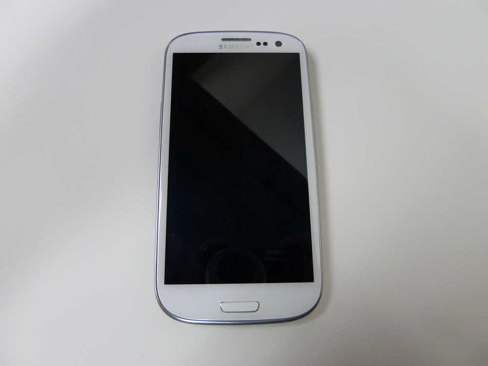
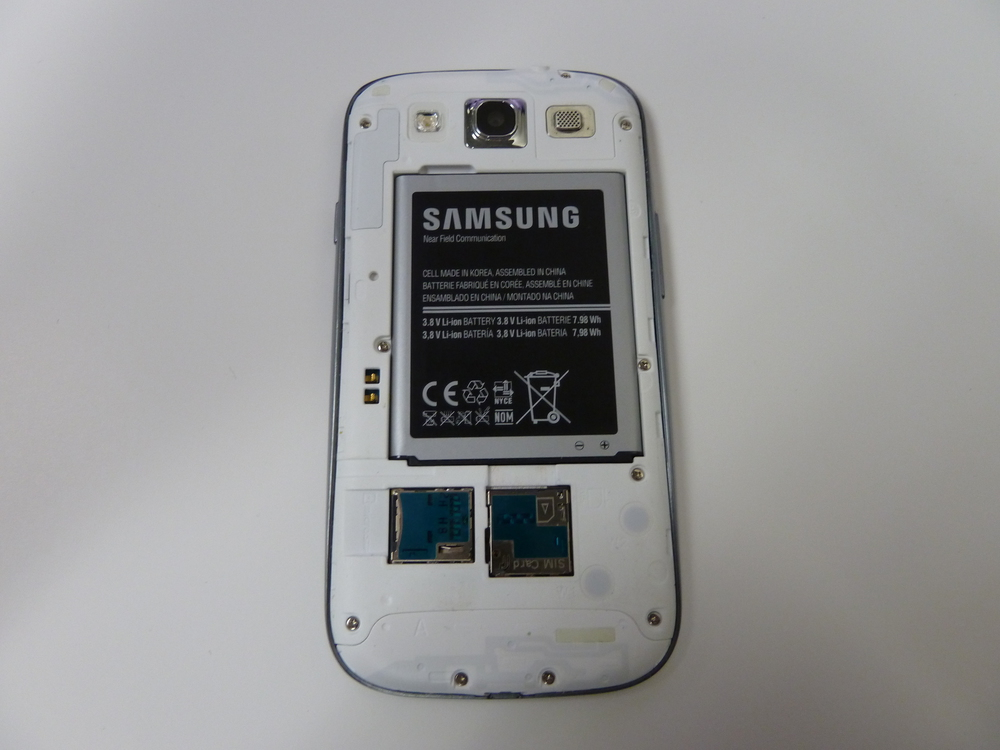
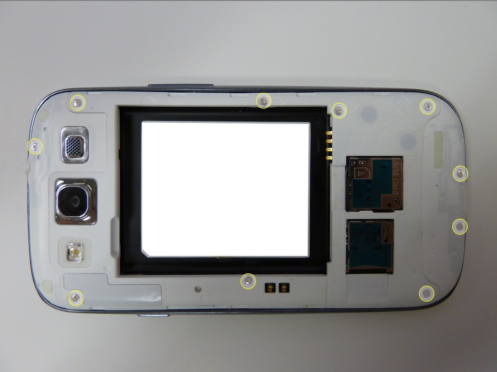
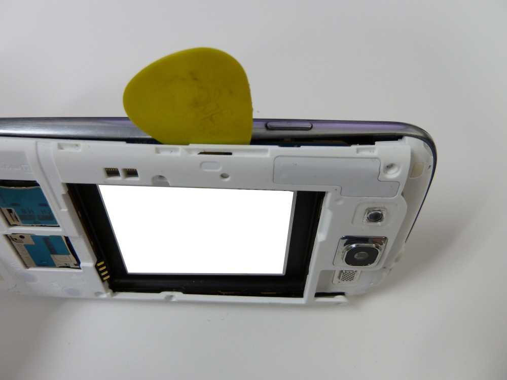
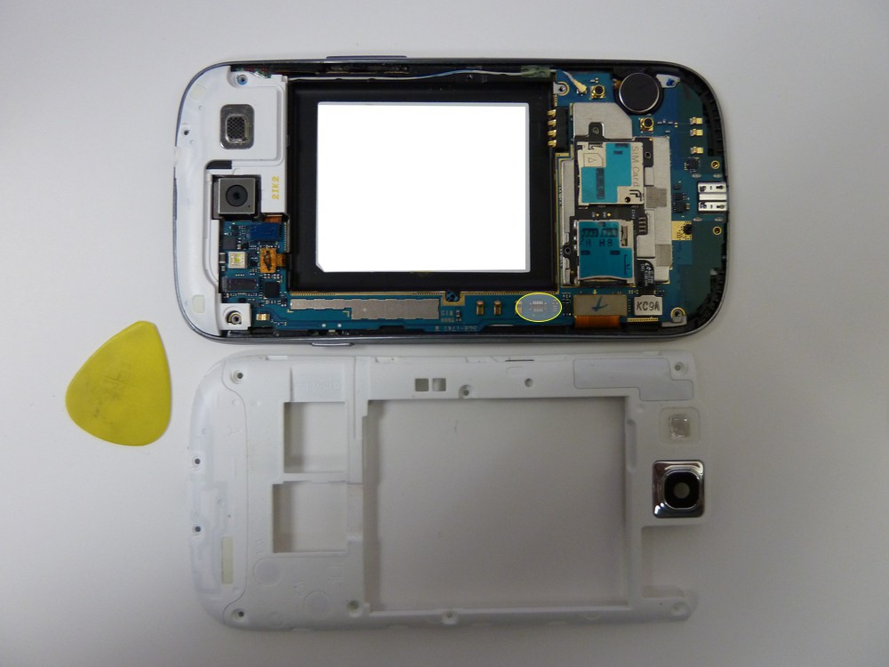
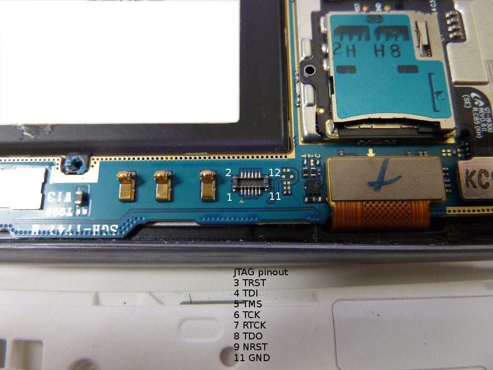
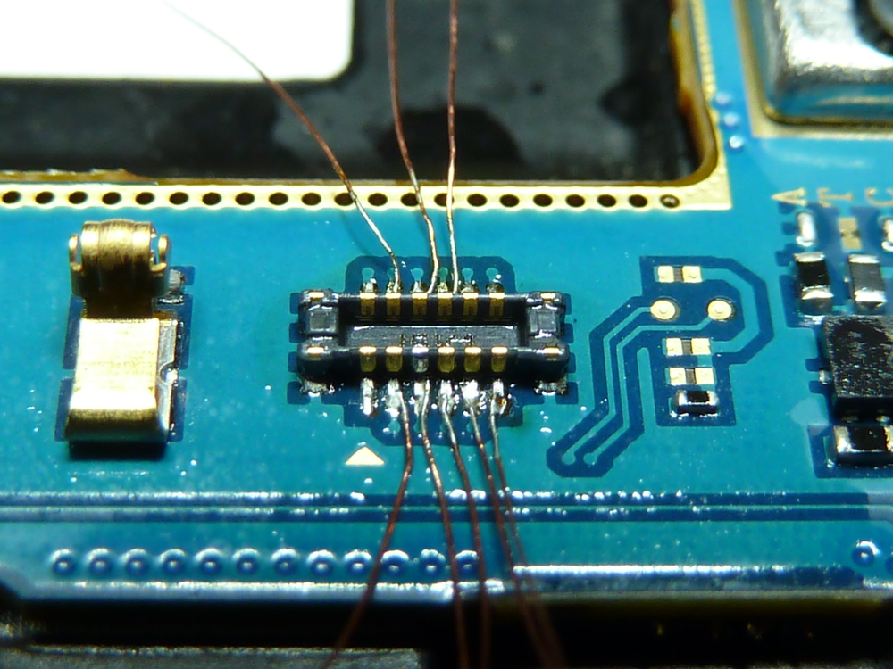
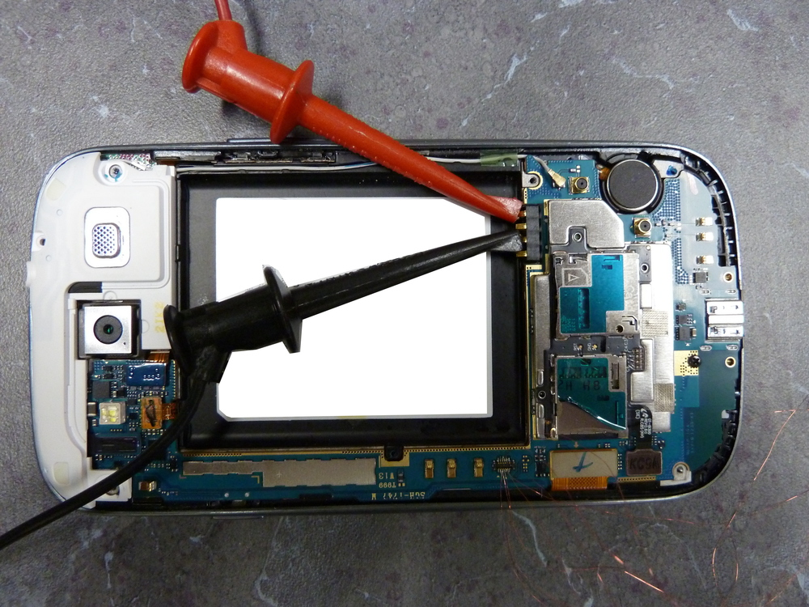
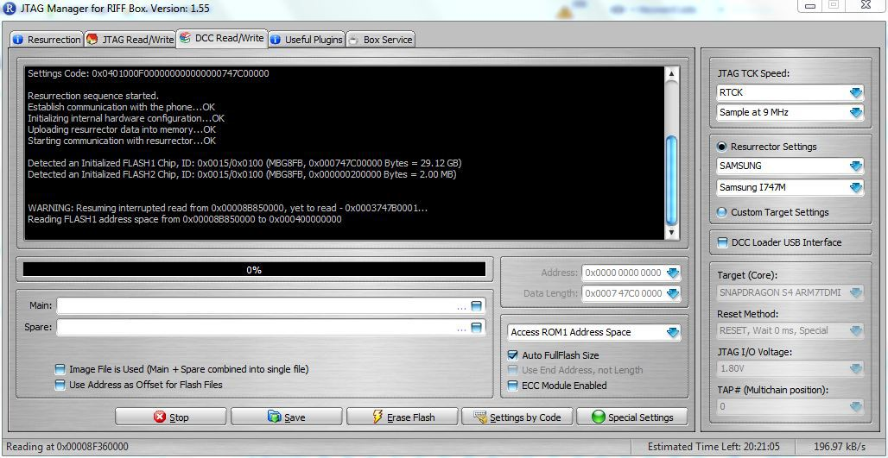

---
tags:
  - Mobile
---
## JTAG Samsung Galaxy S3 (SGH-I747M)

The Samsung Galaxy S3 is an Android based smartphone. At the time of
this writing (2014JAN22), I am unaware of any method other than JTAG to
acquire a physical image of the NAND on this device.

For the purpose of this document, a Samsung Galaxy S3 was disassembled,
read via JTAG, and reassembled.

### Getting Started

What you need to dump the NAND:

1. A [RIFF Box](https://www.riffbox.org/)
2. Soldering skills and small tip soldering iron (a JTAG jig may be
   available).
3. A DC Power supply capable of supplying 3.8V/2.1A output. The power
   supply used for this was an U8002A DC Power Supply.

### NAND Dump Procedure

1. Disassemble the phone down to the PCB.
2. Connect the RIFF Box to the PC via USB.
3. Connect the RIFF Box to the PCB via the JTAG pins.
4. Connect the PCB to the DC power supply.
5. Start the "RIFF Box JTAG Manager" software.
6. Enable the power on the DC power supply.
7. Power the phone via the power button.
8. Dump the NAND via the RIFF Box software.

Instructions for disassembly can be found on Internet but it can be
summarized as follows:

* Remove the rear cover and battery.
* Remove the 10 x Phillips screws.
* Remove the rear plate using a case opening tool (guitar pick).

{width="600"}

{width="600"}

{width="600"}

{width="600"}

* Once the phone has been disassembled, you can see the JTAG connection
  port located closed to the edge of the PCB near the ribbon cable.

{width="1000"}

* The JTAG pinouts are as follows.

{width="1000"}

* Solder the JTAG connector to the JTAG port as follows. I used 0.040
  gauge magnet wire, connected to breadboard pins, which were inserted
  into the 20 pin ribbon cable supplied with the RIFF box.

{width="500"}

* Connect the PCB battery terminal connections to the DC power supply.
  The positive (+) connection is the outermost pin (1) and the negative
  (-) pin is pin (3). You can configure your power supply to match the
  battery specifications which in this case is 3.8V and 2.1A but do not
  apply power at this time.

{width="1000"}

* Now we can start the RIFF JTAG software, configure it, and connect the
  phone to the RIFF box. See the picture below for more detail.

**NOTE:** In the picture, the "JTAG TCK Speed" has been changed from
"Sample at MAX" to "Sample at 9MHz". This was done in attempt to
eliminate disconnects between the RIFF Box and the phone mid-read. Leave
this setting at "Sample at MAX" unless you experience this problem.

{width="1000"}

Apply power to the DC power supply and turn the phone on using the
button on the side of the PCB. After powering the phone on, select
"READ" under the "DCC Read/Write" tab. If all goes well the "READ"
button will become the "STOP" button and the phone will begin
reading...if not the RIFF software provides troubleshooting steps that
should be taken to assist in diagnosing some of the issues you may
experience.

**NOTE:** In the event of read errors the RIFF software keeps track of
where the failure occurred and gives you option to restart the read
where it left off. If this occurs, you can adjust the "JTAG TCK Speed"
and lower it to 9MHz (or lower) which can stabilize the read.

* Once the acquisition is complete the resulting image can be saved and
  forensic analysis can take place using the tool of your choosing.

## External Links

* <https://forensics.spreitzenbarth.de/2012/02/>
