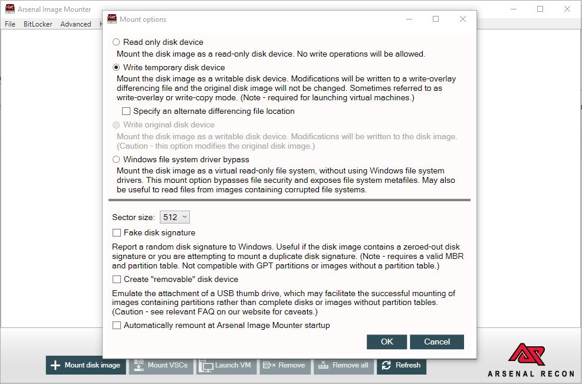
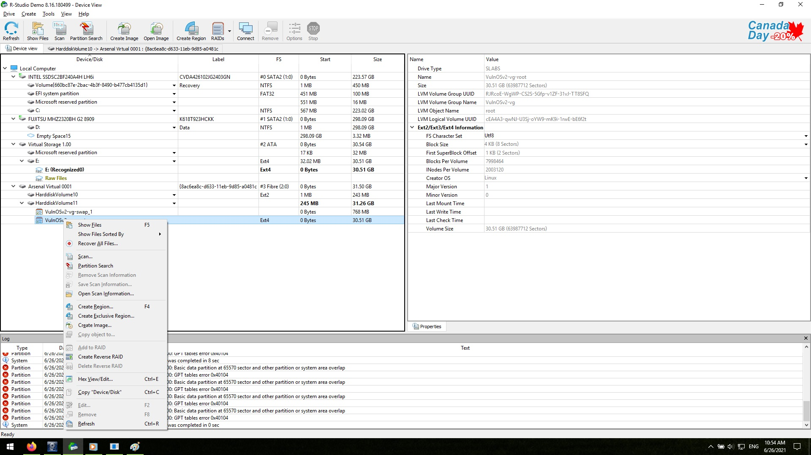

---
tags:
  - Tools
  - Data Recovery
  - Linux
---
## R-Studio recovery method

Step 1. Load disk image in arsenal image mounter (AIM)

{width="1000"}

Step 2. Right-click on the root partition and choose show files

{width="1000"}

## Tools

* [R-studio Recovery](https://www.r-studio.com/)
* [Arsenal Image Mounter](https://arsenalrecon.com/downloads/)

## External Links

* [Performing Linux Forensic Analysis and Why You Should Care!](https://www.osdfcon.org/presentations/2019/Ali-Hadi_Performing-Linux-Forensic-Analysis-and-Why-You-Should-Care.pdf),
  by Ali Hadi, 2019
