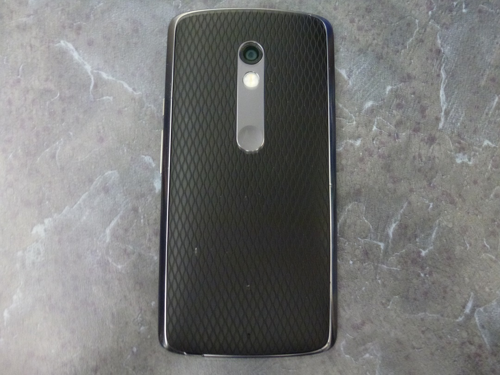
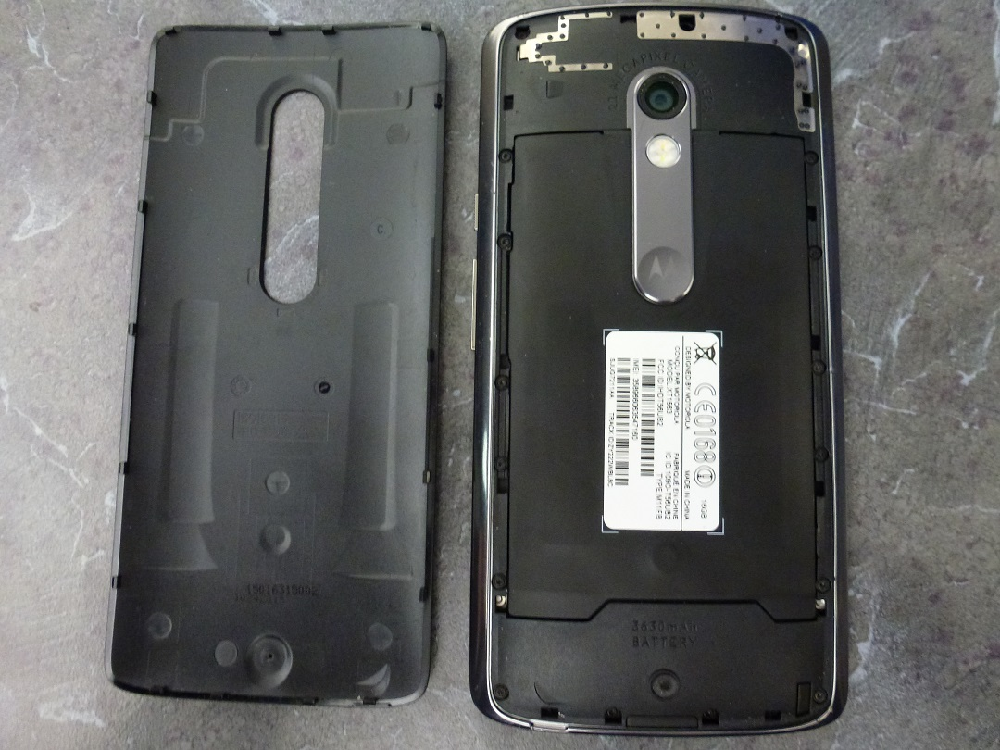
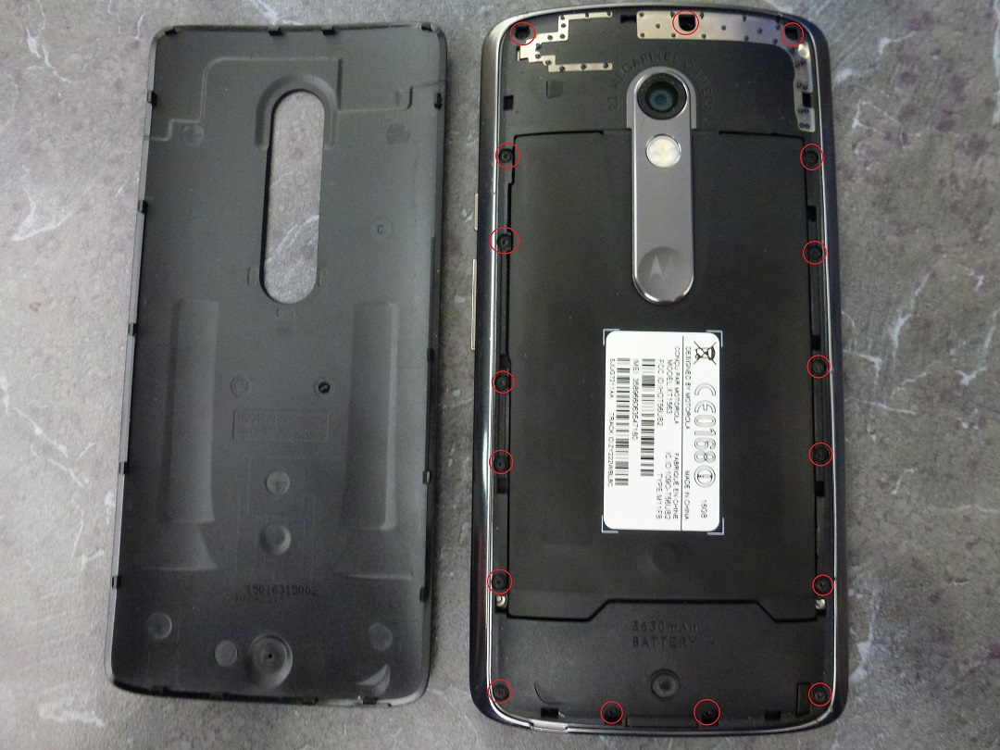
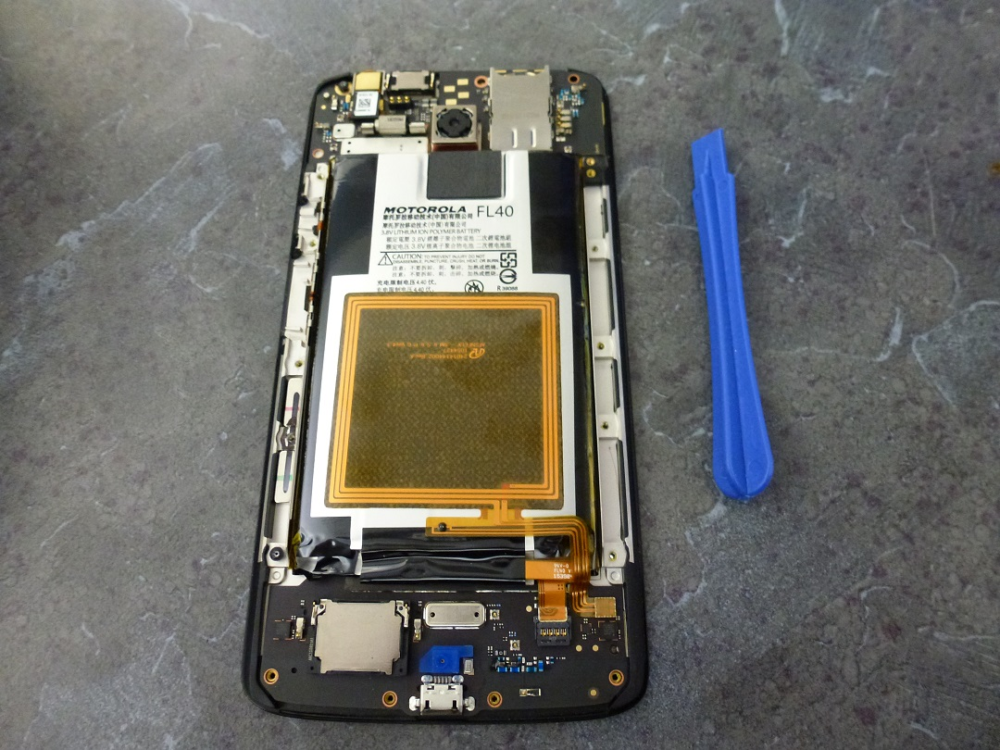
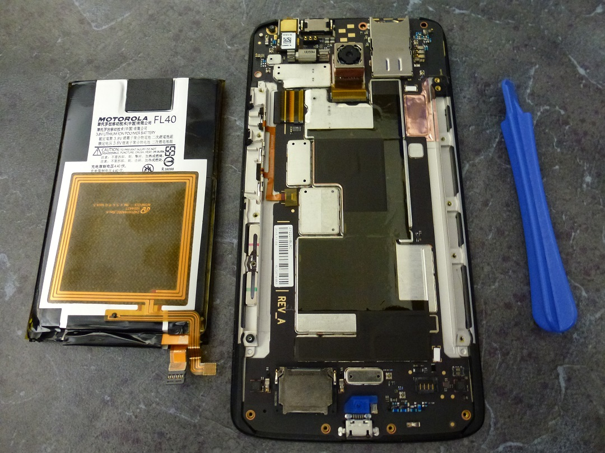
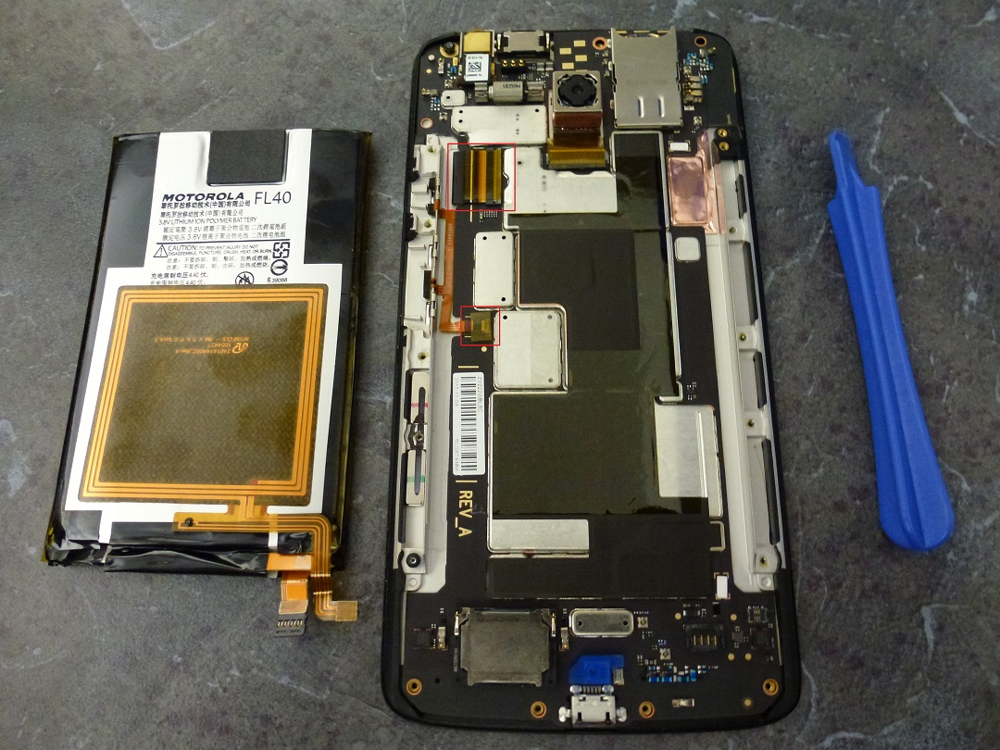
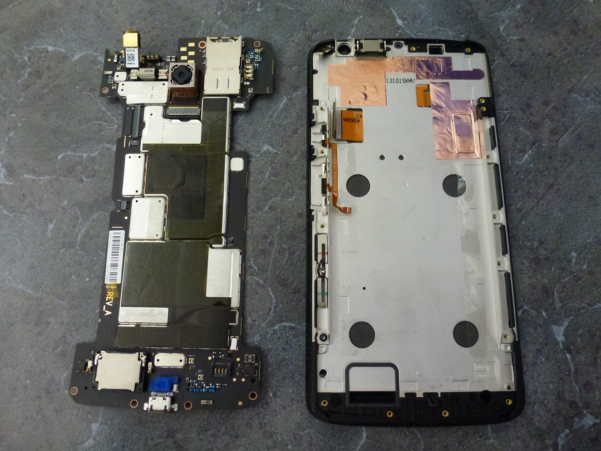
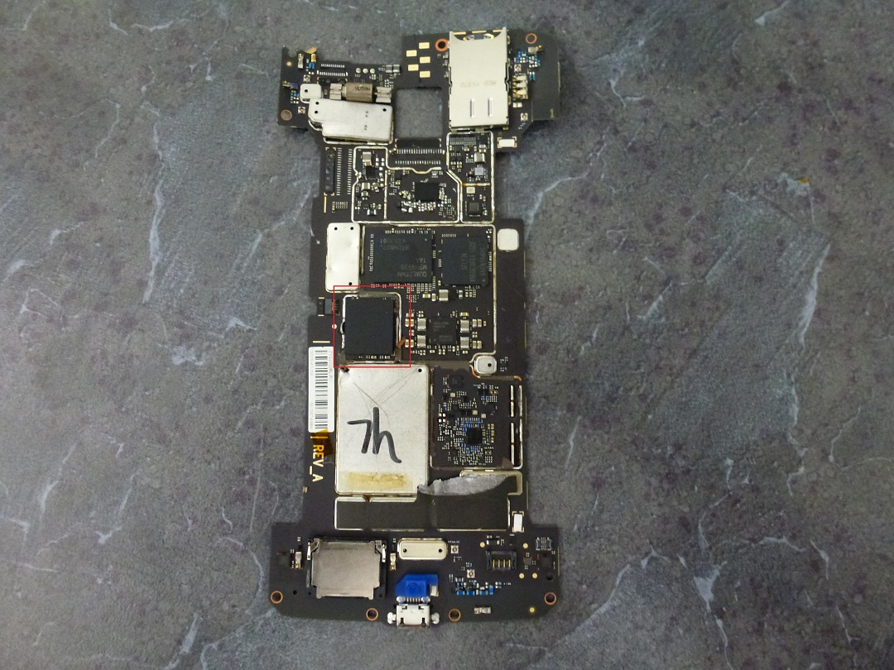
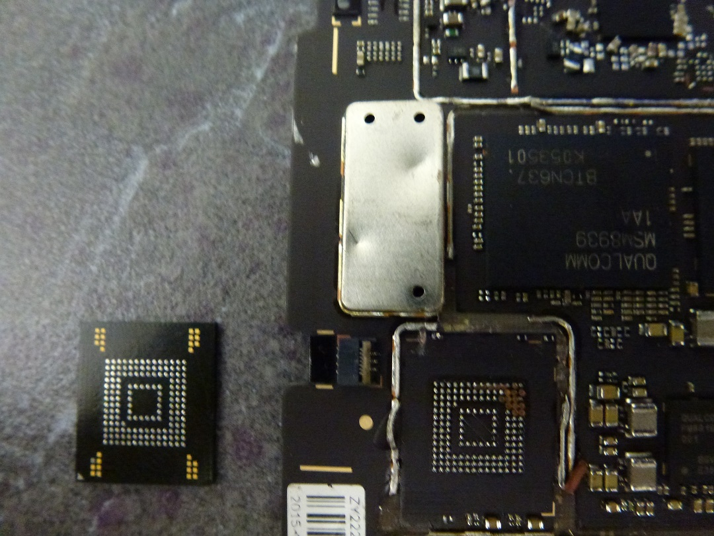
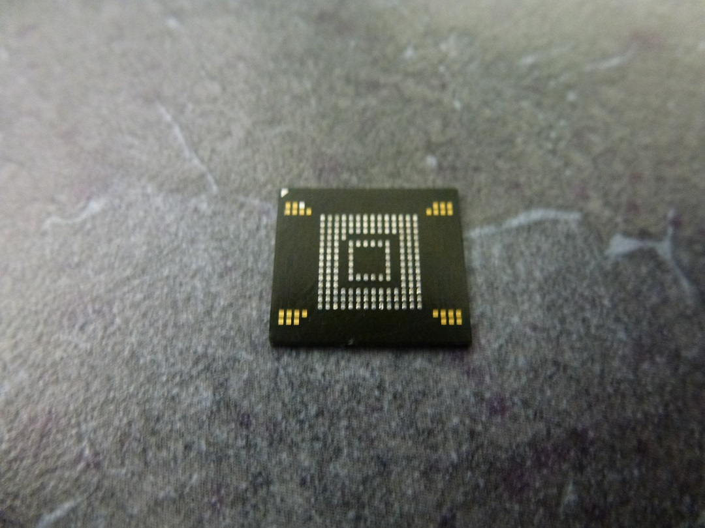

---
tags:
  - Mobile
---
{width="600"}

Step 1. Remove the back panel, and SIM tray from the top of the phone.

{width="600"}

Step 2. There are 17 Torx-4 screws that are glued in the back. Be careful not
to strip them when removing them.

{width="600"}

{width="600"}

Step 3. Remove the two battery cables, and carefully peel the battery away from
the glue on the motherboard.

{width="600"}

{width="600"}

Step 4. Remove the two ribbon cables from the left side of the motherboard and
carefully peel it away from the glue on the underside. Be careful not to bend
the board in the middle where all the chips reside.

{width="600"}

{width="600"}

Step 5. Heat the middle of the board under a hot air gun until the heat shields
pull off. The memory chip should also be ready to pull off at this point.
Despite all the glue on the rest of the phone, there was no epoxy on our test
phone's NAND.

{width="600"}

{width="600"}

Step 6. Prepare the chip for reading with a little flux, and re-tin the pads if
needed. In this case, our chip is a Toshiba THGBMFG7C2LBAIL/16GB which was read
in an 11.5x13 Sireda adapter, and can also be read in an UP-828 programmer
using the VBGA169E adapter.

{width="600"}
