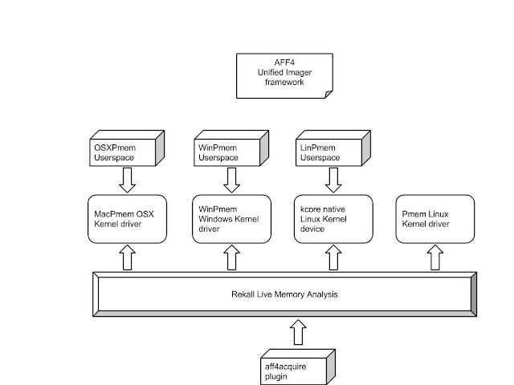

---
tags:
  - Linux
  - Memory Analysis
  - Memory Imaging
  - Tools
---
> This article was copied from the Rekall Forensics blog, posted on 2016-05-24.
> Copied with permission for historical preservation.

The recent Rekall Furka release updated the pmem suite of acquisition
tools, so I thought this would be a good time to write a blog post about
the new features and to recap the work we have been doing on reliable
and robust memory acquisition for Linux, OSX and Windows.

## The Pmem memory acquisition suite

The Pmem suite of memory acquisition tools are already quite well known
as the best open source memory acquisition tools available, and in the
case of OSX, the only reliable memory acquisition solution available for
the latest versions of the operating system. This blog post discusses
some of the recent changes we made in the recently released pmem 2.1
series of acquisition tools. The old Winpmem 1.6.2 tool is still
available and it is perhaps the most stable and battle tested, but the
new series offers many advantages, so it might be worth testing these
with your own incident response procedures.

While access to physical memory is different on each operating system,
we tried to unify the userspace component as much as possible. This
should make it easier to use because the same command line options are
available on each operating system. Previous tools had completely
different sets of options, but now most of the options are the same
across all target OSs.

### OSXPmem, WinPmem, LinPmem ... So many pmem's

The Pmem suite offers a complete memory acquisition solution and
consists of a few different sub-components. It is sometimes a bit
confusing when we talk about so many different things all called pmem.

Here is a high level overview of the different components:

We see that there are four main kernel based components to facilitate
access to physical memory:

1. On OSX, the MacPmem memory driver provides direct access to physical
   memory.
2. On Windows, the WinPmem kernel driver provides physical memory access.
3. On Linux, we mainly rely on the built in /proc/kcore device which is
   often enabled. This provides raw physical memory access natively.
4. Sometimes, however, on Linux, the kcore device is disabled. In that case
   we also provide the pmem kernel driver which facilitates physical memory
   access.

All the kernel components enable access to physical memory, which we use
to implement memory acquisition and live analysis. The memory
acquisition tools are OSXPmem, WinPmem (2.1) and LinPmem are operating
system specific acquisition tools. They all use the same unified AFF4
imager framework and therefore all have similar command line arguments,
and produce images in the same way.

Finally, Rekall can use all kernel components directly when performing
live analysis on all supported operating systems. Rekall also has a
plugin called aff4acquire which uses this raw physical memory access to
acquire a physical memory image, in a similar way to the standalone
tools. Memory acquisition through Rekall is able to include additional
data which can only be deduced from live analysis (e.g. it also captures
all mapped files) but it requires running Rekall (with larger footprint
and requires access to the profile repository).

### What is AFF4 anyway, and why are you forcing me to use it

Because the pmem imagers use the unified AFF4 imager framework, the pmem
acquisition tools always write AFF4 images. What does that mean?

I know that many people are still using RAW or ELF images, mainly in
order to interact with other tools that do not support AFF4 directly.
Maybe users are not ready to commit to a new file format which is
potentially not compatible with other tools?

[AFF4 (Advanced Forensic Format 4)](aff4.md) is a concept,
as well as a file format. The main features of AFF4 are that it defines
containers, streams and metadata:

1. A stream is an object which supports randomly seeking and reading in.
   For example, a regular file on disk is a stream. AFF4 also defines other
   stream formats.
2. Similarly, a container is just something that contains streams. For
   example, a regular filesystem directory is also an AFF4 container. By
   default pmem will use a ZIP file as a container but it can easily use a
   directory instead.
3. Finally, AFF4 contains metadata about the image. This is something you
   always want for memory acquisition - the more data the better! AFF4
   stores metadata in RDF Turtle format by default, but Pmem also uses
   YAML.

The nice thing about AFF4 therefore, is that it is actually completely
compatible with simpler file formats, such as RAW but at the same time,
due to the additional metadata included, tools that understand AFF4 can
make use of that automatically.

So when we say we only write AFF4 images, we really mean that the images
that are produced are written in a structured way, but these images can
also be made to look like a RAW or ELF image to other tools.

### Let me see examples

Let's take a look at an example. In this example, I am acquiring memory
from an OSX system into a standard AFF4 ZIP container. This is the
default output format:

In this example we specified:

* -o test.aff4 write output into this file.
* -t - output file will be truncated
* -c snappy : Use Snappy compression. This is much faster than the default zlib compression and
  still pretty good compression.

The resulting AFF4 file is stored in a ZipFile container. What does that
look like?

We can use osxpmem to show us some metadata about the image:

The volume contains two streams:

* The first stream (ends with dev/pmem) is a map with a category of
  physical memory. This is the actual memory image.
* The second stream is an aff4:image which stores bulk image data, divided
  into compressed chunks.

An AFF4 map is an efficient construct which allows use to store sparse
images (with holes) such as memory images which usually have gaps for
PCI DMA regions. We do not need to waste any space on sparse gaps. The
Map itself is backed by a regular AFF4 image stream which uses
compressed chunks to store the bulk data in the image. Hence we get both
compression and sparse image.

We can use the regular unzip command to inspect it (NOTE: The default
unzip that comes with OSX does not support ZIP64 very well so it reports
the file as slightly corrupted. It is not, in fact corrupted at all and
a proper unzip utility will support it well).

We can see some members in the ZIP file:

* information.turtle contains RDF information about this AFF4 container.
* dev/pmem/idx stores the map transformation (very small)
* dev/pmem/data is the bulk data stream
* dev/pmem/data/00000XXXXX are the segments which store the compressed chunks
* dev/pmem/data/00000XXXXX/index are indexes for each segment

This image works well with Rekall which supports AFF4 natively:

[Rekall output on the image](docs/assets/images/rekall-forensics-blog/pmem_suite_of_memory_acquisition_tools_snap_vtckn86s3bbdt5nwidvwif69.png)

But, suppose I wanted to use another program with this image, so I
really want RAW output.

We could always export the memory image from the AFF4 volume into a raw
file:

But this might be inconvenient. What if we wanted to acquire to RAW
format in the first place? Pmem offers support for the following memory
image formats:

It is important to note that the --format option talks about the format
of the memory stream (i.e. RAW) not the format of the container which is
still an AFF4 Zip based file. In the following example, I will create a
ZIP file with a huge RAW memory image in it.

This is fine and it is very useful when you want to acquire a bunch of
files off the same system (e.g. memory, pagefiles, drivers etc). In the
end you just get a simple (but very large) ZIP file with all the files
inside it - convenient for easy transport off the system. Note that even
though the RAW image is stored in a ZIP file it is not compressed - so
the ZIP file is still huge. This is because Rekall can use the ZIP file
directly then without needing to unpack it first (You can not seek in a
compressed archive member). The RAW image is just a single large
uncompressed archive member.

This is still not that useful for running other tools on the image - we
will need to unzip the image first so we can point our tool at it.
Remember that I mentioned above that a simple filesystem directory is
also an AFF4 container? Why don't we write the image into a directory?

In order to make pmem choose an AFF4 directory container you just
specify a directory path. So you need to create a directory first:

Remember that AFF4 containers just store streams so it is exactly the
same as the previous example, except that the files are written to a
directory instead of a single Zip file. However, in this case, you will
find the huge RAW physical memory file (dev%2fpmem) inside the directory - ready
to be viewed with another tool:

Note also the metadata files which contain important information about
the memory collected:

Rekall, however, understands AFF4 volumes so it can use the metadata
directly to bootstrap analysis (e.g. use the correct profile
automatically). Note that when we use Rekall we should specify the path
to the entire directory, not the path to the RAW image inside the
directory (So Rekall understands we mean the AFF4 volume to be used).

### Adding files

We often only get one chance to acquire memory. We need to make sure
that everything we might need in the analysis phase will end up in the
image. For example, sometimes after analysis we see a mapped file that
is of interest in the memory image. But trying to dump files from memory
is not very reliable since many pages are missing - it would have been
better to acquire these files in the first place.

The nice thing about AFF4 containers is that they can store multiple
streams - i.e. they can capture more than one file. The Pmem suite tries
to acquire as many files as it can automatically. For example, in
windows the pagefile can be acquired, as well as all the drivers and the
kernel image itself. In Linux, the contents of */proc/kallsyms* is
captured as well as the /boot/ partition.

It is possible to include other files during acquisition. This can be
done during the memory acquisition or later, by appending to the AFF4
volume.

Note that by default, when you specify the -i flag, pmem assumes you
want to add files to an existing volume and does not acquire memory. You
can force memory acquisition and file inclusion at the same time with
the -m flag.

## The Winpmem acquisition tool

The driver component of Winpmem has been stable for many years now. Like
the MacPmem driver, it uses advanced page table manipulation to bypass
any OS restrictions (which have been presented at DFRWS 2013).
So this release of winpmem reuses the same driver as Winpmem 1.6.2 - the
only difference is in the userspace tool.

## The OSXPmem acquisition tool

The OSX counterpart of the pmem suite comes as a ZIP file. To use it you
simply need to unzip it as root (note: You must be root when unzipping
on order to ensure proper file permissions. The extracted files must be
owned by root and only readable by root).
