---
tags:
  - Windows
  - Memory Analysis
---
> This article was copied from the Rekall Forensics blog, posted on 2016-05-24.
> Copied with permission for historical preservation.

Rekall has long had the capability of scanning memory for various
signatures. Sometimes we scan memory to try and recover pool tags (e.g.
**psscan**), other times we might scan for specific indicators or Yara
rules (e.g. **yarascan**). In the latest version of Rekall, we have
dramatically improved the speed and effectiveness of these capabilities.
This post explains one aspect of the new Rekall features and how it was
implemented and can be used in practice to improve your forensic memory
analysis.

Traditionally one can scan the physical address space, or the virtual
address space (e.g. the kernel's space or the address space of a
process). There are tradeoffs with each approach. For example, scanning
physical memory is very fast because IO is optimized. Large buffers are
read contiguously from the image and the signatures are applied on
entire buffers. However, traditionally, this kind of scanning could only
yield a result when a signature was found but did not include any
context to the hit, which means that it is difficult to determine which
process owned the memory and what the process was doing with the memory.

If we scan the virtual address space we see memory in the same way that
a process sees it. This is ideal because if a signature is found, we can
immediately determine which process address space it appears in, and
precisely where, in that address space, the signature resides.

Unfortunately, scanning in a virtual address space is more time
consuming because reading from the image (or live memory) is
non-sequential. Rekall effectively has to glue together in the right
order a bunch of page size buffers collected randomly from the image
into a temporary buffer which can be scanned - this involves a lot of
copying buffers and allocating memory. Additionally when scanning the
address space of processes, we will invariably be scanning the same
memory multiple times because mapped files (like DLLs) are shared
between many processes, and so they appear in multiple processes'
virtual address space.

It would be awesome if we could ask: given a physical address (i.e.
offset in the memory image), which process owns this page and what is
the virtual address of this page in the process address space? Being
able to answer this question quickly allows us to scan physical memory
in the most efficient way (at least for smallish signatures which do not
span page boundaries).

Rekall has a plugin called pas2vas which aims to solve this problem. It
is a brute force plugin: simply enumerate all the virtual address to
physical address mappings and build a large reverse mapping. This works
well enough, but takes a while to construct the reverse mapping and
because of this does not work well on live memory which is continuously
changing.

Have you ever used the
[RamMap.exe](https://learn.microsoft.com/en-us/sysinternals/downloads/rammap)
tool from sysinternals? It's an awesome tool which lets one see what
each physical page is doing on your system. Here is an example
screenshot (click on the image to zoom in):

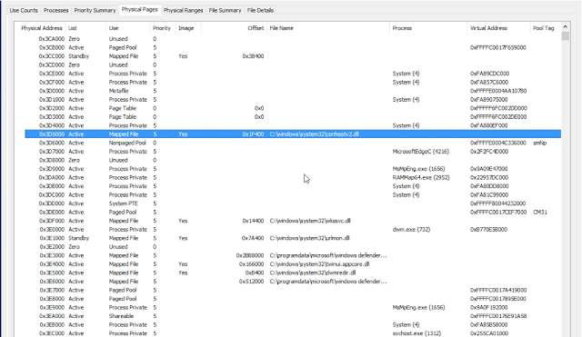

This looks exactly like what we want! How does this magic work? Through
understanding and parsing the Windows
[PFN database (Windows Internals)](http://www.amazon.com/Windows-Internals-Part-Developer-Reference/dp/0735665877/)
it is possible to relate a physical address directly to the virtual
address in the process which owns it very quickly and efficiently. If
only we had this capability in Rekall we could provide sufficient
context to scanners in physical memory to work reliably and quickly!

Lets explore how one can use the Windows PFN database to ask exactly
what each physical page is doing. In the end we implemented new plugins
such as "pfn", "p2v" and "rammap" to shed more light on how physical
memory is used within the Windows operating system. These plugins are
integrated with other plugins (e.g. yarascan to assist in providing more
contextual information for physical addresses).

## Windows page translation

We all know about the AMD64 page tables
and how they work so I won't go into it in too much depth here. Just to
say that the hardware needs page tables to be written in memory, which
control how the page resolution process works. The CR3 register contains
the Directory Table Base (DTB) which is the address of the top most
table.

The hardware then traverses these tables, by masking bits off the
virtual address until it reaches the PTE which contains information
about the physical page representing that virtual address. The PTE may
be in a number of states (which we described in detail in previous posts
and are also covered in the Windows Internals book). In any state other
than the "Valid" state, the hardware will generate a page fault to find
the actual physical page.

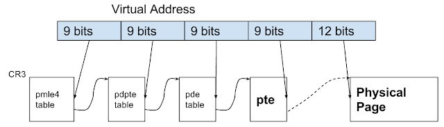

Rekall has the "vtop" plugin (short for virtual-to-physical) to help
visualize what page translation is doing. Let us take for example a
Windows 7 image:

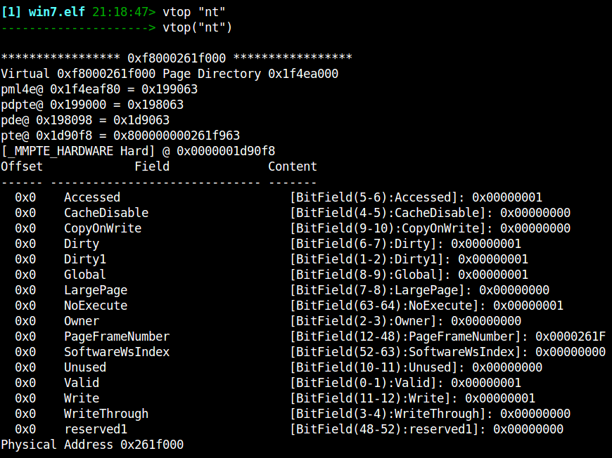

Here we ask Rekall to translate the symbol for "nt" (The kernel's image
base) in the kernel address space into its physical address. Rekall
indicates the address of each entry in the 4 level page table and
finally prints the PTE content in detail. We can see that the PTE for
this symbol is a HARDWARE PTE which is valid (i.e. the page exists in
physical memory) and the relevant page frame number is shown (i.e.
physical address).

The important points to remember about page translation are:

* The page tables are primarily meant for the hardware. Addresses for
  valid pages in the page tables are specified as Page Frame Numbers (PFN)
  which means they are specified in the physical address space. This is
  the only thing the MMU can directly access.
* On the other hand, the CPU cannot access physical memory. All CPU access
  occurs through the virtual address space of the kernel.
* Invalid PTEs may carry any data to be used by the kernel, therefore
  typically those addresses are specified in the kernel's virtual address
  space.
* All PTEs (and all parts of the page tables) must be directly mapped into
  the kernel's address space at all times so that the kernel may
  manipulate them.

Each PTE controls access to exactly one virtual memory page. The PTE is
the basic unit of control for virtual pages, and each page in any
virtual address space must have at least one PTE controlling it (This is
regardless if the page is actually mapped into physical memory or not - the
PTE will indicate where the page can be found).

There are two types of PTEs - hardware PTE and prototype PTEs. Prototype
PTEs are used by the kernel to keep track of intended page purpose, and
although they have a similar format to hardware PTEs, they are never
accessed directly by the MMU. Prototype PTEs are allocated from pool
memory, while hardware PTEs are allocated from System PTE address range.

## Section objects

Consider a mapped file in memory. Since the file is mapped into some
virtual address space, some pages are copied from disk into physical
memory, and therefore there are some valid PTEs for that address space.
At the same time, other pages are not read from disk yet, and therefore
must have a PTE which points at a prototype PTE.

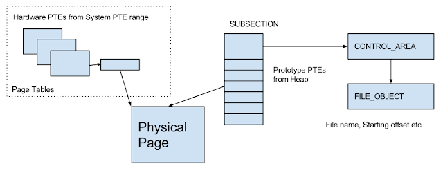

The _SUBSECTION object is a management structure which keeps track of
all the mapped pages of a range from mapped files. The _SUBSECTION
object has an array of prototype PTEs - a management structure similar
to the real PTE.

Consider the figure above - a file is mapped into memory and Windows
creates a _SUBSECTION object to manage it. The subsection has a pointer
to the CONTROL_AREA (which in turn points to the FileObject which it
came from) and pointers to the Prototype PTE array which represents the
mapped region in the file. In this case a process is reading the mapped
area and so the hardware PTE inside the process is actually pointing at
a memory resident page. The prototype PTE is also pointing at this page.

Now imagine the process gets trimmed - in this case the hardware PTE
will be made invalid and point at the prototype PTE. If the process
tries to access the page again a page fault will occur and the pager
will consult the prototype PTE to determine if the page is still
resident. Since it is resident the hardware PTE will be just changed
back to valid and continue to point at that page.

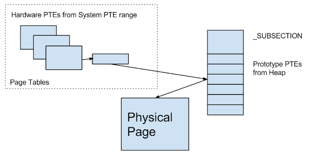

Note that in this situation, the physical page still contains valid file
data, and it is still resident. It's just that the page is not directly
mapped in any process. Note that it is perfectly OK to have another
process with a valid hardware PTE mapping to the same page - this
happens if the page is shared with multiple processes (e.g. a DLL) - one
process may have the page resident and can access it directly, while
another process might need to invoke a page fault to access this page
(which should be extremely quick since the page is already resident).

## The Page File Number Database (PFN)

In order to answer the question: What is this page doing? Windows has
the Page File Number database (PFN Db). It is simply an array of _MMPFN
structs which starts at the symbol "nt!MmPfnDatabase" and has a single
entry for every physical page on the system. The MMPFN struct must be as
small as possible and so consists of many unions and can be in several
states - depending on the state, different fields must be interpreted.

### Free, Zero and Bad lists

We start off with discussing these states - they are the simplest to
understand. Pages which can take on any of these states (A flag in the
_MMPTE.u3.e1.PageLocation) are kept in their own lists of Free pages
(ready to be used), Zero pages (already cleared) or Bad pages (will
never be used).

### Active Pages: PteAddress points at a hardware PTE

If the PFN Type is set to Active, then the physical page is used by
something. The most important thing to realize is that a valid physical
page (frame) must be managed by a PTE. Since that PTE record must also
be accessible to the kernel, it must be mapped in the kernel's virtual
address space.

When the PFN is Active, it contains 3 important pieces of information:

1. The virtual address of the PTE that is managing this physical page (in
   _MMPFN.PteAddress).
2. The Page Frame (Physical page number) of the PTE that is managing this
   physical page (in _MMPFN.u4.PteFrame). Note these two values provide
   the virtual and physical address of the PTE.
3. The OriginalPte value (usually the prototype PTE which controls this
   page). When Windows installs a hardware PTE from a prototype PTE, it
   will copy the original prototype PTE into this field.

Here is an example of Rekall's pfn plugin output for such a page:

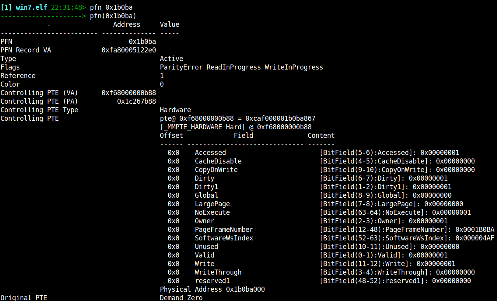

The interesting thing is that in this case, the PTE that is managing
this page will belong in the Hardware page tables created for the
process which is using this page. That PTE, in turn will also be
accessible by a PDE inside that process's page tables, and so forth.
This occurs all the way up to the root of the page table (DTB or CR3)
which is its own PTE.

Therefore if we keep following the PTE which controls each PTE 4 times
we will discover the physical addresses of the DTB, PML4, PDPTE, PDE and
PTE belonging to the given physical address. Since a DTB is unique to a
process we immediately know which process owns this page.

Additionally we can also figure out what is the virtual address by
subtracting the table offset of the real PTE from the start of the PTE
table at each level of the paging structure, and assigning the relevant
bits to that part of the virtual address. This is illustrated below.

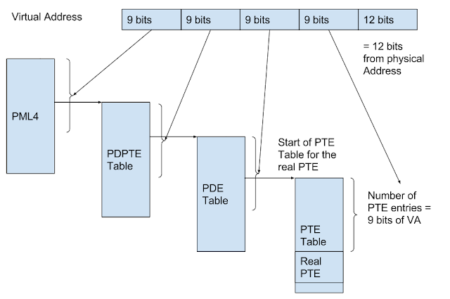

So when the PFN is in this state (i.e. PteAddress pointing to a Hardware
PTE) we can determine both the virtual address of this page and the
process which maps it. It is also possible that another process is
mapping the same page too. In this case the OriginalPTE will actually
contain the _MMPTE_SUBSECTION struct which was originally filled in
the prototype PTE. We can look at this value and determine the
controlling subsection in a similar way to the below method.

Rekall's ptov plugin (short for physical-to-virtual) employs this
algorithm to derive the virtual address and the owning process. Here is
an example

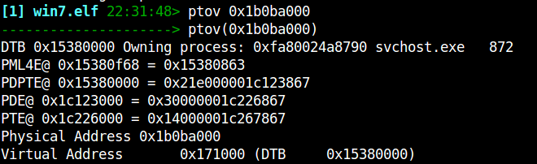

We can verify this works by switching to the svchost.exe process context
and converting the virtual address to physical. We should end up in the
same physical address we started with:

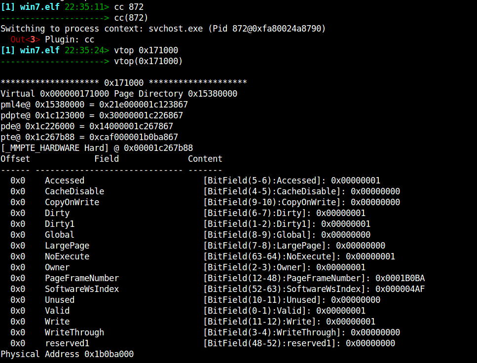

### Active Pages - PteAddress points at a prototype PTE

Consider the case where two or more processes are sharing the same
memory (e.g. mapping the same file). In order to aid in the management
of this, Windows will create a subsection object as described earlier;
if the virtual page is trimmed from the working set of one process, the
hardware PTE will not be valid and instead point at the controlling
subsection's prototype PTE.

In this case the PFN database will point directly at the prototype PTE
belonging to the controlling subsection (The PFN entry will indicate
that this is a prototype PTE with the _MMPFN.u3.e1.PrototypePte flag).
Lets look at an example:

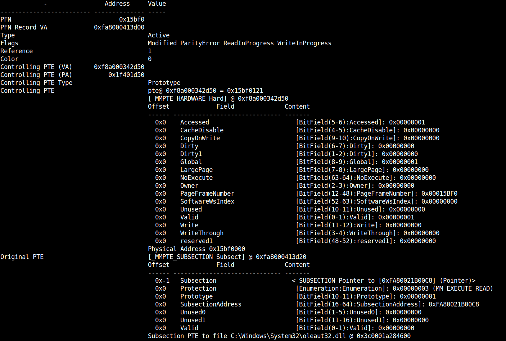

In this example, the PFN record indicates that a prototype PTE is
controlling this physical page. The prototype PTE itself indicates that
the page is valid and mapped into the correct physical page. Note that
the controlling PTE for this page is allocated from system pool
(0xf8a000342d50) while in the previous example, the controlling
prototype was from the system PTE range (0xf68000000b88) and belonged to
the process's hardware page tables.

If we tried to follow the same algorithm as we did before we will
actually end up in the kernel's DTB because the prototype PTE is itself
allocated from paged pool (so its controlling PTE will belong to the
kernel's page tables). So in this case we need to identify the relevant
subsection which contains the prototype PTE (and the processes that maps
it).

When a process maps a file, it receives a new VAD region. The _MMVAD
struct stores the following important information:

1. The start and end virtual addresses of the VAD region in the process
   address space.
2. The Subsection object which is mapped by this VAD region.
3. The first prototype in the subsection PTE array which is mapped (Note
   that VADs do not have to map the entire subsection, the first mapped PTE
   can be in the middle of the subsection PTE array. Also the subsection
   itself does not have to map the entire file either - it may start at the
   _SUBSECTION.StartingSector sector).

The _MMPFN.PteAddress will point at one of the Prototype PTEs. We build
a lookup table between every VAD region in every process and its range
of prototype PTEs. We are then able to quickly determine which VAD
regions in each process contain the pointed to PTE address, and so we
know which process is mapping this file.

The result is that we are able to list all the processes mapping a
particular physical page, as well as the virtual addresses each use for
it (using the _MMVAD information). We also can tell which file is
mapped at this location (from the _SUBSECTION data and the filename)
and the sector offset within the file it is mapped to. Here is the
Rekall output for the ptov plugin:

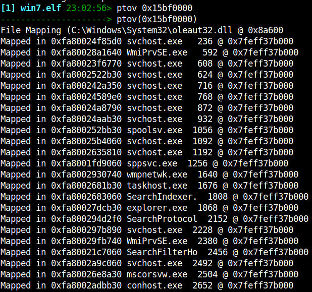

Rekall is indicating that this page contains data from the oleaut32.dll
at file offset 0x8a600. And as you can see in the output this data is
shared with a large number of processes.

## Putting it all together

We can utilize these algorithms to provide more context for scanning
hits in the physical address space. Here is an example where I search
for my name in the memory image using the yarascan plugin:

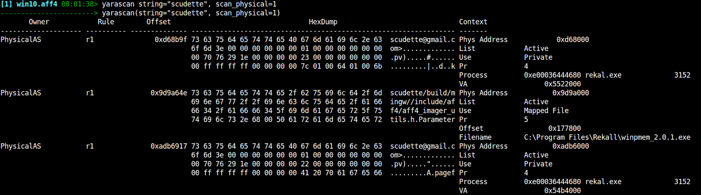

The first hit shows that this page belong to the rekall.exe process,
mapped at 0x5522000. The second hit occurs at offset 0x177800 inside the
file called winpmem_2.0.1.exe etc.

This information provides invaluable context to the analyst and helps
reasoning about why these hits occur where they do.

The **rammap** plugin aims to display every page and what it is being
used for (Click below to zoom in). We can some pages are owned by
processes, some are shared by files and others belong to the kernel
pools:

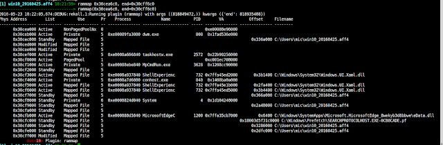

## Other applications: Hook detection

Inline hooking is a very popular way to hijack the execution path in a
process or library. Malware typically injects foreign code into a
process then overwrites the first few bytes of some critical functions
with a jump instruction to detour into its code. When the API function
is called, the malware hijacks execution and then typically relays the
call back to the original DLL to service the API call. For example it is
a common way to hide processes, files or network connections.

Here is an example output from Rekall's hooks_inline plugin which
searches all APIs for inline hooks.

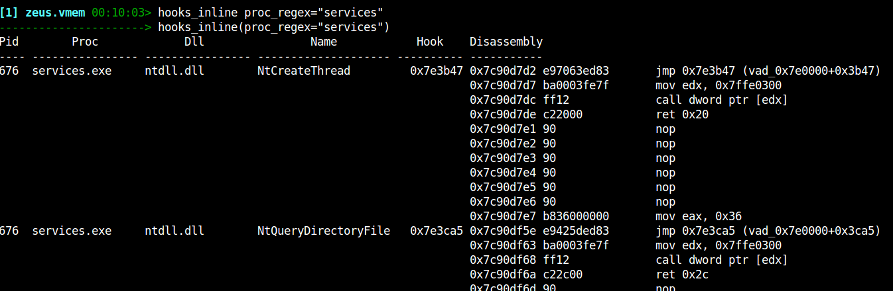

In this sample of Zeus (taken from the Malware Analyst's Cookbook), we can
clearly see a jump instruction to be inserted at the start of critical
functions (e.g. NtCreateThread) for Zeus to monitor calls to these APIs. Rekall detects the hooks by
searching the first few instructions for constructs which divert the
flow of execution (e.g. jump, push-ret etc).

Let us consider what happens in the PFN database when Zeus installs
these hooks. Before the hook installation. the page containing the
functions is mapped to the DLL file from disk. When Zeus installs the
trampoline by writing on the virtual memory, Windows changes the written
virtual page from file backed to a private mapping. This is often called
copy-on-write semantics - Windows makes a copy of the mapped file
private to the process whenever the process tries to write to the page.
Even if the page is shared between multiple processes, only the process
which wrote to it would see these changes.

Let's examine the PFN record of the hooked function. First we switch to
the process context, then find the physical page which backs the
function "ntdll!NtCreateThread" (Note we can use the function's name
interchangeably with the address for functions Rekall already knows
about).

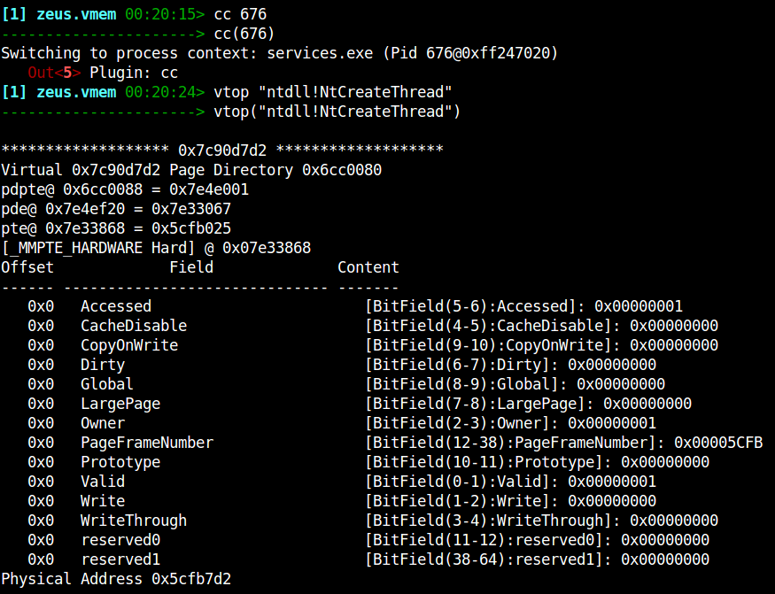

Now let's display the PFN record (Note that a PFN is just a physical
address with the last 3 hex digits removed):

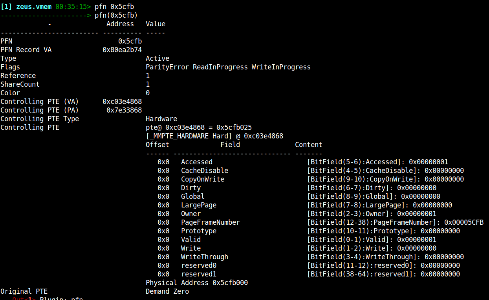

Notice that the controlling PTE is a hardware PTE (which means it exists
in the process's page tables). There is only a single reference to this
page which means it is private (Share Count is only 1).

Let's now examine the very next page in ntdll.dll (The next virtual page
is not necessarily the next physical page so we need to repeat the vtop
translation - again we use Rekall's symbolic notation to refer to
addresses):

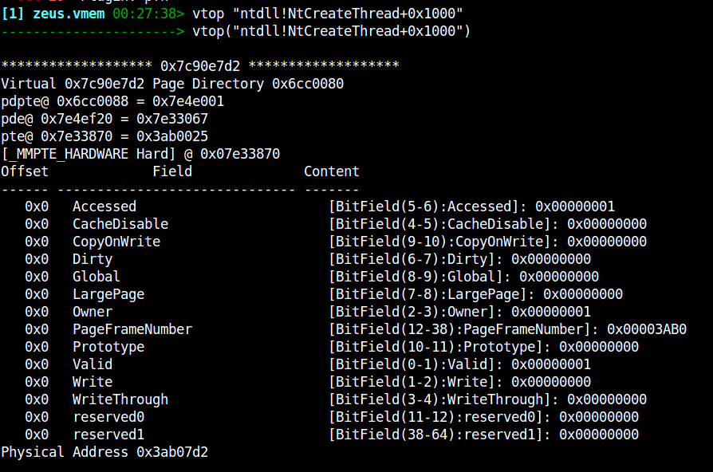

And we examine the PFN record for this next page:

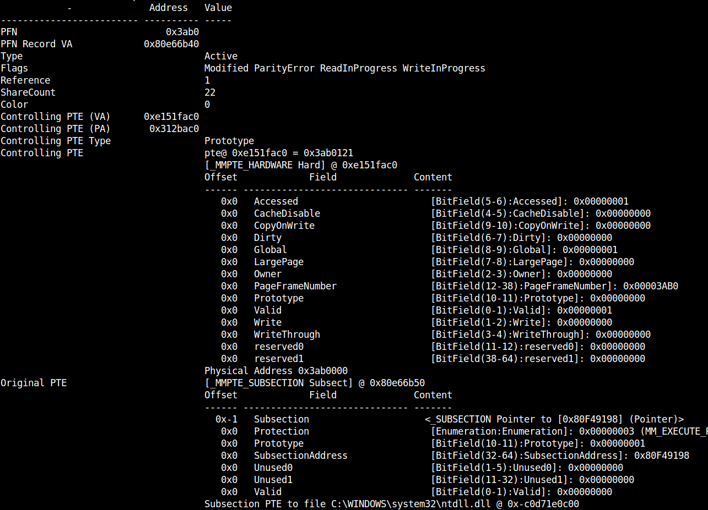

It is clearly a prototype page, which maps a subsection object. It is
shared with 22 other processes (ShareCount = 22). Let's see how this
physical page is mapped in the virtual address:

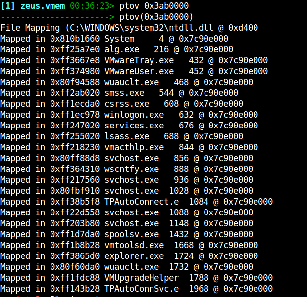

So the takeaway from this exercise is that by installing a hook, Zeus
has converted the page from shared to a private mapping. If we assume
that Zeus does not change files on disk, then memory only hooks can only
exist in process private pages and not in shared file pages. It is
therefore safe to skip shared pages in our hook analysis. This
optimization buys a speedup of around 6-10 times for inline hook
inspection - all thanks to the Windows PFN database!
