---
tags:
  - Linux
  - Memory Analysis
  - Tools
---
> This article was copied from the Rekall Forensics blog, posted on 2018-01-09.
> Copied with permission for historical preservation.

Imagine you are responding to an incident on an old Linux server. You
log into the server, download your favorite Linux incident response tool
(e.g. Linpmem, aff4imager), and start collecting evidence. Unfortunately
the first thing you see is:

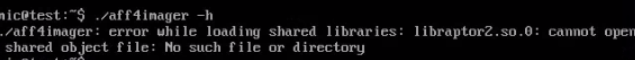

Argh! This system does not have the right library installed! Welcome to
Linux's own unique version of DLL hell!

This is sadly, a common scenario for Linux incident response.
Unfortunately we responders, can not pick which system we will
investigate. Some of the compromised systems we need to attend to are
old (maybe thats is why we need to respond to them :). Some are very
old! Other systems simply do not have required libraries installed and
we are rarely allowed to install required libraries on production
machines.

In preparation to the next release of AFF4 imagers (including Linpmem,
Winpmem and OSXPmem), I have been testing the imagers on old server
software. I built an Ubuntu 10.04 (Lucid Lynx) system for testing. This
distribution is really old and has been EOLed (end-of-life) in 2015,
but I am sure some old servers are still running this.

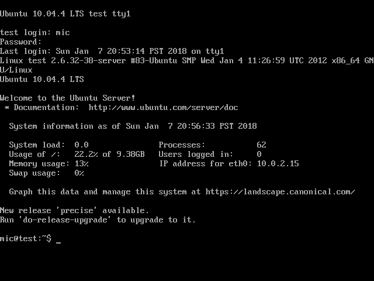

Such an old distribution helps to illustrate the problem - if we can get
our tools to work on such an old system, we should be able to get them
to work anywhere. In the process I learned a lot about ELF and how Linux
loads executables.

In the rest of this post, I will be using this old system and trying to
get the latest aff4imager tool to run on it. Note, that I am building
and developing the binary on a modern Ubuntu 17.10 system.

## Statically compiling the binary

As shown previously, just building the aff4 imager using the
normal ./configure, make install commands will build a dynamically
linked binary. The binary depends on a lot of libraries. How many? Let's
take a look at the first screenfull of dependencies:

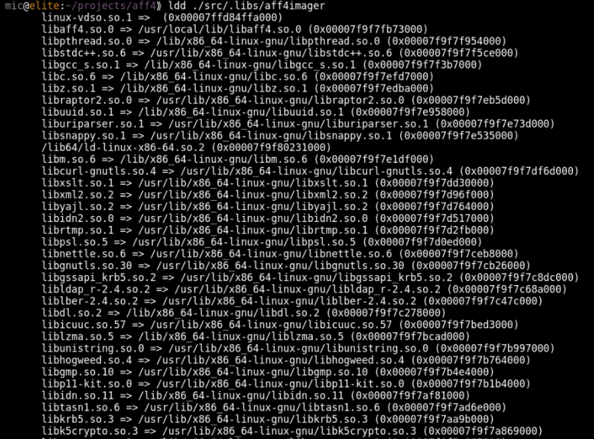

It is obviously not reasonable to ship such a tool for incident
response. Even on a modern system this will require installing many
dependencies. On servers and managed systems it may be against
management policy to install so many additional packages.

The first solution I thought of is to simply build a static binary. GCC
has the -all-static flag which builds a completely static binary. That sounds like what we want:

```text
-all-static
```

If output-file is a program, then do not link it against any shared
libraries at all.

Since modern linux distributions do not ship any static libraries, we
need to build every dependency from source statically. This is mostly a
tedious exercise but it is possible to
create a build environment with the static libraries installed into a
separate prefix directory. Adding the -all-static flag to the final link
step will produce a fully static binary.

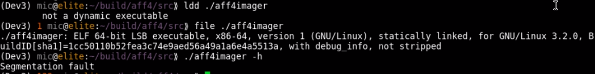

Excellent! This built a static binary as confirmed by ldd and file.
Unfortunately this binary crashes, even on the modern system it was
built on. If we use GDB we can confirm that it crashes as soon as any
pthread function is called. It seems that statically compiling pthread
does not work at all.

If we try to run this binary on the old system, it does not even get to
start:

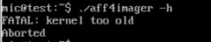

The program aborts immediately with "kernel too old" message. This was
a bit surprising to me but it seems that static binaries do not
typically run on old systems. The reason seems to be that glibc requires
a minimum kernel version, and when we statically compile glibc into the
binary, it refuses to work on older kernels. Additionally some functions
simply do not work when statically compiled (i.e. pthread). For binaries
which do not use threads, an all static build does work on modern enough
kernel, but obviously it does not achieve the intended effect of being
able to run on all systems since it introduces a minimum requirement on
the running kernel.

## Building tools on an old system

A common workaround is to build the tools on an old system, and perhaps
ship multiple versions of the tool. For example, we might build a static
binary for Ubuntu 10.04. Ubuntu 10.10 ... all the way through to modern
Ubuntu 17.10 systems.

Obviously this is a lot of work in setting up a large build environment
with all the different OS versions. In practice it is actually very
difficult to achieve if not impossible. For example, the AFF4 library is
written using modern C++11. The GCC versions shipped on such old systems
as Ubuntu 10.04 do not support C++11 (The standard has not even been
published when these systems were released!). Since GCC is intimately
connected with glibc and libstdc++ it may not actually be possible to
install a modern gcc without also upgrading glibc (and thereby losing
compatibility with the old glibc which is the whole point of the
exercise!).

## Building a mostly static binary

Ok, back to the drawing board. In the previous section we learned that
we can not statically link glibc into the binary because glibc is tied
to the kernel version. So we would like to still dynamically link to the
local glibc, but not much more. Ideally we want to statically compile
all the libraries which may or may not be present on the system, so we
do not need to rely on them being installed. We use the same static
build environment as described above (so we have static versions of all
dependent libraries).

Instead of specifying the "-all-static" flag as before we can specify
the "-static-libgcc" and "-static-libstdc++" flags:

```text
-static-libstdc++
```

When the g++ program is used to link a C++ program, it will normally
automatically link against libstdc++. If libstdc++ is available as a
shared library, and the -static option is not used, then this will link
against the shared version of libstdc++. That is normally fine. However,
it is sometimes useful to freeze the version of libstdc++ used by the
program without going all the way to a fully static link. The
-static-libstdc++ option directs the g++ driver to link libstdc++
statically, without necessarily linking other libraries statically.

This is looking better. When we build our aff4imager with these flags we
get a dynamically linked binary, but it has a very small set of
dependencies - all of which are guaranteed to be present on any
functional Linux system:

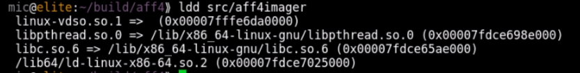

This is looking very promising! The binary works on a freshly installed
modern Linux system since it links to libpthread dynamically, but does
not require any external libraries to be installed. Lets try to run it
on our old system:

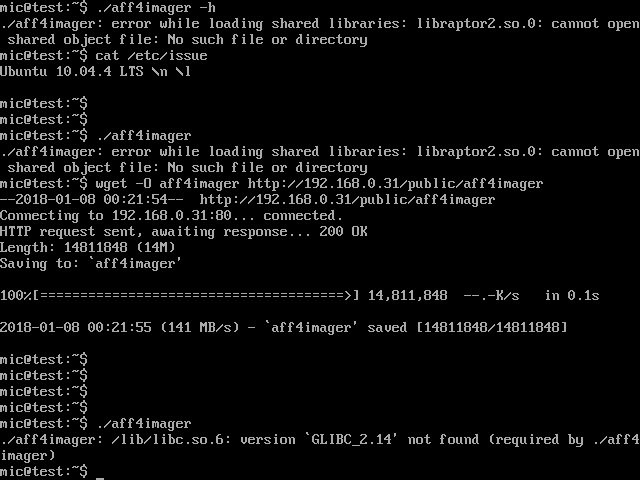

Argh! What does this mean?

## Symbol versioning

Modern systems bind binaries to specific versions of each library
function exported, rather than to the whole library. This is
called Symbol Versioning.

The error reported by the old system indicates that the binary requires
a particular version of GLIBC symbols (2.14) which is not available on
this server. This puts a limit of the oldest system that we can run
this binary on.

Symbol versioning means that every symbol in the symbol table requires a
particular version. You can see which version each symbol requires using
the readelf program:

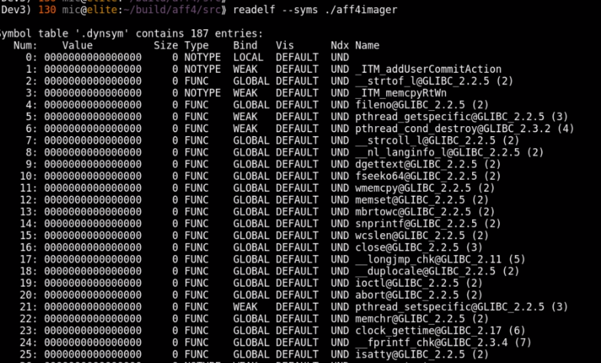

Before the binary is loaded, the loader makes sure it has all the
libraries and their versions it needs. The readelf program can also
report this:

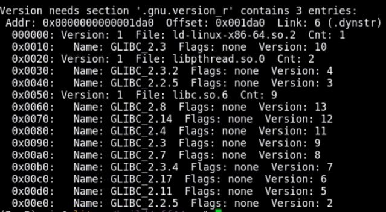

## ELF parsing with Rekall

To understand how the ELF file format implements symbol versioning we can use Rekall to implement
an ELF parser.  The ELF parser is a pretty good example of Rekall's advanced type parser, so I will
briefly describe it here. Readers already familiar with Rekall's parsing system, can skip to the
next section.

The Rekall parser is illustrated in the diagram below

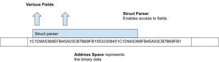

The Address Space is a Rekall class responsible for representing the raw
binary data. Rekall's binary parser interprets the raw binary data
through the Struct Parser class. Rekall automatically generates a parser
class to decode each struct from three sources of information:

1. The struct definition is given as a pure JSON structure (This is
   sometimes called the VTypes language). Typically this is automatically
   produced from debugging symbols.
2. The overlay. This python data structure may introduce callables
   (lambdas) to dynamically calculate fields, offsets and sizes overlaying
   on top of the struct definition.
3. If more complex interfaces are required, the user can also specify a
   class with additional methods which will be presented by the Struct
   Parser class.

The main emphasis of the Rekall binary parser is on readability. One
should be able to look at the code and see how the data structures are
constructed and related to one another.

Let us examine a concrete example. The elf64_hdr represents the ELF
header.

The VType definition describes the struct name, its size, and each known
field name, its relative offset within the struct as well as its type.
This information is typically generated from debug symbols.

```text
"elf64_hdr": [64, {
    'e_ident': [0, ['array', 16, ['uint8_t']]],
    'e_type': [16, ['uint16_t']],
    'e_machine': [18, ['uint16_t']],
    'e_version': [20, ['uint32_t']],
    'e_entry': [24, ['uint64_t']],
    'e_phoff': [32, ['uint64_t']],
    'e_shoff': [40, ['uint64_t']],
    'e_flags': [48, ['uint32_t']],
    'e_ehsize': [52, ['uint16_t']],
    'e_phentsize': [54, ['uint16_t']],
    'e_phnum': [56, ['uint16_t']],
    'e_shentsize': [58, ['uint16_t']],
    'e_shnum': [60, ['uint16_t']],
    'e_shstrndx': [62, ['uint16_t']],
}],

"elf64_hdr": [None, {
    'e_type': [None, ['Enumeration', {
    "choices": {
    0: 'ET_NONE',
    1: 'ET_REL',
    2:'ET_EXEC',
    3:'ET_DYN',
    4:'ET_CORE',
    0xff00:'ET_LOPROC',
    0xffff:'ET_HIPROC'},
    'target': 'uint8_t'}]],

    'sections': lambda x: x.cast("Array",
    offset=x.e_shoff,
    target='elf64_shdr',
    target_size=x.e_shentsize,
    count=x.e_shnum),
}],
```

Similarly, we can add additional "pseudo" fields to the struct. When the
user accesses a field called "sections", Rekall will run the callable
allow it to create and return a new object. In this example, we return
the list of ELF sections - which is just an Array of elf64_shdr structs
specified at offset e_shoff.

```text
class elf64_hdr(obj.Struct):
def section_by_name(self, name):
for section in self.sections:
if section.name == name:
return section
```

In this example we add the section_by_name() method to allow
retrieving a section by its name.

We can now parse an ELF file. Simply instantiate an address space using
the file and then overlay the header at the start of the file (offset
0). We can then use methods attached to the header object to navigate
the file. In this case print all the section headers.

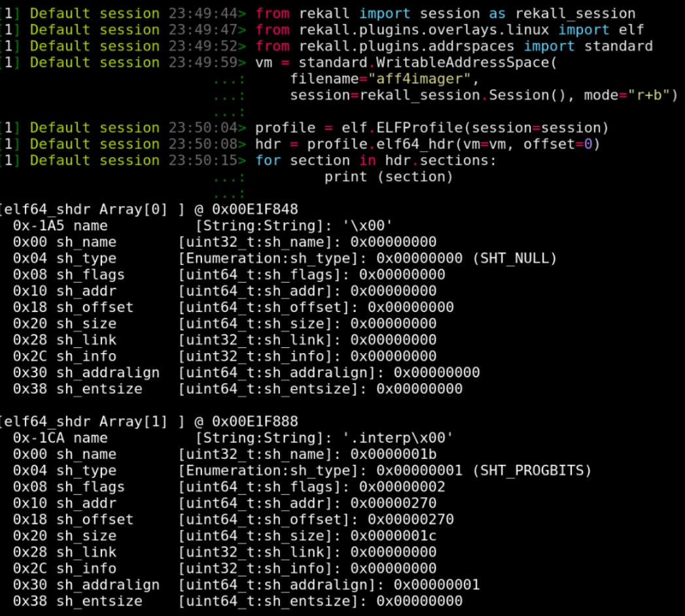

## Symbol Versioning in ELF files

So how is symbol versioning implemented in ELF? There are two new
sections defined: The ".gnu.version" (SHT_GNU_versym) and the
".gnu.version_r" (SHT_GNU_verneed).

Let's examine the SHT_GNU_verneed section first. Its name is always
".gnu.version_r" and it consists of two different structs - the elf64_verneed struct
is a linked list essentially naming the library files needed (e.g.
libc.so.6). Each elf64_verneed struct is also linked to a second list
of elf64_vernaux structs naming the versions of the library needed.

This arrangement can be thought of as a quick index of all the
requirements of all the symbols. The linker can just quickly look to see
if it has all the required files and their symbols before it even needs
to examine each symbol. The most important data is the "other" number
which is a unique number referring to a specific filename + version
pair.

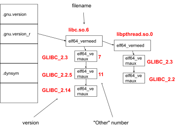

The next important section is the SHT_GNU_versym section which always
has the name ".gnu.version". This section holds an array of "other"
numbers which line up with the binaries symbol table. This way each
symbol may have and "other" number in its respective slot.

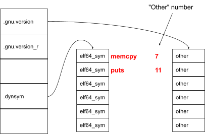

The "other" number in the versym array matches with the same "other"
number in the verneed structure.

We can write a couple of Rekall plugins to just print this data. Let's
examine the verneed structure using the elf_versions_needed plugin:

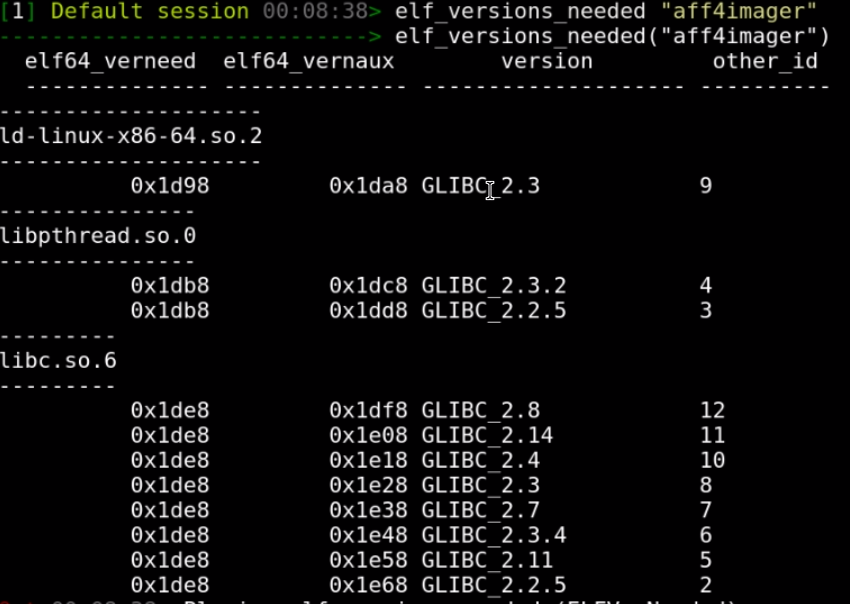

Note the "other" number for each filename + version string combination.

Lets now print the version of each symbol using
the elf_versions_symbols plugin.

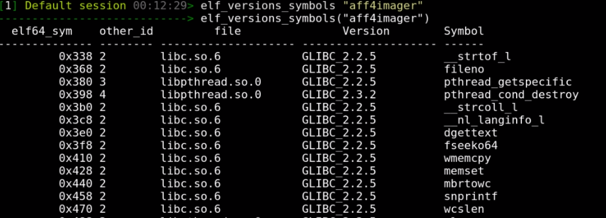

## Fixing the Symbol Versioning problem

Ok so how do we use this to fix the original issue? While symbol
versioning has its place, it prevents newer binaries from running on old
systems (which do not have the required version of some functions).
Often however the old system has some (older but working) version of the
required method.

If we can trick the system into loading the version it has instead of
the version the binary requires, then the binary can be linked at
runtime and would work. It will still invoke the old (possibly buggy)
version of these functions, but that is what every other software on the
system will be using anyway.

Take for example the memcpy function which on the old system is
available as memcpy@2.2.5. This function was replaced with a more
optimized memcpy@2.14, because
newer binaries require breaking backwards compatibility.
This is discussed in an [LWN article about the memcpy change](https://lwn.net/Articles/414467/).
Old binaries running on the old system still use (the possibly slower)
memcpy@2.2.5, so if we make our binary use the old version instead of
the new version it would be no worse than existing old binaries
(certainly if we rebuilt our binary on the old system it would be using
that same version anyway). We don't actually need these optimizations so
it should be safe to just remove the versioning in most cases.

Rekall also provides write support. Normally, Rekall operates off a read
only image, so it is not useful, but if Rekall operates on a writable
media (like live memory) and write support is enabled, then Rekall can
modify the struct. In python this works by simply assigning to the
struct field.

So the goal is to modify the verneed index so it refers to acceptably
old enough versions. The verneed section is an index of all the symbol
versions and the loader checks these before even loading the symbol
table.

We can then also remove the "other" number in the versym array to remove
versioning for each symbol. The tool was developed and uploaded to the
contrib directory of the Rekall distribution. As can be seen after the
modifications the needed versions are all reset to very early versions.

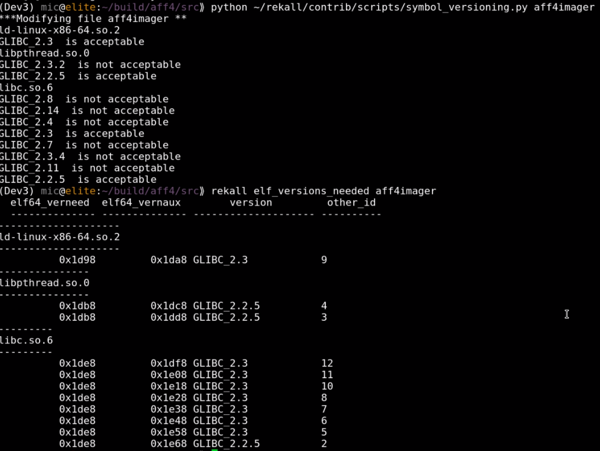

### One last twist

Finally we try to run the binary on the old system and discover that the
binary is trying to link a function called clock_gettime@GLIBC_2.17.
That function simply does not exist on the old system and so fails to
link (even when symbol versioning is removed).

At this point we can either:

1. Map the function to a different function
2. Implement a simple wrapper around the function.

By implementing a simple wrapper around the missing function and
statically linking that into the binary we can be assured that our
binary will only call functions which are already available on the old
system. In this case we can implement clock_gettime() as a wrapper to
the old gettimeofday().

```text
int clock_gettime(clockid_t clk_id, struct timespec \*tp) {
struct timeval tv;
clk_id++;

int res = gettimeofday(&tv, NULL);
if (res == 0) {
tp->tv_sec = tv.tv_sec;
tp->tv_nsec = tv.tv_usec / 1000;
}
return res;
}
```

### The moment of truth

By removing symbol versioning we can force our statically built imager
to run on the old system. Although it is not often that one may need to
respond to an old system, when the need arises it is imperative to have
ready to use and tested tools.

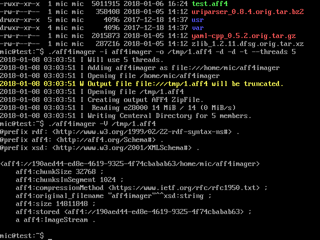

### Other tools

I wanted to see if this technique was useful for other tools. One of my
other favourite IR tools is OSQuery which is distributed as a mostly
statically built binary. I downloaded the pre-built Linux binary and
checked its dependencies.

There are a few more dependencies but nothing which can not be found on
the system.

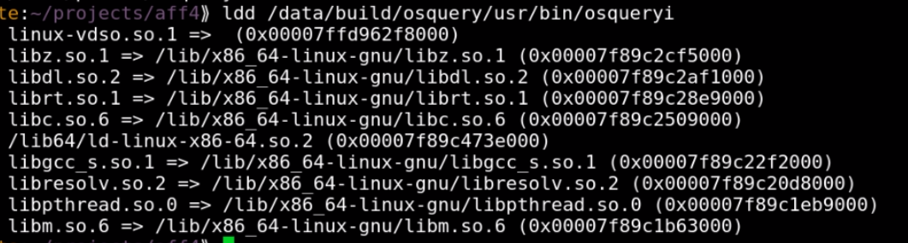

Again the binary requires a newer version of GLIBC and so will not run
on the old system:

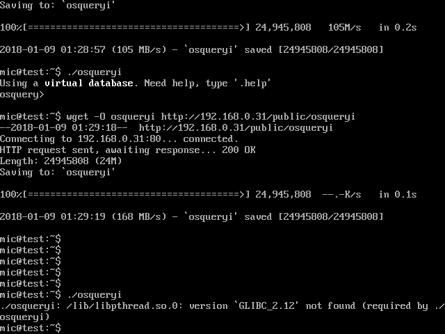

I applied the same Rekall script to remove symbol versioning. However,
this time, the binary still fails to run because the
function pthread_setname_np is not available on this system.

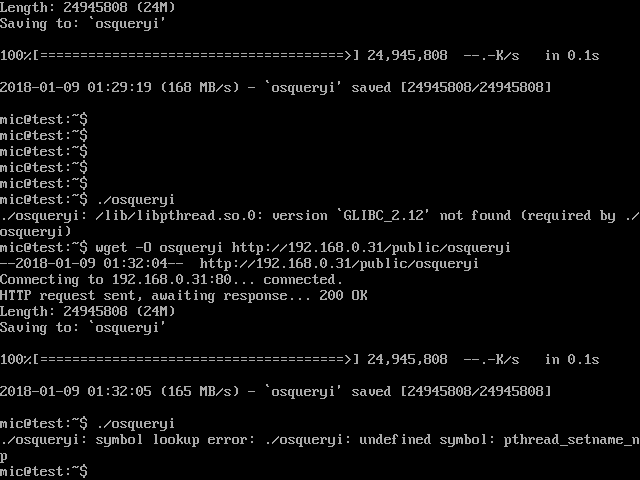

We could implement a wrapper function like before, but this will require
rebuilding the binary and this takes some time. Reading up on the
pthread_setname_np function it does not seem important (it justs sets
the name of the thread for debugging). Therefore we can just re-route
this function to some other safe function which is available on the
system.

Re-routing functions can be easily done by literally loading the binary
in a hex editor and replacing "pthread_setname_np" with "close" inside
the symbol
table.

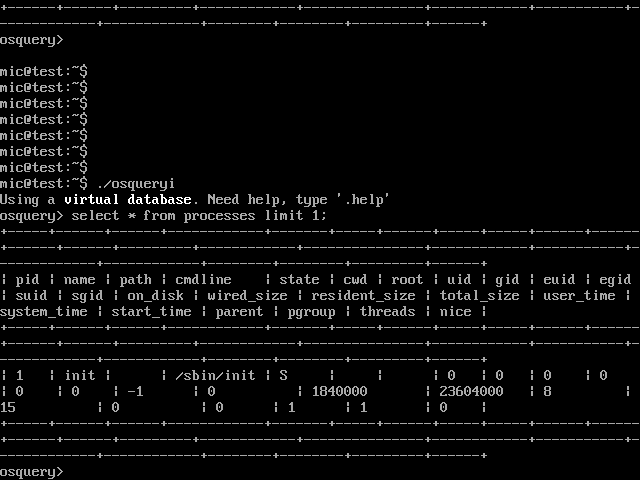

### External Links

* [Running new applications on old glibc](http://www.lightofdawn.org/wiki/wiki.cgi/NewAppsOnOldGlibc)
* [Wikipedia: Executable and Linkable Format](https://en.wikipedia.org/wiki/Executable_and_Linkable_Format)
