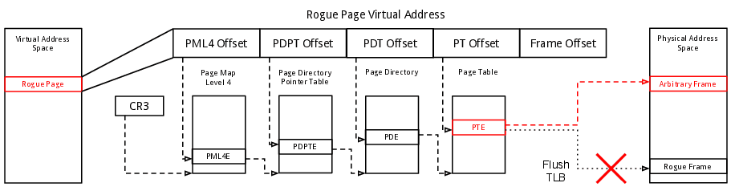

---
tags:
  - MacOS
  - Memory Analysis
  - Memory Imaging
---
> This article was copied from the Rekall Forensics blog, posted on
> 2014-03-28. Copied with permission for historical preservation.

# Mac OS X 10.9 Memory Acquisition

Late in 2012, the only free solution for Mac memory acquisition was MacMemoryReader,
which is not open source and depends on a binary distribution of the
driver to be built especially for the target kernel. This means
MacMemoryReader actually carries 5 different versions of it's kernel
extension in it's **supportfiles** directory, and automatically chooses
the correct one as long as it is used on a system that was supported at
the time the program got packaged.

These constraints didn't fit our use case very well, which is why I
developed an open source memory acquisition program for Mac OS X
called [OSXPmem](https://code.google.com/p/pmem/wiki/OSXPmem). This
program was designed specifically with the goal to be as operating
system independent as possible, while providing a stable way to acquire
memory even on future versions of Mac OS X.

With the 10.9 release of Mac OS X, MacMemoryReader stopped working (it only
packages drivers for Mac OS X 10.5 - 10.8). Fortunately, OSXPmem still works
and is currently the only free memory acquisition tool which is able to
acquire memory on Mac OS X 10.9 or higher.

In this blogpost I want to elaborate a bit on the reasons for that,
while also giving an overview on how memory acquisition on Mac OS X
actually works under the hood.

## How Memory Acquisition is Implemented

Because of memory protection it is not possible for a normal user-mode
application to just go ahead and read all the memory. Each process
resides in a virtual address space which is mapped into physical memory
using paging. The data-structures used for this are managed by the
kernel, and can only be accessed from system-mode. This is the reason
why any memory acquisition program must first load a driver into the
kernel, that provides the actual memory access.

## Enumerating Physical Memory

Physical memory is not continuous, so don't expect the physical address
space of a computer with e.g. 4GB of RAM to be laid out as one chunk
from **00000000 - FFFFFFFF**. The physical address space itself is again
a virtual construct, controlled by the northbridge. For faster access to
device memory, many hardware devices like graphics or network cards map
parts of their integrated memory or registers into the physical address
space via memory mapped I/O. The BIOS (or on modern systems the EFI)
initializes the hardware on boot and arranges all these memory chunks
into something called the physical address space. Here is a redacted
example of the layout on my laptop:

```text
 Size of physical address space: 6171918336 bytes (206 segments)
 Memory Type       Start Addr    End Addr
 Conventional  0000000000000000 000000000008f000
 Reserved      000000000008f000 0000000000090000
 Conventional  0000000000090000 00000000000a0000
 Reserved      00000000000a0000 0000000000100000
 ...
 Conventional  0000000100000000 000000016fe00000
```

Regions marked "Conventional" are guaranteed to be backed by physical
memory, while regions marked "Reserved" might contain device memory. It
should be avoided to read from the reserved regions, as this can trigger
interrupts on a device and thus even result in a hardware malfunction,
system instability and a kernel crash. If you're interested in more
details I can recommend Gustavo Duarte's excellent articles
[Getting Physical With Memory](https://manybutfinite.com/post/getting-physical-with-memory/)
and [Motherboard Chipsets and the Memory Map](https://manybutfinite.com/post/motherboard-chipsets-memory-map/).

The bottom line is that a memory acquisition tool must find out how
physical memory is laid out in order to acquire it in a way that does
not cause instability and thus loss of the desired data. This is usually
done by querying the kernel, as it manages physical memory and has to
know it's layout. On Mac OS X the EFI passes this information to the
component of the kernel called the "platform expert" \[Source Mac OS X Internals: A Systems
Approach by Amit Singh],
which stores it in a data-structure in
**PE_state.bootArgs->MemoryMap**. If you look at line 13 of
**PE_state_raw.dtrace** in MacMemoryReader's supportfiles directory,
you can see how it is obtained:

```text
 self->kgm_boot_args = ((struct boot_args*)(`PE_state).bootArgs);
```

OSXPmem uses the same source of information to obtain the memory map.
Unfortunately this information is not very reliable, as this
data-structure is not used by the kernel at runtime, making it an easy
target for rootkit manipulation. In
one of our papers last year \[published at DFRWS 2013]
we showed that it is trivial to overwrite this data-structure, making
memory acquisition impossible on the system. We also implemented a more
reliable way to obtain an accurate memory map in that publication.
However, this has not been implemented for Mac OS X yet.

## Mapping Physical Memory

Because even the kernel operates inside virtual memory, the memory
acquisition driver needs to map physical memory into the kernels address
space. On Mac OS X, this is ultimately done by the Mach
portion of the kernel. However, kernel extensions are not allowed to
link directly to kernel functions. Instead, they are linked to Kernel
Programming Interfaces (KPI), which are interfaces to a limited set of
symbols Apple allows kernel extensions to use. The functions available
through these interfaces can change with every kernel release,
especially the ones in the "unsupported" KPI (where the Platform Experts
state is linked from). But even supported KPIs like the ones for
physical memory mapping can change, as Apple
[has shown in the past](https://developer.apple.com/library/archive/releasenotes/Darwin/RN-KernelExtensions/).

Both OSXPmem and MacMemoryReader use a simple BSD kernel extension
(kext) to provide memory access. However, physical memory mapping is
only supported from Apples IOKit framework. This is the reason why both
kext use the **IOMemoryDescriptor** class to map memory into the kernel.
Now with the introduction of memory compression in Mac OS X 10.9 this method
has been found to cause problems. The kernel can compress and uncompress
memory on the fly, and doesn't want any other driver touching it. It is
entirely possible that in future Mac OS X releases some KPIs will change and
this method of mapping memory will not be possible at all.

Luckily, we have also developed a different mapping technique.
Originally intended as a rootkit resilient mapping technique, this
approach has also proven to be very reliable on any major operating
system. It works by directly modifying the page tables and clearing the
caches, forcing the memory management unit (MMU) to remap an existing
virtual address. As illustrated in Figure 1, a virtual page called
"Rogue Page" is remapped by editing the page table entry (PTE) directly
and then flushing the translation lookaside buffer (TLB). This enables
us to access any arbitrary page in the physical address space, without
any kernel dependency. Details on this approach can be found in our
\[DFRWS 2013] paper.

[](assets/images/rekall-forensics-blog/osx_10_9_memory_acquisition_1.png)

By "bypassing" the kernel when accessing memory this technique does not
depend on any KPIs and thus isn't affected by compressed RAM or any
obstacles Apple might decide to put into the **IOMemoryDescriptor** in
future versions of Mac OS X. This is why we made it the default mapping
method in WinPmem and OSXPmem. We expect this method to be more stable
and resilient to changes in the kernel and even anti-forensic
techniques.

## Kernel Extention Code Signing

With the release of Mac OS X 10.9 Apple has changed it's previous policy on
driver signature enforcement. While it was previously possible to sign a
kernel extension, unsigned kext could also be loaded without any issues.
In 10.9 and later,
[the kext loader displays a warning message when an unsigned kext is loaded](https://developer.apple.com/library/archive/releasenotes/MacOSX/WhatsNewInOSX/Articles/MacOSX10_9.html#//apple_ref/doc/uid/TP40013207-SW4).
It is very likely that Apple will adopt the Microsoft approach at some
time, preventing unsigned kext to be loaded.

## 32-bit Kernel Support

OSXPmem only supports Macs using the 64-bit version of Mac OS X. Apple
introduced 64-bit builds with Mac OS X 10.6, making it the default with 10.7.
Since Mac OS X 10.8, the 32-bit kernel is deprecated and all Macs running
10.8 or higher should be running in 64 bit mode. This means OSXPmem will
not work on Mac OS X 10.5 or older, and might not work on some 10.6 systems.
I will not add 32-bit support, as these kernels are deprecated and only
run on very old machines anyways. If you need to acquire memory from
such a system I encourage you to use MacMemoryReader.
