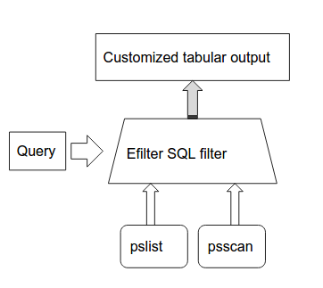
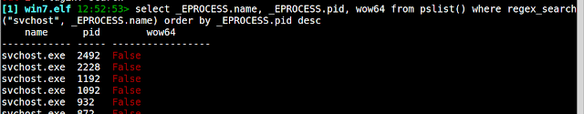
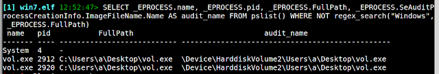
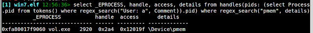
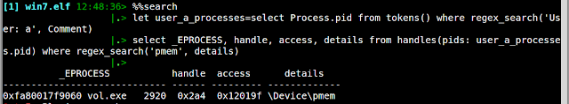

---
tags:
  - Tools
  - Memory Analysis
  - Howtos
---
> This article was copied from the Rekall Forensics blog, posted on 2016-07-01.
> Copied with permission for historical preservation.

This blog post covers the new searching capability in the latest Rekall
release (Starting from Rekall 1.5.2). The searching capabilities in
Rekall are powered by the [Efilter project](https://github.com/google/dotty).

## Customizing plugin output

Rekall is a plugin based framework. This means that Rekall comes with
many plugins written by different contributors. For example, one of the
most popular plugins is the pslist plugin. We can see some help about
the pslist plugin by following it with a question mark (?).

We can see that by default, the plugin can filter the output by PID, or
process name. These filters are common to all plugins which deal with
processes. For example, suppose we want to only see the svchost.exe
processes.

The pslist plugin has a typical tabular output. There are a number of
columns which were pre-chosen by the plugin author, such as the address
of the _EPROCESS struct, the process name, the PID etc.

This information is most useful, however, we don't have a way to
customize the output much past those columns hard-wired into the plugin.
For example, we might want to also sort the output based on the start
time, or PID or something else.

How can we do this? The solution is implemented by the Efilter library
and the search plugin implemented in Rekall.

## Efilter and the search plugin

Efilter is a filtering framework which implements an SQL-like search
language. This approach is not new. For example other tools (such as
Volatility) can produce output into sqlite tables, which can
subsequently be filtered using SQL.

The main difference with the Efilter approach is that Efilter does not
actually use pre-extracted data, but rather runs Rekall plugins on
demand automatically in order to satisfy each query. As we see below,
this allows queries to inspect data which was never even exported
directly by the plugin - giving a complete and flexible interface for
inspection of analysis results.



The general search process is illustrated above. Efilter analyzes the
query to figure out which plugins will be run, then the output from
these plugins is fed into the Efilter framework where the specified
filters are applied. The query can specify a set of columns to display
(and possibly their sorting order). The result is a customized tabular
output governed by the specified query.

Here is a trivial example:

```bash
select * from pslist()
```

In this example we simply select all the output from the pslist() plugin
(using the SQL \* specifier). Efilter simply runs the pslist plugin and
outputs all the rows produced by the plugin with no filtering. The
output is also identical to the pslist plugin.

In the above query, Efilter just re-emitted all the columns emitted by
the plugin but we can pick and choose some of the columns. Before we can
filter and select some columns from the pslist plugin, we need to know
exactly what type of output the plugin is producing. The column names
are human readable and may not always correspond to the specific name of
the column itself.

We use the describe plugin to describe the output of the pslist plugin
in much the same way that the SQL describe statement describes a table.

Next to each field, we see the type of the field. This gives us an idea
of what type of filtering operation is possible with this field. For
example, let's display only the wow64 processes and show which session
they are running in. The wow64 field is a boolean field so we simply
evaluate it in the where clause:

```sql
select _EPROCESS, session_id, wow64 from pslist() where wow64
```

If you look closely at the output you might notice that the _EPROCESS
column is actually split into 3 different columns, the virtual address,
the process name and the process PID. Similarly in the output of
"describe pslist" above there is no specific column for the process name
or PID - all we see is a single _EPROCESS column with a type of
_EPROCESS.

What is going on? How can we select only the process name?

When a plugin emits a more complex type (in this case the plugin emits
raw _EPROCESS objects), Rekall might employ a specialized renderer (or
a customized output format) for this columm. In this case a single
_EPROCESS object is shown as a small table with three columns. However,
Efilter actually sees the raw object itself. Therefore as far as the
search plugin is concerned the pslist plugin emits raw _EPROCESS
objects for each row.

We can use this fact by dereferencing fields inside the _EPROCESS
object itself within a search query. Let us repeat the "describe pslist"
plugin, but this time we tell it to show sub fields to a depth of 1 (In
this screenshot we snipped many of the fields because the output is
long. The plugin actually shows all the members of the _EPROCESS
struct, as well as Rekall defined pseudo-members and properties.):

We can see that the _EPROCESS object itself contains many fields, and
they can all be used as filtering targets, columns and sort orders. Here
is something a bit more complex:

```sql
select _EPROCESS.name, _EPROCESS.pid, wow64 from pslist() where regex_search("svchost", _EPROCESS.name) order by _EPROCESS.pid desc
```



Here we sort by PID in reverse and show all the processes which match
"svchost.exe" as well as their Wow64 status. Note that the built in
search function finds the case insensitive regular expression anywhere
in the filename.

Being able to drill into the objects returned by plugins allows users to
invent completely different tables, even extending the output the
original plugin was not designed to produce.

For example, closer inspection of the _EPROCESS object (either with the
describe plugin or the dt plugin) reveals that extra information is
present in the _SE_AUDIT_PROCESS_CREATION_INFO struct produced by
the Windows auditing system. We also see a FullPath member on the
_EPROCESS object (This is actually a virtual member added by Rekall
which displays the full path to the binary running the process). Let's
find all the processes which were started from locations other than the
Windows directory and also show the audit system's record of where they
were started:

```sql
SELECT _EPROCESS.name, _EPROCESS.pid, _EPROCESS.FullPath, _EPROCESS.SeAuditProcessCreationInfo.ImageFileName.Name AS audit_name FROM pslist() WHERE NOT regex_search("Windows", _EPROCESS.FullPath)
```



Note the use of the regex_search() function applies a regular
expression to a match, the use of the not operator to exclude this match
and the use of the as operator to rename a column to a more meaningful
name.

NOTE: Efilter currently provides the **=~** operator for a regular
expression match, however this matching is case sensitive. When matching
Windows file names we never want a case sensitive match or we might miss
some filenames which should match. Therefore it is always preferable to
use the case insensitive regex_search() function instead.

## Subqueries

Sometimes it is useful to take the result of one search and apply it as
an input to another plugin. Efilter supports this concept as a subquery.
For example, suppose we asked - which processes were launched by a
particular user? There is already a plugin which tells us this - the
tokens() plugin:

```sql
select * from tokens() where regex_search("User: a", Comment)
```

We could also select by Sid but Rekall already resolves the Sid to a
username for us. Now we would like to know which of these processes
holds an open handle to the pmem driver?

```sql
select _EPROCESS, handle, access, details from handles(pids: (select Process.pid from tokens() where regex_search("User: a", Comment)).pid) where regex_search("pmem", details)
```



The above example is a bit hard to follow because it is all on one line
and has a subselect clause. Efilter also allows us to save entire
queries and therefore make the query more readable. To make this easier
we can use the **%%search** magic command in the *Rekall* shell. This
allows us to write more complex, multi-line queries:

```text
[1] win7.elf 20:37:02> %%search
let user_a_processes=select Process.pid from tokens() where regex_search('User: a', Comment)
select _EPROCESS, handle, access, details from handles(pids: user_a_processes.pid) where regex_search('pmem', details)
```



How does this work?

The let assignment stores a query at the variable user_a_processes.
Note that it does not execute the query at this point yet. A stored
query is simply a table with columns and rows:

1. In this case there is only one column called "pid" and several rows.
2. The next query executes the handles plugin and provides the stored query
   to the "pids" parameter. Since the query is just a table, we need to
   choose which column to expand into the PIDs arguments (this is the
   purpose of the second ".pid"). Now the plugin will receive a list of
   PIDs to operate on.
3. The output from the handles plugin (restricted by the PIDs selected by
   the first query) is further filtered for a file handle matching "pmem"

Note that we could have just run the handles() plugin without arguments
and filtered on the output but this would have been inefficient because
Efilter will need to list all the handles for all the processes and then
filter out those processes we don't care about. It is always important
to try to reduce the total number of processes examined first off by
providing good process selectors to plugins which take them. Efilter
does not currently have a good feel as to the cost of running each
plugin so it is up the user to decide which order the queries should be
run in and how the output is to be combined.

In this blog post we have demonstrated how EFilter queries are useful to
tailor exactly the output you need from Rekall plugins. In the next blog
post we will discuss how to harness this power in formulating and
recovering forensic artifacts for memory images.
