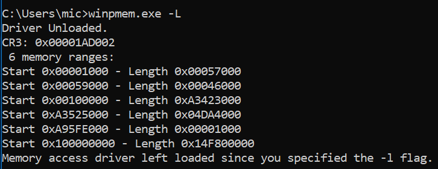
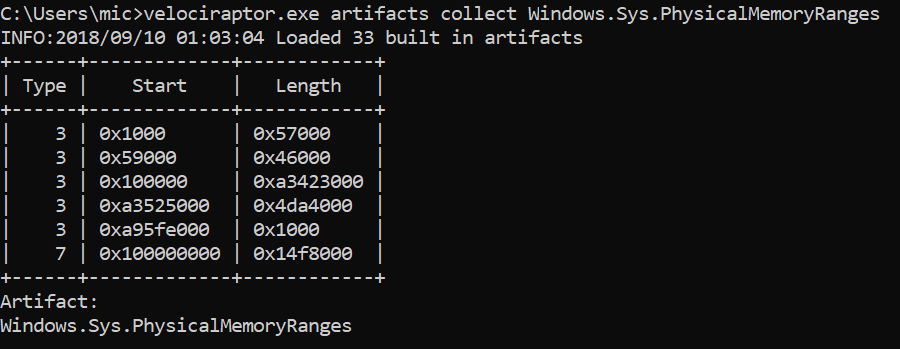
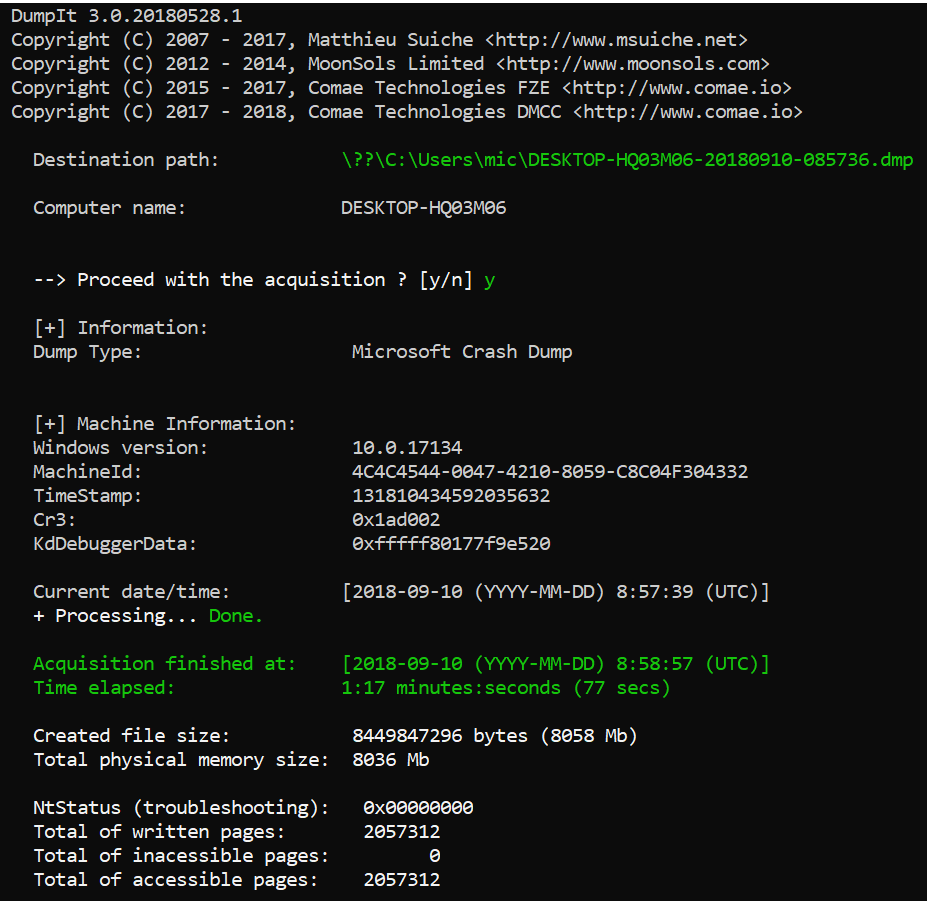
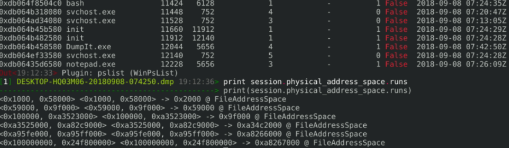
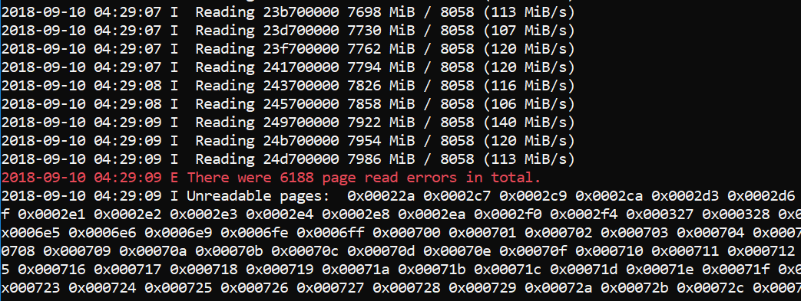
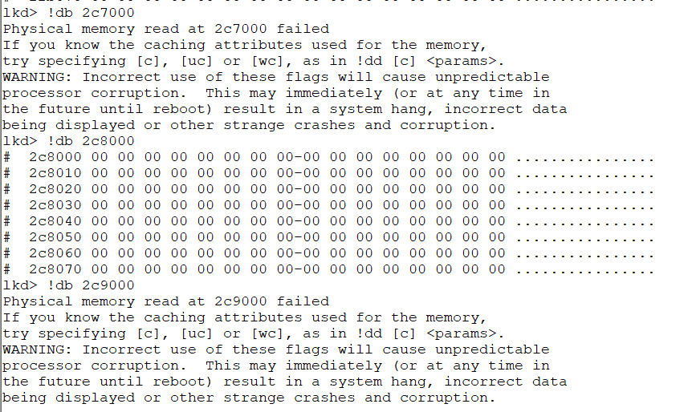
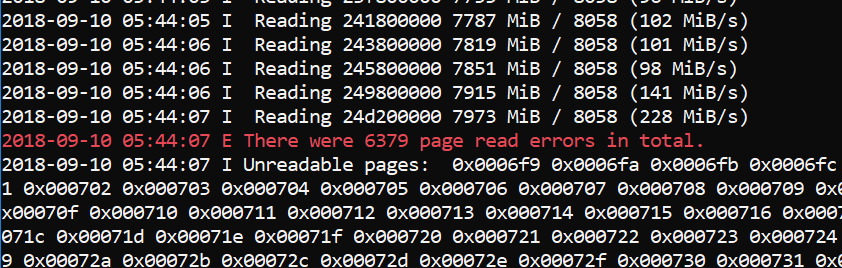
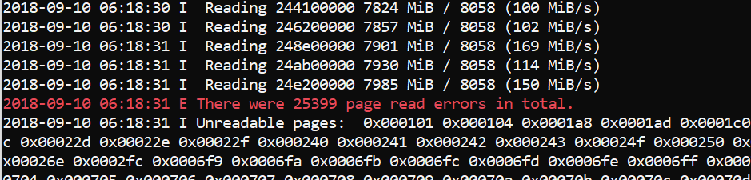
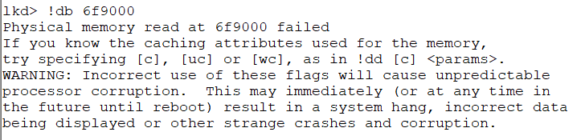
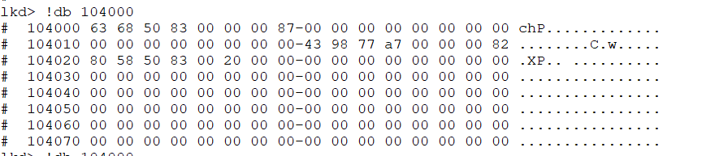

---
tags:
  - Windows
  - Memory Analysis
  - Memory Imaging
---
> This article was copied from the Rekall Forensics blog, posted on 2018-09-17.
> Copied with permission for historical preservation.

This blog post is about my recent work to track down and fix a bug in
Winpmem - the open source memory acquisition utility. You can try the
latest release at
the [Velocidex/c-aff4](https://github.com/Velocidex/c-aff4) release
page *(Note Winpmem moved from the Rekall project into the AFF4 project
recently).*

The story starts, as many do, with an email send to the SANS DFIR list asking
about memory acquisition tools to use for VSM protected laptops. There
are a number of choices out there, these days, but some readers proposed
the old favorite: [WinPmem](https://github.com/Velocidex/c-aff4).
WinPmem is AFAIK the only open source memory acquisition tool. It was
released quite some years ago and had not been updated for a while.
However, it has been noted that it crashes on Windows systems with VSM
enabled.

In 2017 Jason Hale gave an excellent talk at DFRWS:
where he put a number of memory acquisition tools through their paces
and found that most tools blue screened when run on VSM enabled systems.
Subsequently some of these tools were fixed but I could not find any
information as to how they were fixed. The current state of the world is
that Winpmem appears to be one of those tools that crashes.

When I heard these reports I finally blew the dust off my Windows
machine and enabled VSM. I then tried to acquire with the released
winpmem (v3.0.rc3) and I can definitely confirm it BSODs right away! Not
good at all!

At first I thought that the physical memory range detection is a
problem. Maybe under VSM the memory ranges we detect with WinPmem are
wrong and this makes us read into invalid physical memory ranges? Most
tools get the physical memory ranges using the undocumented kernel
function MmGetPhysicalMemoryRanges() - which is only accessible in
kernel mode.

To confirm, I got winpmem to just print out the ranges it got from that
function using the -L flag. This flag makes winpmem just load the
driver, report on the memory ranges and quit without reading any memory
(so it should not crash).



These memory ranges look a bit weird actually - they are very different
from what the same machine reports without VSM enabled.

The first thing I checked was another information source for the physical memory ranges. I wrote a
Velociraptor artifact to collect the physical memory ranges as reported by the hardware manager in
the registry (Since [MmGetPhysicalMemoryRanges](http://www.reactos.org/pipermail/ros-diffs/2009-June/031391.html))
is not accessible from userspace so the system writes the memory ranges into the Windows Registry
on each boot). Note that you can also use [meminfo](https://www.alex-ionescu.com/meminfo-peer-inside-memory-manager-behavior-on-windows-vista-and-server-2008/)
from Alex Ionescu to dump memory ranges from userspace.



So this seems to agree with what the driver reports.

Finally I attempted to take the image
with [DumpIt](https://www.comae.com/) - this is a great memory imager
which did not crash either:



The DumpIt program produced a Windows crash dump image format. It is
encouraging to see that the CR3 value reported by DumpIt was consistent
with WinPmem's report. While DumpIt does not explicitly report the
physical memory ranges it used, since it uses a crashdump format file,
we can see the ranges encoded into the crashdump using Rekall:



So at this point I was convinced that the problem is unrelated to
reading outside valid physical memory ranges - even DumpIt is using the
same ranges as WinPmem but it does not crash!

Clearly any bug fix will involve updating the driver components (since
all imager's userspace component just reads from the same ranges
anyway). It had been years since I did any kernel development and my
code signing certificate expired many years ago. These days code signing
certs are much more expensive since they require EV certs. I was
concerned that unsuspecting users would attempt to use WinPmem on VSM
enabled systems (which are becoming more common) and cause BSOD. This
poses an unacceptable risk.

I updated the DFIR list announcing that in my estimation we would need
to fix the issue with the kernel driver and since my code signing cert
expired I won't be able to do so. I felt the only responsible thing was
to pull the download and advise users to consider an alternative product - at
least for the time being.

What happened next was an amazing response from the DFIR community. I
receives many emails generously offering to sponsor a code signing cert
and people expressing regret over the possibility of Winpmem winding
down. Finally Emre Tinaztepe from Binalyze has graciously offered to
sign the new drivers and contribute them to the community. Thanks Emre!
It is really awesome to see open source at work and the community coming
together!

Fixing the bug

So I set out to see why Winpmem crashes. To do kernel development, one
needs to install Visual Studio with the Driver Development Kit (DDK).
This takes a long time and downloads several GB worth of software!

After some time I had the development environment set up, checked out
the winpmem code and tried to replicate the crash with the newly built
driver. To my surprise it did not crash and worked perfectly! At this
point I was confused....

I turns out that the bug was fixed back in [2016](https://github.com/google/rekall/commit/a76abcf74f2652494c67d28a60bd141a138271f1)
but I had totally forgotten about it (a touch of senility no doubt). I then
forensically analyzed my email to discover a conversation with Jason
Hale back in October 2016! Unfortunately my code signing cert ran out in
August 2016 and so although the fix was checked in, I never rebuilt the
driver for release - my bad :-(.

Taking a closer look at the bug fix, the key is this code:

```text
char *source = extension->pte_mmapper->rogue_page.value + page_offset;   try {     // Be extra careful here to not produce a BSOD. We would rather     // return a page of zeros than BSOD.     RtlCopyMemory(buf, source, to_read);   } except(EXCEPTION_EXECUTE_HANDLER) {     WinDbgPrint("Unable to read from %p", source);     RtlZeroMemory(buf, to_read);   }
```

The code attempts to read the mapped page, but if a segfault occurs,
rather than allow it to become a BSOD, the code traps the error and pads
the page with zeros. At the time I thought this was a bit of a cop out - we
don't really know why it crashes, but if we are going to crash, we would
rather just zero pad the page than BSOD. Why would reading a page from
physical RAM backed memory segfault?

To understand this we must understand what Virtualization Based Security
is. Microsoft windows implements [Virtual Secure Mode (VSM)](https://learn.microsoft.com/en-us/archive/blogs/ash/windows-10-device-guard-and-credential-guard-demystified):

> VSM leverages the on chip virtualization extensions of the CPU to
> sequester critical processes and their memory against tampering from
> malicious entities. ... The protections are hardware assisted, since the
> hypervisor is requesting the hardware treat those memory pages
> differently.

What this means in practice, is that some pages belonging to sensitive
processes are actually unreadable from within the normal OS. Attempting
to read these pages actually generates a segfault by design! Of course
in the normal course of execution, the VSM container would never access
those physical pages because they do not belong to it, but the
hypervisor is actually implementing an additional hardware based check
to make sure the pages can not be accessed. The above fix works because
the segfault is caught and WinPmem just moves on to the next page
avoiding the BSOD.

So I modified Winpmem to report all the PFNs that it was unable to read.
Winpmem now prints a list of all unreadable pages at the end of
acquisition:



You can see that there are not many pages protected by the hypervisor
(around 25Mb in total). The pages are not contained in a specific region
though - they are sprayed around all of physical memory. This actually
makes perfect sense, but let's double check.

I ran the kernel debugger (windbg) to see if it can read the physical
pages that WinPmem can not read. Windbg has the !db command which reads
physical memory.



Compare this output to the previous screenshot which indicates Winpmem
failed to read PFN 0x2C7 and 0x2C9 (but it could read 0x2C8). Windbg is
exactly the same - it too can not read those pages presumably protected
by VSM.

Representing unreadable pages

This is an interesting development actually. Disk images have for a long
time had the possibility of a sector read error, and disk image formats
have evolved to account for such a possibility. Sometimes when a sector
is unreadable, we can zero pad the sector, but most forensic disk images
have a way of indicating that the sector was actually not readable. But
this never happened before in memory images, because it was
inconceivable that we could not read from RAM (as long as we had the
right access!).

Winpmem uses the [AFF4](https://github.com/aff4/Standard) format by
default, and luckily AFF4 was designed specifically with forensic
imaging in mind (See section 4.4. Symbolic stream aff4:UnreadableData).
Currently the AFF4 library fills an unreadable page with "UNREADABLE"
string to indicate this page was protected.

Note that if the imaging format does not support this (e.g. RAW images
or crashdumps) than we can only ever zero pad unreadable pages and then
we don't know if these pages were originally zero or were unreadable.

PTE Remapping Vs. MmMapIoSpace

Those who have been following winpmem for a while are probably aware
that winpmem uses a technique called PTE remapping by default. All
memory acquisition tools have to map the physical memory into the
kernel's virtual address space - after all software can only ever read
the virtual address space, and can not access physical memory directly.

There are typically 4 techniques for mapping physical memory to virtual
memory:

1. Use of \\.\PhysicalMemory device - this is an old way of exporting
   physical memory to userspace and has been locked down for ages by
   Windows.
2. Use of the undocumented MmMapMemoryDumpMdl() function to map arbitrary
   physical pages to kernel space.
3. Use of the MmMapIoSpace() function. This function is typically used to
   map PCI devices DMA buffers into kernel space.
4. Direct PTE remapping - the technique used by WinPmem.

Memory acquisition is by definition an incorrect operation when viewed
from the point of view of OS stability. For example, running Winpmem's
MmMapIoSpace() mode under the driver verifier will produce a bugcheck
0x1a with code 0x1233 "A driver tried to map a physical memory page that
was not locked. This is illegal because the contents or attributes of
the page can change at any time."

This is technically correct - we are mapping some random pages of system
physical memory into our virtual memory space - but we don't actually
own these pages (i.e. we never locked them) so anyone could at any time
just go ahead and use them from under us. Obviously if we want to write
a kernel driver then by definition mapping physical memory we do not own
is bad! Yet this is what memory acquisition is all about!!1

The other interesting issue is caching attributes. Most people's gut
reaction is that direct PTE manipulation should be less reliable since
it essentially goes behind the OS's back and directly maps physical
pages ignoring memory caching attributes. The reality is that the OS
performs a lot of extra checks which are designed to trap erroneous use
of APIs. For example, it may fail a request for MmMapIoSpace() if the
cache attributes are incorrect - this makes sense if we are actually
trying to read and write to the memory and depend on cache coherence,
but if we are just acquiring the memory it doesn't matter - we would
much rather get the data than worry about caching. Because we are going
to have a lot of smear in the image anyway, caching really does not
affect imaging in any measurable way.

Winpmem implements both PTE Remapping and MmMapIoSpace() modes.
MmMapIoSpace() typically fails to collect more pages though. Here is the
output from the MmMapIoSpace() method vs. PTE Remapping method side by
side:

| | |
| --- | --- |
|  |  |
|  |  |
| Total unreadable pages with PTE Remapping | Total Unreadable pages with MmMapIoSpace() function. |

As can be seen, the MmMapIoSpace() method fails to read more pages, and
the pages it fails to read are still accessible as proven by the kernel
debugger.

## Final notes

This post just summarises my understanding of how memory acquisition
with VSM works. I may have got it completely wrong! If you think so,
please comment below or on the DFIR/Rekall/Winpmem mailing list. It kind
of makes sense to me that winpmem can not read protected pages, and even
the kernel debugger cannot read those same pages. However, I checked the
image that DumpIt produced, and it actually contains data (i.e. not all
zeros) in the same pages which are supposed to be unreadable. The other
interesting thing is that DumpIt reports no errors reading pages (see
the screenshot above), so it claims to have read all pages (including
those protected by VSM). I don't know if DumpIt implements some other
novel way to read through the hypervisor restrictions or maybe it has a
bug like an uninitialized buffer so these failed pages return random
junk? Or maybe I have a deep misunderstanding of the whole thing (most
likely). More tool testing is required!

## Thanks

I would like to extend my gratitude to Emre Tinaztepe from
[Binalyze](https://binalyze.com/) for his patient testing and signing
the drivers. Also thanks for Matt Suiche for feedback and doing a lot of
excellent original research and producing such cool tools.
