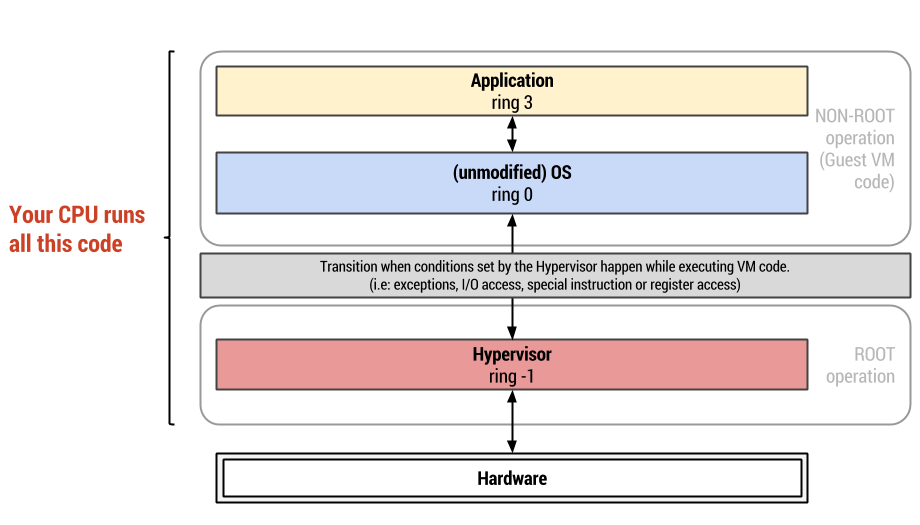
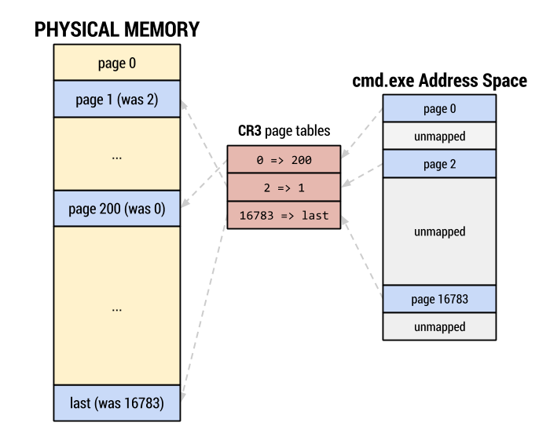
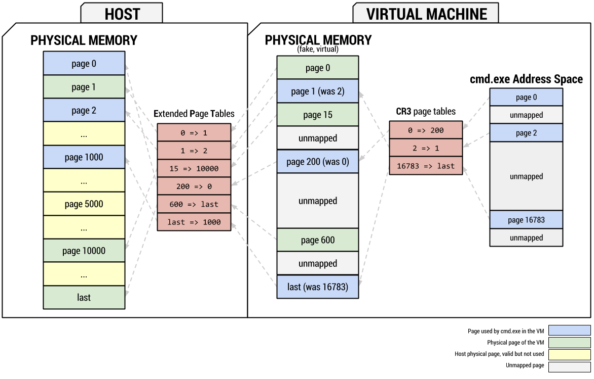
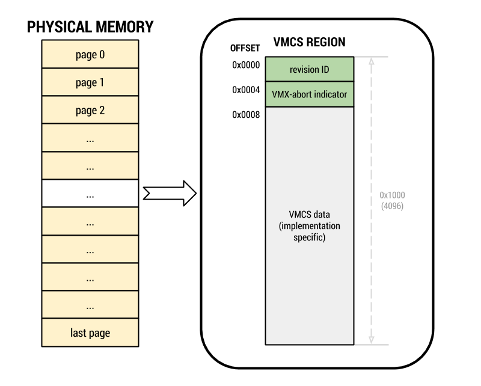
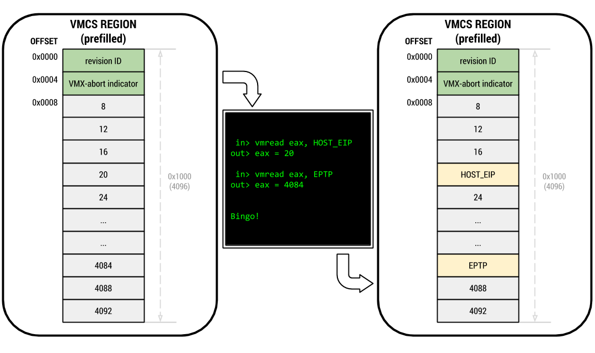
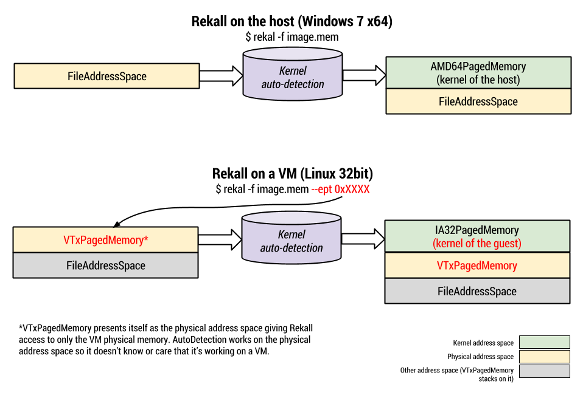
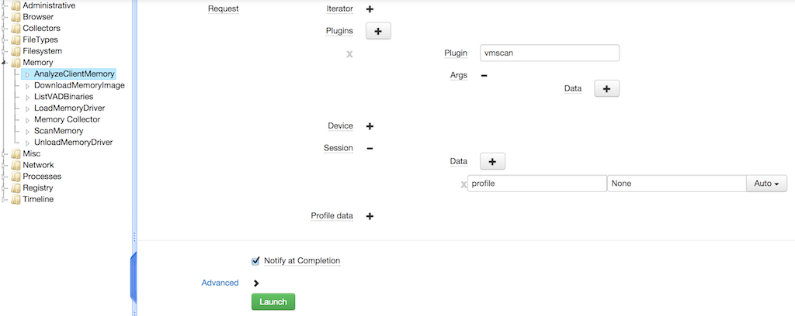

---
tags:
  - Tools
  - Memory Analysis
  - Virtualization
---
> This article was copied from the Rekall Forensics blog, posted by
> Jordi Sanchez on 2014-10-04.
> Copied with permission for historical preservation.

## VM discovery and introspection with Rekall

*Monday, 9 AM*. Your SIEM alerts you of packets matching a Gh0stpdf
signature coming from a web designer's OS X machine.

Network activity for the host
shows HTTP requests with a Chrome on Windows user-agent. The machine has
Virtualbox installed and running.

*An hour later*, another alert fires for a known-bad URL hit from one of
your customers' Windows VMs on your OpenStack Compute/KVM deployment.

It looks like it's gonna be a long week.

These are two scenarios that would most likely require disk forensics to
triage and analyze since the VMs are out of your control and none of
your remote forensics tools are installed. Lots of time wasted just to
determine if they are false positives.

* What if you could inspect the VM and launch your Rekall plugin of choice
  on it? **With Rekall you can!**
* “I want to do it remotely, live!”
  Try **GRR (now with Rekall integration)** \*wink\*.
* What if you prefer to use your tool of choice instead of Rekall to
  analyze the VM memory? **Rekall helps you!**

Rekall is the first memory framework to support transparent
introspection of VMs with any host-guest OS combination and is
independent of the virtualization software layer, as long as it's
employing [Intel Virtualization extensions with Extended Page
Tables](http://en.wikipedia.org/wiki/X86_virtualization) which is
present in all modern Intel processors and the default for many
virtualization packages.

Together with [GRR](https://github.com/google/grr), Rekall allows you
to discover virtual machines running in your fleet and analyze their
memory, **live** requiring only access to the host. No interaction is
done with the virtualization layer.

In this article I'll explain how Intel's hardware-assisted
virtualization works, how Rekall emulates this technology to allow
transparent introspection of guest VMs from just the host memory and the
challenges of its implementation.

If you just want to know how detect and analyze VMs right away,
see [the_vmscan_plugin](rekall_vm_discovery_and_introspection.md#the-vmscan-plugin).
For a complete feature list,
see [feature_list](rekall_vm_discovery_and_introspection.md#feature-list).

## Short introduction to virtualization

Virtualization has become a pervasive technology. From cloud
infrastructure and malware analysis sandboxes, to consumer-grade
virtualization products that allow you to run your Operating System of
choice, virtualization is everywhere.

Virtualization at its core separates software from hardware in a way
that allows multiple operating systems to share the same resources, at
the same time. Some resources such as memory are split so that each
virtual machine has access to a portion of it, while others like your
network card are shared. It is a not a new concept and several different
techniques have been used for a long time to provide such capabilities.

Virtualization can be done in multiple ways:

* *Full emulation* (like in Bochs) allows for complete control over the
  running code at the expense of speed. Each and every CPU instruction of
  the guest OS is trapped and its effect on the state of the virtual
  machine is emulated.
* *Binary translation*, on the other hand, takes blocks of instructions
  and translates them to a different set of instructions. Then they are
  executed natively in the processor. This technique can be used to apply
  optimizations, run code compiled for a CPU in a different CPU or to
  facilitate debugging by introducing traps in the code.
* *Paravirtualization*, instead, requires the guest kernel to be modified
  so that it knows that it's running virtualized and executes code
  accordingly. It usually provides better performance than either Full
  emulation or Binary translation but is only supported by some operating
  systems (i.e Linux-XEN).
* *Hardware-assisted*. Where the CPU provides functionality to aid or
  speed up virtualization tasks such as running the guest code, quick page
  translations or device access control.

Because most operating systems base process isolation on paging and
page-level protections, virtualization solutions must also virtualize
paged memory. The main problem with this is that virtualizing paged
memory adds noticeable overhead.

By 2004, AMD realized the need for hardware-assisted virtualization and
announced their virtualization solution AMD-V (codenamed Pacifica). It
wasn't until May 2006 that they commercialized the first Athlon 64
processors with AMD-V support. To improve performance of page
translations, AMD introduced a technology called RVI (Rapid
Virtualization Indexing) in September 2007.

Intel also realized the problem and introduced VT-x (codename
Vanderpool) in November 2005 along with processors that had support for
it. However, it wasn't until November 2008 that Intel introduced their
response to AMD's RVI, called EPT (Extended Page Tables) in their 2nd
generation processors.

Both AMD-V and VT-x introduce support for running code for the VM
directly on the CPU, while offering at least the same level of
protection as native code. Both RVI and EPT attempt to solve or mitigate
some of the page translation overhead by allowing the processor to
perform all the page translations for the VM all the way up to the
physical memory. Both hardware-assisted solutions are remarkably
similar.

Nowadays, most virtualization solutions use hardware-assisted
virtualization when available and resort to a mix of the aforementioned
techniques when it's unavailable. Some solutions implement a backdoor of
sorts in the kernel that is allowed direct communication from the guest
to the host (an example of which is VMWare Tools).

Rekall supports detection and transparent emulation of Intel VT-x with
EPT translation since January 2014. We support any host and guest OS,
both 32 and 64bits.

> **Warning:** Because EPT translation was introduced after Penryn
> processors were released, Rekall can find VMs on Penryn processors but
> not inspect them at this time. Some Nehalem processors also didn't have
> support for EPT translation. You can
> use `http://ark.intel.com/products/virtualizationtechnology` to check if
> the processor of the machine you're trying to analyze has EPT support.
> Most machines bought in the last 5 years should be supported.

## x86 hardware-assisted virtualization

The central piece of any virtualization technology is the hypervisor.
This component sets up the virtual machine and controls its execution.

In x86 hardware-assisted virtualization the CPU is in charge of actually
running the VM (that is, it executes its code), but the hypervisor code
gets control every now and then. In VT-x you tell the CPU to pause the
VM execution and return control to the hypervisor under certain
circumstances.



Figure 1. High-level view of processor CPL transitions with VT-x
enabled.

In order to set up the VM and start/resume it, VM-specific x86
instructions are used (`VMREAD`, `VMWRITE`, `VMPTRLD`, `VMRUN`). Only
code running with CPL 0 (ring0) is allowed to execute these
instructions. This is why virtualization software use kernel drivers.
These kernel components are the actual hypervisor and pretty much all
virtualization products provide some sort of UI or API to communicate
with the hypervisor and request operations like pausing or resuming a
VM.

One key piece the hypervisor has to set up before asking the processor
to run a VM is what Intel calls a Virtual Machine Control Structure
(VMCS). This structure holds all the state of the VM and contains
information such as:

* The conditions under which the CPU should stop executing the VM and
  return to the hypervisor; this is stored in control fields.
* State information about the guest VM. Values of important registers like
  CR0, CR3, EAX, EBX or EIP. These are needed to run or resume the VM.
* State information about the hypervisor. To know how the processor can
  get back to executing it when one of these conditions happen.

## VT-x: Virtualized memory and EPT translation

Let's talk about virtual memory for a second. When using paged memory
any memory references require performing a virtual to physical page
translation. This means taking the address that was requested and
finding the location in memory where data is actually stored. This
process requires traversing page tables and this usually requires 3 to 4
memory lookups. The processor has a cache called the Translation
Lookaside Buffer (TLB) whose job is to improve these lookups.



Figure 2. High-level view of address translation in a real machine.

One of the main premises behind full virtualization is that software
should run as is and in an environment virtually indistinguishable from
a real machine.

This means that a software-based full virtualization solution must
emulate paging when the operating system it runs requests it. And, at
the same time, a full-virtualization solution must separate the memory
of two running VMs from each other. The way this is solved is by having
two page tables.

* One that maps a VM's physical memory. These page tables translate
  addresses of the VM's "physical memory" to the actual physical memory of
  the host.
* One that maps the guest operating system virtual to physical
  translation.

This means that a software-only full-virtualization solution has to
perform at least 2 sets of traversals of page tables before resolving an
address. This requires a lot of memory accesses for each resolution
because it has to traverse the physical-to-physical set of page tables
on every step of the virtual-to-physical resolution.

This is the fundamental problem that Extended Page Tables (EPT) tries to
optimize. The processor is in charge of maintaining and optimizing both
page mappings. The guest-physical-to-host-physical page tables are
pointed to by the EPT Pointer (`EPTP`), which is a value stored in the
VMCS region. The guest-virtual-to-guest-physical page tables are pointed
to by the `GUEST_CR3` field of the VMCS region.



Figure 3. Address translation in a virtual machine. Rekall emulates the
CR3 and EPT page translation step.

## VM introspection

Rekall requires having access to the physical memory of a machine to
perform its magic of [OS and memory layout autodetection](rekall_profile_repository_and_profile_auto_selection.md).

We just explained that the Extended Page Tables perform a mapping
between guest physical and host physical memory, so the only thing we
need to do is find them. This means finding the value of the EPT
pointer, which resides in the VMCS.

There's two caveats, though.

* A VMCS region can be anywhere in memory and no preset locations or
  registers hold references to it.
* Most of the layout of the VMCS region is an implementation detail and is
  undocumented.

Let's try to solve the first problem: finding VMCSs in memory.

### Detecting a running VM: Discovering VMCS regions in memory

Since we don't have pointers to the VMCS regions that may be in memory,
we'll have to try creating signatures.

From the Intel manual we know that the region has the following
properties:

* It's stored in a 4KB page.
* The first 4-bytes have to match the processor revision ID.
* The 4 following bytes are the `VMX-abort indicator`. This field will be
  0 unless an error occurred.
* The rest is reserved for VMCS fields and is an implementation detail.



Figure 4. The VMCS layout as described by Intel.

With just this information we already have a signature. The problem is
that this is a very weak signature and would give thousands of hits on
any memory image. We need a way to refine it. And this means we need to
find fields in the VMCS whose values we can rely on or that we can
validate.

*Mariano Graziano, Andrea Lanzi and Davide
Balzarotti* [madhmf](rekall_vm_discovery_and_introspection.md#madhmf) did
a great study of this issue and identified fields in a VMCS that are
essential to it running. They found that several of the fields have
fixed values and that changing them at runtime would make the VM to stop
functioning. We could extend our signature to include them, except that
we don't know yet where in the VMCS region these fields are.

Time to solve the second problem.

> **Tip:** *Mariano Graziano* also released a proof of concept
> implementation of his research
> on <https://www.s3.eurecom.fr/tools/actaeon/>, with support for 32-bit
> Windows guests and 3 microarchitectures (Penryn, Nehalem and Sandy
> Bridge).

### Detecting a running VM: Mapping the layout of the VMCS region

So we don't know what the layout of the VMCS region is but we have
control over it:

* We can decide its initial state
* We can ask the processor to read (`VMREAD`) and write to it (`VMWRITE`).
* We can see the effect each operation has on the 4KB page.

*Graziano et al* [madhmf](rekall_vm_discovery_and_introspection.md#madhmf) devised
the following method:

1. Start with a blank (zero'd out) memory region.
2. Instruct the CPU to use this region.
3. `VMWRITE` to a single field with a needle value.
4. Find the needle in the memory region and record its offset.
5. Repeat this step for every field.

This works, except there's some fields in the VMCS that are read-only.
For example, fields used for error-reporting that you cannot write to.

So they devised a second method. Not all fields are writable but all of
them are readable. Instead:

1. Prefill the memory region with values that represent the offset within
   the region a value is located.
2. Instruct the CPU to use this region.
3. `VMREAD` a single field.
4. The value should contain its own offset within the region.
5. Repeat for every field.



Figure 5. The VMCS layout discovery process.

This approach mostly works but there's some caveats.

* It assumes all fields are aligned to a 2 or 4 byte boundary. This
  appears to be the case.
* Some fields don't become active unless a relevant flag is active in
  other fields.
* `VMREAD` behaviour for inactive fields isn't consistent, sometimes
  properly reporting a failure, sometimes returning bogus data.

But suffice to say this technique discovers almost all of the fields,
and certainly the relevant ones for our goals.

One important discovery they did is that the layout changes only between
microarchitectures. This means all Nehalem processors share the same
layout, which is different from Westmere's layout. So, in theory, we
only need as many signatures as microarchitectures support VT-x.

> **Note:** We've seen that Ivy Bridge and Sandy Bridge actually share the
> same layout despite officially being two different microarchitectures.
> They even have the same revision ID.

Luckily for us, the revision ID field in the VMCS region can be used to
identify the microarchitecture, so we can select the right offsets when
we start validating potential VMCS hits with intelligent signatures.

To automate the layout discovery task in a convenient way I wrote
a [Linux kernel module](https://github.com/google/rekall/tree/master/tools/linux/vmcs_layout)
called `vmcs_layout` that dumps via syslog the VMCS layout of the CPU in the profile format of
Rekall.

Currently, Rekall has in its repository profiles for all current Intel
microarchitectures that support virtualization: Penryn, Nehalem,
Westmere, Sandybridge, Ivy Bridge and Haswell.

#### Haswell is interesting

While working on `vmcs_layout`, I found that this exact approach
doesn't work on processors with the Haswell microarchitecture. No matter
how many `VMWRITEs` you do, you won't see the value you wrote in memory
right away. Same thing for `VMREAD`. If you prefill the page, ask the
processor to use that page as a VMCS region and then issue
a `VMREAD` you will get zeros back. Why?

Well, the the Intel manual explicitly says:

A logical processor may maintain a number of VMCSs that are active. The
processor may optimize VMX operation by maintaining the state of an
active VMCS **in memory, on the processor, or both**. At any given time,
at most one of the active VMCSs is the current VMCS.

* [Intel® 64 and IA-32 Architectures - Software Developer's Manual - Volume
3](http://www.intel.com/content/dam/www/public/us/en/documents/manuals/64-ia-32-architectures-software-developer-system-programming-manual-325384.pdf)

As far as I've seen, Haswell processors are the first ones to implement
internal storage for VMCSs. So, in order to discover the layout, I
implemented a simple trick in `vmcs_layout`.

`vmcs_layout` asks the processor to keep loading fake VMCSs until we
overflow its storage. Then the processor is forced to flush to memory
one of the previous VMCSs to make space for a new one. When this
happens, any new VMCS that we ask the processor to load will forcefully
be read from memory because it doesn't know about it and cannot know if
it holds previous state unless it reads it from memory. So we then
proceed as explained earlier. We prefill it with values and discover the
fields as usual.

Does this mean we may not find Haswell VMCS regions in memory? In my
tests, I've been able to locate them in memory just fine. It's likely
when running `VMRUN` to start a VM or when transitioning back to the
hypervisor, the processor flushes it to memory. I haven't determined
what exactly causes this to happen. Please, let us know if you find
problems like virtual machines not being detected or being detected with
the wrong number of cores.

### Detecting a running VM: One last thing

Once we know how to identify candidate VMCS regions in memory and we
build an intelligent scanner that checks for known values of different
fields and the right offsets based on the microarchitecture of the VMCS
region, we are a step closer to actually finding real, valid VMCS.

What are we missing, then? Well, we may still have false positives. Or
we may have imaged a host shortly after a VM has been stopped or paused
and the VMCS may be in memory but the physical memory of the VM freed
and reused. We need some additional validation.

When the processor stops executing a VM and wants to returns its
execution to the hypervisor it has to restore the whole processor state.
This not only means registers like EAX and ECX, but the paging
configuration as well (page table location and mode: IA32, PAE or
AMD64). This state is stored in the VMCS region as well.

In order to further validate a candidate region we resort to traversing
the page tables of the host as stated by the VMCS and we try to see if
the VMCS region itself is mapped in it. This is because the hypervisor
must have it mapped in its address space, or else it wouldn't be able to
control execution of the VM.

This step also makes sure that the host address space is well-formed. If
it's a false positive, it's unlikely it will point to data that can be
interpreted as a page table. So this check actually has an acceptable
performance for false positives.

At this point, we know we have a valid VMCS and we are now ready to use
the EPT pointer to access the guest physical memory. This means we can
now have access to the VM's physical memory in a **generic way**!

All this scanning and validating is done by the `vmscan` plugin. See an
example invocation for a host with 3 VMs running on 2 different
hypervisors:

```bash
$ python rekall/rekal.py -f ~/memory_images/Windows7_VMware(VM,VM)_VBox(VM).ram vmscan
Virtual machines                                     Type    Valid EPT
------------------------------------ -------------------- -------- ---
VM #0 [2 vCORE, I386]                                  VM     True 0xDEB1B01E
**************************************************
VM #1 [2 vCORE, AMD64]                                 VM     True 0x14128D01E
**************************************************
VM #2 [4 vCORE, AMD64]                                 VM     True 0x17725001E
**************************************************
```

### Introspecting a running VM

Once you know the EPT value you can feed it to Rekall with
the `--ept` parameter.

What this does is place `VTxPagedMemory` address space as
the `session.physical_address_space`. `VTxPagedMemory` stacks on top
of the memory image address space (the one that can read from the file
format of the memory image). Any read requests done
on `VTxPagedMemory` for a given address will first translate the address
via the Extended Page Tables and then read from the underlying address
space at the translated address.

So, normally, if you're running a plugin against a raw memory image,
when it requests to read data at the physical address 0, we'll read at
offset 0 from the file.

However, when you specify --ept, `VTxPagedMemory` will instead receive
this request, translate address 0 via EPT (for example: 38684000) and
return data from the underlying address space.

Because of how address spaces are designed, neither rekall or the
plugins care that they are not actually reading from the physical image,
but from a view into it (the VM memory).

* Kernel autodetection, for example, reads from the physical address space
 and finds and sets the `session.kernel_address_space` for it. When
 using the `--ept` parameter, it will locate the guest kernel instead.
* Plugins will operate on the guest automatically because they don't even
 know they're not seeing the host memory.



Figure 6. Address space stacking and how `VTxPagedMemory` is transparent
to any plugin.

> **Tip:** You can read more about address spaces in the Rekall developers documentation.

### Multi-core VMs

Up to this point we know how to properly find and validate VMCS regions
in memory. One more thing I must explain to understand Rekall's output
is what happens with multi-core VMs.

In VT-x a VMCS region is only used by 1 core at a time. This means that
you can run more than one VM at a time and that you can provide a VM
with more than one core. Nowadays, actually, most processors are
multi-core and most virtualization software can take advantage of this.
Which means we'll often find VMs with more than one core.

What this means for us is that if we have a VM running with 4 "virtual
cores", we will find 4 valid VMCS in memory. They will all most likely
point to the same set of Extended Page Tables, as they represent the
physical memory and the same holds true in real machines (1 physical
memory, N cores).

We wanted Rekall to provide a VM-oriented interface, so as you may have
noticed we group them together in the output giving you the number of
VMCS detected as the number of vCOREs of the VM.

### Nested virtualization

Rekall also supports a limited subset of nested virtualization (KVM,
VMWare) setups but we'll leave this for another post.

## The vmscan plugin

Use the `vmscan` plugin, which will find all VMCS regions in memory and
group them together logically as virtual machines.

In this test image, the host is Windows 7 SP1 x64. It's running 2 VMs
inside VMWare (Linux and Windows XP SP2 32bits) and 1 Windows 7 x64 VM
inside VirtualBox.

```bash
$ python rekall/rekal.py -f ~/memory_images/Windows7_VMware(VM+VM,VM)_VBox(VM).ram vmscan
Virtual machines                                     Type    Valid EPT
------------------------------------ -------------------- -------- ---
VM #0 [2 vCORE, I386]                                  VM     True 0xDEB1B01E   (1)
**************************************************
VM #1 [2 vCORE, AMD64]                                 VM     True 0x14128D01E  (2)
**************************************************
VM #2 [4 vCORE, AMD64]                                 VM     True 0x17725001E  (3)
**************************************************
```

1. Windows XP SP2 32bits running on VirtualBox.
2. Windows 7 X64 running on VMWare.
3. 64-bit Linux VM running on VMWare.

Now you can run plugins on any VM by using the --ept parameter on the
command line.

## How to run a rekall plugin on a VM

To run a rekall plugin on a VM that `vmscan` found, invoke rekall as you
normally would, but add `--ept EPT_VALUE` as a parameter.

We'll run pslist on the XP SP3 32bit VM first.

```bash
$ python rekall/rekal.py -f ~/memory_images/Windows7_VMware(VM+VM,VM)_VBox(VM).ram --ept 0xDEB1B01E pslist
Offset (V) Name                    PID   PPID   Thds     Hnds   Sess  Wow64 Start                    Exit
---------- -------------------- ------ ------ ------ -------- ------ ------ ------------------------ ------------------------
0x823c6a00 System                    4      0     54      241 ------  False -                        -
0x82018598 wuauclt.exe             380   1000      3      106      0  False 2014-03-04 15:58:48+0000 -
0x821f1020 smss.exe                508      4      3       19 ------  False 2014-03-04 15:56:32+0000 -
0x82199da0 csrss.exe               572    508     11      298      0  False 2014-03-04 15:56:33+0000 -
0x821a3020 winlogon.exe            596    508     19      513      0  False 2014-03-04 15:56:33+0000 -
0x8219c6d0 services.exe            640    596     15      243      0  False 2014-03-04 15:56:33+0000 -
0x8225d4c0 lsass.exe               652    596     18      336      0  False 2014-03-04 15:56:33+0000 -
0x8222b020 svchost.exe             832    640     16      191      0  False 2014-03-04 15:56:34+0000 -
0x82212c20 alg.exe                 864    640      6      107      0  False 2014-03-04 15:56:50+0000 -
0x8218e020 svchost.exe             900    640      8      238      0  False 2014-03-04 15:56:34+0000 -
0x82222748 wscntfy.exe             968   1000      1       26      0  False 2014-03-04 15:56:50+0000 -
0x821a73c8 svchost.exe            1000    640     56     1435      0  False 2014-03-04 15:56:34+0000 -
0x820a5020 svchost.exe            1092    640      4       76      0  False 2014-03-04 15:56:34+0000 -
0x821afda0 svchost.exe            1196    640     13      192      0  False 2014-03-04 15:56:34+0000 -
0x82094020 spoolsv.exe            1344    640     10      107      0  False 2014-03-04 15:56:35+0000 -
0x81f13bc0 cmd.exe                1376   1600      1       30      0  False 2014-03-04 17:14:24+0000 -
0x8206b020 explorer.exe           1600   1544     11      302      0  False 2014-03-04 15:56:36+0000 -
```

And now we'll try doing a pslist on the 64-bit Ubuntu.

```bash
$ python rekall/rekal.py -f ~/memory_images/Windows7_VMware(VM+VM,VM)_VBox(VM).ram --ept 0x14128D01E,0x3D67F01E pslist
Offset (V)           Name          PID    PPID   UID    GID        DTB              Start Time
-------------- -------------------- ------ ------ ------ ------ -------------- ------------------------
...
0x88003b8d1770 dbus-daemon             966 -         102    106 0x00003c244000                        -
0x88003c6bc650 systemd-logind         1031 -           0      0 0x00003c18a000                        -
0x880036978000 getty                  1042 -      -      -      0x000039b9d000                        -
0x88003697aee0 getty                  1049 -      -      -      -                                     -
0x880036bcddc0 getty                  1055 -           0      0 -                                     -
0x88003c310000 getty                  1056 -      -      -      0x00003c7af000                        -
0x88003b629770 getty                  1058 -      -      -      0x00003c6b6000                        -
0x88003b82aee0 sshd                   1074 -      -      -      0x00003c1b9000                        -
0x880039954650 acpid                  1081 -      -      -      -                                     -
0x880035cd1770 irqbalance             1103 -           0      0 0x000035d64000                        -
0x880036869770 cron                   1131 -           0      0 0x00003c246000                        -
0x8800369baee0 atd                    1132 -      -      -      0x00003693d000                        -
0x88003b9f4650 login                  1160 -           0   1000 0x00003caf2000                        -
0x88003c311770 whoopsie               1176 -      -      -      -                                     -
0x88003b8b8000 libvirtd               1199 -           0      0 0x00003c0a4000                        -
0x88003686c650 kauditd                1290      2      0      0 -                                     -
0x88003b30ddc0 bash                   1335   1160 -      -      0x00003b60d000                        -
0x88003b8bc650 dnsmasq                1486 -         108     30 -                                     -
...
```

### Live analysis

All of this works live, too!

Open a root/administrator console and use any of Rekall's physical memory
access drivers. Then try
pointing rekall against "`\\.\pmem`" on Windows or "`/dev/pmem`" on
Linux while running a VM and Rekall will detect it for you. Remember
that you need to have VT-x extensions active (it's usually a BIOS
setting).

```cmd
C:\winpmem-1.4> winpmem_1.4.exe -l
Driver Unloaded.
Loaded Driver C:\Users\Administrator\AppData\Local\Temp\pmeF23H.tmp.
Setting acquisition mode to 3
CR3: 0x0000185000
 3 memory ranges:
Start 0x00001000 - Length 0x0009E000
Start 0x00100000 - Length 0x3FDF0000
Start 0x3FF00000 - Length 0x00100000

C:\winpmem-1.4> rekal -f \\.\pmem vmscan
```

### Remote live analysis with GRR

Because GRR now ships with Rekall, you
can remotely discover VMs running in a machine. Or your whole fleet if
you run a GRR hunt.

Set up an `AnalyzeClientMemory` flow and use `vmscan` as the plugin name
and select `profile` = `None` in the session data.



Figure 7. Setting up a Rekall memory analysis flow in GRR.

Once you get the results, you can run additional plugins against a VM by
adding the `ept` = `0xVALUE_FOUND` as a parameter.

> **Warning:** At this time, we don't support running hunts for rekall
> plugins against the host and all VMs found in any machine. Only against
> the host. We want to extend this functionality in the future so that it
> can be automated.

### The Rekall shell and VMs

You can also interact with VMs from the shell via
the `get_vms()` method of the `vmscan` plugin. It returns a list
of `[VirtualMachine](http://www.rekall-forensic.com/epydocs/rekall.plugins.hypervisors.VirtualMachine-class.html)`:

```bash
$ python rekall/rekal.py -f ~/memory_images/Windows7_VMware(VM+VM,VM)_VBox(VM).ram
 ----------------------------------------------------------------------------
 The Rekall Memory Forensic framework 1.0rc11.

 "We can remember it for you wholesale!"

 This program is free software; you can redistribute it and/or modify it under
 the terms of the GNU General Public License.

 Type 'help' to get started.
 ----------------------------------------------------------------------------
Windows7_VMware(VM+VM,VM)_VBox(VM).ram 00:03:28> vmscan_plugin = session.plugins.vmscan(session=session)
Windows7_VMware(VM+VM,VM)_VBox(VM).ram 00:04:17> vms = vmscan_plugin.get_vms()
Windows7_VMware(VM+VM,VM)_VBox(VM).ram 00:05:18> for vm in vms: print vm
VirtualMachine(Hypervisor=0XFFFFF8800E8718A0, EPT=0XDEB1B01E)
VirtualMachine(Hypervisor=0XFFFFFFFFFC2AE0FA, EPT=0X14128D01E)
VirtualMachine(Hypervisor=0XFFFFFFFFFC2AE0FA, EPT=0X17725001E)
VirtualMachine(Hypervisor=0X0, EPT=0X329D8F8)
```

**Caution!** VMs returned via `get_vms()` are all that were found, not just the valid ones. Use
the `is_valid` property to check if a VM was determined to be valid. Invalid VMs are reported via
the API to aid in debugging.

```text
> vmscan_plugin = session.plugins.vmscan()
> vms = list(vmscan_plugin.get_vms())
> vms[0].is_valid True
> vms[1].is_valid False
```

You can run any plugin on a VM by using the `RunPlugin()` method of `VirtualMachine`.

```cmd
Windows7_VMware(VM+VM,VM)_VBox(VM).ram 00:06:41> vms[0].RunPlugin("pslist")
Offset (V) Name                    PID   PPID   Thds     Hnds   Sess  Wow64 Start                    Exit
---------- -------------------- ------ ------ ------ -------- ------ ------ ------------------------ ------------------------
0x823c6a00 System                    4      0     54      241 ------  False -                        -
0x82018598 wuauclt.exe             380   1000      3      106      0  False 2014-03-04 15:58:48+0000 -
0x821f1020 smss.exe                508      4      3       19 ------  False 2014-03-04 15:56:32+0000 -
0x82199da0 csrss.exe               572    508     11      298      0  False 2014-03-04 15:56:33+0000 -
0x821a3020 winlogon.exe            596    508     19      513      0  False 2014-03-04 15:56:33+0000 -
0x8219c6d0 services.exe            640    596     15      243      0  False 2014-03-04 15:56:33+0000 -
0x8225d4c0 lsass.exe               652    596     18      336      0  False 2014-03-04 15:56:33+0000 -
0x8222b020 svchost.exe             832    640     16      191      0  False 2014-03-04 15:56:34+0000 -
0x82212c20 alg.exe                 864    640      6      107      0  False 2014-03-04 15:56:50+0000 -
0x8218e020 svchost.exe             900    640      8      238      0  False 2014-03-04 15:56:34+0000 -
0x82222748 wscntfy.exe             968   1000      1       26      0  False 2014-03-04 15:56:50+0000 -
0x821a73c8 svchost.exe            1000    640     56     1435      0  False 2014-03-04 15:56:34+0000 -
0x820a5020 svchost.exe            1092    640      4       76      0  False 2014-03-04 15:56:34+0000 -
0x821afda0 svchost.exe            1196    640     13      192      0  False 2014-03-04 15:56:34+0000 -
0x82094020 spoolsv.exe            1344    640     10      107      0  False 2014-03-04 15:56:35+0000 -
0x81f13bc0 cmd.exe                1376   1600      1       30      0  False 2014-03-04 17:14:24+0000 -
0x8206b020 explorer.exe           1600   1544     11      302      0  False 2014-03-04 15:56:36+0000 -
                                          Out<4>
```

### Use other tools: Export raw memory of a VM

If you'd like to analyze a virtual machine in another tool that doesn't
support VM introspection, you can export the VM memory instead as a raw
image!

Again, using the EPT parameter of the VM you want to analyze, simply run

```bash
python rekall/rekal.py -f ${HOST_IMAGE} --ept ${EPT_VALUE} imagecopy -O guest_vm.raw
```

And guest_vm.raw will contain the physical memory in raw format. Now
you can load this image in your tool of choice :)

## Rekall virtualization feature list

**Supported:**

* VM detection on any virtualization platform that uses Intel VT-x with
  EPT (requires access to the host physical memory).

* All Type 2 (hosted) hypervisors (VMWare Workstation/Server, Virtualbox,
  KVM, QEMU-KVM, Parallels, ...).
* Generic approach to VM introspection.

* **Any guest OS**, 32 and 64 bits.
* All current Intel microarchitectures
* **Live introspection** on Windows, Linux and OS X hosts via the PMEM
  memory acquisition drivers.
* **Remote live VM detection and introspection** with GRR.
* Allows 3rd party tools to analyze the VM memory.

**Planned:**

* AMD-V support.
* \[Pending testing] Detection and introspection of VMs created from Type 1 (bare-metal)
  hypervisors provided a full physical memory capture has been acquired.

**Unsupported:**

* Live introspection on bare-metal hypervisors without direct physical
  memory access (VMWare ESXi, vSphere, Hyper-V(?), etc.)

## Future improvements

We want `vmscan` to provide better output. In particular, we'd also like
to provide the OS or profile that matches a VM and the hostname.

We'd also like to implement support for AMD-V so that people running AMD
processors can benefit from VM inspection in Rekall.

We're thinking of something along these lines.

```bash
$ python rekall/rekal.py -f ~/memory_images/Windows7_VMware(VM+VM,VM)_VBox(VM).ram vmscan2
Virtual machines                                  Type/OS    Valid Hostname            EPT
------------------------------------ -------------------- -------- ------------------- ----------
Hypervisor #0: 0xFC78230                           VMWARE     True
  VM #0 [2 vCORE, I386]                      Ubuntu 13.10     True localhost.local     0xDEB1B01E
  VM #1 [2 vCORE, AMD64]                 Windows 6.0.6000     True VM-TEST-PC          0x14128D01E
    Hypervisor #0: 0x6789090                       VMWARE     True
      VM #0 [2 vCORE, I386+PAE]          Linux 3.8-12-owl     True openwall            0x14128D01E,0x3D67F01E
**************************************************
Hypervisor #1: 0x2345678                       VIRTUALBOX
  VM #2 [4 vCORE, AMD64]                 Windows 5.1.2600     True VBOX-VM             0x17725001E
**************************************************
```

Additionally, we'd like to better integrate all this functionality into
GRR so you can discover and introspect VMs running in your environment
with a couple of clicks.

## External Links

* [Hypervisor Memory Forensics](http://www.s3.eurecom.fr/docs/raid13_graziano.pdf),
  by Mariano Graziano, Andrea Lanzi and Davide Balzarotti, October 2013
