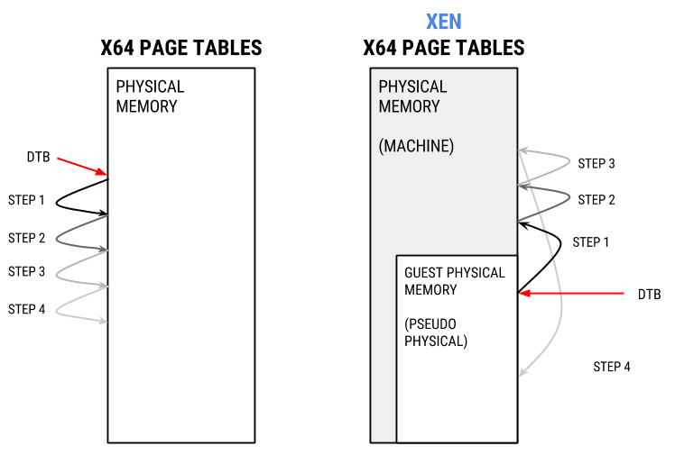

---
tags:
  - Tools
  - Memory Analysis
  - Virtualization
---
> This article was copied from the Rekall Forensics blog, posted by
> Jordi Sanchez on 2015-08-31.
> Copied with permission for historical preservation.

If you've ever taken a memory image of a Linux virtual machine that's
running under XEN in *paravirtualization mode* and you've tried to
analyze it you'll have noticed most of your plugins don't work (if any).

```text
[1] XEN-testmachine-PVguest.mem 14:20:42> pslist

ERROR:rekall.1:No profiles match this image. Try specifying manually.

---------------------------------------------------------------------------

RuntimeError                              Traceback (most recent call last)

[...]

RuntimeError: Unable to find a valid profile for this image. Try using -v for more details.
```

The reason is that XEN's page tables are funky. XEN uses a technique
known as *direct mapping* which significantly differs from how memory
management is done in many other virtualization solutions.

Per <https://wiki.xenproject.org/wiki/X86_Paravirtualised_Memory_Management#Direct_Paging>:

> "In order to virtualise the memory subsystem all hypervisors introduce
> an additional level of abstraction between what the guest sees as
> physical memory (often called pseudo-physical in Xen) and the underlying
> memory of the machine (machine addresses in Xen). This is usually done
> through the introduction of a Physical to Machine (P2M) mapping.
> Typically this would be maintained within the hypervisor and hidden from
> the guest Operating System through techniques such as the use of Shadow
> Page Tables."

So instead of trapping every single memory access from the guest and
having the hypervisor do an additional translation, XEN uses a different
model.

Per <https://wiki.xenproject.org/wiki/X86_Paravirtualised_Memory_Management#Direct_Paging>:

> "The Xen paravirtualised MMU model instead requires that the guest be
> aware of the P2M mapping and be modified such that instead of writing
> page table entries mapping virtual addresses to the (pseudo-)physical
> address space it would instead write entries mapping virtual addresses
> directly to the machine address space by mapping performing the mapping
> from pseudo physical to machine addresses itself using the P2M as it
> writes its page tables. This technique is known in Xen as direct
> paging."

What *direct mapping* means is that instead of having page tables where
each entry points to physical memory of the guest, XEN's page tables
point to the physical memory of the host.

But, why does XEN do this? The answer is performance.

Because the guest kernel knows it's virtualized and can cooperate with
the hypervisor, XEN can afford cheating in virtualization. Knowing the
presence of and cooperating with the hypervisor is one of the strong
points of paravirtualization. It requires modification of the guest
kernel but provides opportunities for speed improvements.

The guest kernel is allowed to know and use the host's physical memory
for page table upkeeping. In exchange, it has to perform the upkeep of
the page tables in cooperation with the host. This way no heavy
translation mechanism like
[shadow pages tables](https://en.wikipedia.org/wiki/Shadow_table) must
be used.

However, you can imagine that tinkering with the hosts's memory may
allow a hostile kernel to subvert the host. XEN keeps the guest kernel
in control because it runs in ring-3 and it is not allowed to directly
write into the host memory. Instead, it must issue a hypercall, a call
to the hypervisor, whenever it needs to update them. The hypervisor
performs sanity checks to make sure the guest kernel request to modify
page tables is not attempting to subvert the hypervisor itself or other
VMs.

Throughout the article we'll be using XEN's terminology:

* XEN refers to the physical memory of the host as **machine memory**.
* The physical memory of the guest is called "**pseudo-physical**" or
 simply "**physical**" memory. To prevent confusion, we'll refer to guest
 physical memory as *(pseudo-)physical*.

## XEN's direct mapping vs normal mapping

Let's deep dive into *direct mapping*. We'll compare how the page tables
look in AMD64 vs how they look in a XEN guest. The host machine is 64
bits, runs the 3.13 kernel and has 32GB of ram, the guest has 256MB and
runs kernel 3.2. All examples will be in the Rekall console.

Let's start by using a kernel symbol on a real machine and look how the
MMU would translate it. We've picked the linux_proc_banner symbol,
which is a kernel symbol that points to a format string (%s version %s)
for the kernel version. It is defined at
init/version.c in the kernel sources (Linux 3.19).
It's a symbol present in all kernels and is what helps build the
string in /proc/version.

To validate the expected address, we'll use the [PAGE_OFFSET trick](https://linux-mm.org/VirtualMemory):

```text
[1] kcore 13:03:23> hex(session.profile.get_constant("linux_proc_banner"))

             Out<6> '0xffffffff81800040L'

[1] kcore 13:03:46> hex(session.profile.get_constant("linux_proc_banner") - session.profile.GetPageOffset())

             Out<8> '0x1800040L'
```

linux_proc_banner is in 0xffffffff81800040 which corresponds to
physical address 0x1800040L.

Despite this trick, while the system is running any virtual address
translation is still done by the MMU. Let's use the vtop plugin to show
the virtual address resolution just like the MMU would do. vtop outputs
debug information about every step of the 2 or 3 level address
translation:

```text
[1] kcore 13:03:50> vtop(0xffffffff81800040L)

*************** 0xffffffff81800040 ***************

Virtual 0xffffffff81800040 Page Directory 0x1c0e000  (the DTB)

pml4e@ 0x1c0eff8 = 0x1c11067                         (1st step translation)

pdpte@ 0x1c11ff0 = 0x1c12063                         (2nd step translation)

pde@ 0x1c12060 = 0x80000000018001e1                  (3rd step translation)

Large page mapped

Physical Address 0x1800040                           (4th step, actual physaddr)

Deriving physical address from runtime physical address space:

Physical Address 0x1800040
```

vtop shows us that the physical address indeed 0x18000040 as we
predicted earlier. And also that each of the different steps of the
translation are within physical memory (0x1c1XXXX is around 29M).

Note that the value of the pde in this case (0x80000000018001e1) is not
an actual physical address. The physical address part of the pde value
are only the following bytes 0x800000000**1800**1e1.

## Page tables in XEN

So how does this look in a XEN guest? We're going to do all this for a
3.2 XEN kernel with a Rekall version without XEN support (I disabled it
on purpose). For starters, let's list the available physical memory
ranges:

```text
[1] XEN-testmachine-PVguest.mem 11:10:09> for (pa, va, sz) in session.physical_address_space.get_address_ranges():

        print "%s - %s" % (hex(pa), hex(pa+sz))

                                      |.>

0x0 - 0x10000000
```

If we are to inspect this image, DTB validation will most likely fail,
but we can do the validation ourselves.
In AMD64, the DTB is identified by the symbol init_level4_pgt.

```text
[1] XEN-testmachine-PVguest.mem 11:10:32> hex(session.profile.get_constant("init_level4_pgt"))

                                   Out<8> '0xffffffff81c05000L'

[1] XEN-testmachine-PVguest.mem 11:10:50> hex(session.profile.get_constant("init_level4_pgt") - session.profile.GetPageOffset())

                                   Out<9> '0x1c05000L'
```

The DTB should be 0x1c05000. Now, let's get the symbol for
linux_proc_banner for this image:

```text
[1] XEN-testmachine-PVguest.mem 11:11:16> hex(session.profile.get_constant("linux_proc_banner"))

                                  Out<10> '0xffffffff81800020L'
```

Meaning its physical address should end up being 0x18000e0. Let's try to
validate this:

```text
[1] XEN-testmachine-PVguest.mem 11:11:37> session.physical_address_space.read(0x1800020, 14)

                                  Out<12> '%s version %s '
```

Perfect!

Now, we have to see what the MMU would see. That is, what the
translation following the DTB at 0x1c05000 would say:

```text
[1] XEN-testmachine-PVguest.mem 11:12:06> from rekall.plugins.addrspaces import amd64

[1] XEN-testmachine-PVguest.mem 11:12:09> adrs = amd64.AMD64PagedMemory(dtb=0x1c05000, session=session, base=session.physical_address_space)

[1] XEN-testmachine-PVguest.mem 11:12:10> t = session.GetRenderer()

[1] XEN-testmachine-PVguest.mem 11:12:21> with t:

    for x in adrs.describe_vtop(0xffffffff81800020L):

        x.render(t)

                                     |..>

pml4e@ 0x1c05ff8 = 0x28417067

pdpte@ 0x28417ff0 = 0x0

Invalid PDPTE

pde@ 0x60 = 0x0
```

As you can see, at the first translation returns a physical address
that's not in the physical memory range. 0x28417067 is 6.7GB. Way above
256M.

When we try to read from an address so high "pdpte@ 0x153ec19ff0"
returns 0. It's not that there's a 0 in that address, it's something
Rekall does when the you try to read from an invalid address.

0x28417067 is, in fact, pointing to the host's physical memory. That is,
this is a machine address.
However, we only have access to (pseudo-)physical memory, the physical
memory of the guest.

Here's what's happening:



Because the page tables point to the host's physical memory, we can't
resolve them directly from the page tables as usual.

So how do we solve this?

## Enter XEN translation

As was mentioned at the start, XEN maintains a mapping of
(Pseudo-)Physical to Machine addresses called a
[P2M mapping](https://wiki.xenproject.org/wiki/X86_Paravirtualised_Memory_Management#The_Physical-to-machine_and_machine-to-physical_mapping_tables).

What we need is a machine to (pseudo-)physical mapping. Or **M2P**.

Both the **P2M** mapping and **M2P** mapping are pointed by symbols
accessible from the guest kernel. However, there's an important
difference. Let's take a look at them:

```text
[1] XEN-testmachine-PVguest.mem 11:13:35> hex(session.profile.get_constant("p2m_top"))

                                  Out<21> '0xffffffff81ddede8L'
```

p2m_top is a pointer. Let's see where it points to:

```text
[1] XEN-testmachine-PVguest.mem 11:14:44> hex(0xffffffff81d41de8L - session.profile.GetPageOffset())

                                  Out<23> '0x1d41de8L'           (physical address of p2m_top)

[1] XEN-testmachine-PVguest.mem 11:15:18> hex(struct.unpack_from("

                                  Out<27> '0xffffffff81f2e000L'  (where p2m_top points to)
```

p2m_top points to 0xffffffff81f2e000. It corrresponds to 0x1e53000 in
physical memory, which is within pseudo physical memory, so we can reach
it. Let's see about machine_to_phys_mapping (**M2P**):

```text
[1] XEN-testmachine-PVguest.mem 12:34:06> hex(session.profile.get_constant("machine_to_phys_mapping"))

                                   Out<2> '0xffffffff81c0f808L'
```

machine_to_phys_mapping is also a pointer. Let's see where it points
to:

```text
[1] XEN-testmachine-PVguest.mem 12:34:07> hex(session.profile.get_constant("machine_to_phys_mapping") - session.profile.GetPageOffset())

                                   Out<3> '0x1c0f808L'

[1] XEN-testmachine-PVguest.mem 12:35:10> hex(struct.unpack_from("
                                   Out<7> '0xffff800000000000L'
```

Ok, machine_to_phys_mapping is a pointer to 0xffff800000000000. Well,
that's a problem:

1. You can't translate this address back to physical memory via the
 PAGE_OFFSET method.
2. You can't translate it directly via the MMU:

```text
[1] XEN-testmachine-PVguest.mem 12:35:11> t = session.GetRenderer()

[1] XEN-testmachine-PVguest.mem 12:39:09> from rekall.plugins.addrspaces import amd64

[1] XEN-testmachine-PVguest.mem 12:39:13> adrs = amd64.AMD64PagedMemory(dtb=0x1c05000, session=session, base=session.physical_address_space)

[1] XEN-testmachine-PVguest.mem 12:39:16> with t:

    for x in adrs.describe_vtop(0xffff800000000000L):

        x.render(t)

                                     |..>

pml4e@ 0x1c05800 = 0x7fff9067      (outside the guests's phys memory range :( )

pdpte@ 0x7fff9000 = 0x0

Invalid PDPTE

pde@ 0x0 = 0x0
```

So how can you access machine_to_phys_mapping? You need to do it on
the live system, from the kernel. But there's 2 problems with the
current capabilities:

1. When analyzing live memory, /dev/pmem only maps physical memory, so we
   can't ask the kernel to read from this address.
2. When analyzing live memory, /proc/kcore doesn't map it either ☹

We have 2 options:

1. Provide a driver that allows reading of virtual addresses. A
   /dev/**v**mem of sorts.
2. Use **P2M**, which we can access, and try inverting it. After all,
   **M2P** should be a reverse **P2M**.

Since solution [1] means we have to compile a new module for every new
kernel version and insert it and we like solutions that work universally
out of the box, we explored [2].

## Inverting P2M

As explained in arch/x86/xen/p2m.c,
p2m_top is essentially a 3-level tree to perform (pseudo-)physical to
machine address resolution. Very much like virtual to physical
translation works in x86, p2m_top translates (pseudo-)physical
addresses to machine addresses. What we're looking for is the reverse: a
machine to guest physical translation, or **M2P**.

p2m_top takes a PFN, a (pseudo-)physical frame number and translates it
to an MFN, a machine frame number. So we experimented with
[code to parse it](https://github.com/google/rekall/commit/366bc975bdd8e33cf1b152d2241d931c38900f23)
and here's some debug information for a single resolution of PFN(0) to
MFN:

```text
p2m_top[0] = 0xffffffff81f30000

p2m_top[0][0] = 0xffffffff84673000

p2m_top[0][0][0] = 0x7f328
```

What this means is that the guest's address range 0 - 0x1000 corresponds
to the hosts' 0x7f328000 - 0x7f328FFF range. If we reverse this: that
whenever we have a reference to host addresses in the 0x7f328000 - 0x7f328FFF
range, we can find them on the guest's physical memory starting at
offset 0. So if we ever find a reference in the page tables
to 0x7f328000, now we know where to find it.

As you can see, we were able to follow the p2m_top tree completely for
the first entry. All addresses were within addressable space in the
guest kernel memory.

And, in fact, if we repeat this for the rest of the tree and invert it
we can now resolve all machine to (pseudo-)physical translations.

Now, remember the vtop we did earlier?

```text
[1] XEN-testmachine-PVguest.mem 14:04:41> with t:

        for x in adrs.describe_vtop(0xffffffff81800020L):

                x.render(t)

                                     |..>
```

pml4e@ 0x1c05ff8 = 0x28417067
pdpte@ 0x28417ff0 = 0x0
Invalid PDPTE

pde@ 0x60 = 0x0

We didn't know where to fetch 0x28417067 (6.5GB) as it's past the guest
physical memory (remember, it's a machine address pointing to the host).
However, once we've parsed the P2M and reverted it, we now know how to
convert it back to a physical address:

```text
[1] XEN-testmachine-PVguest.mem 14:04:46> hex(session.kernel_address_space.m2p_mapping[0x28417])

                                  Out<15> 0x1c07
```

This means machine frame number 0x28417 corresponds to physical frame
number 7175 (0x1c07).

In plain words, whenever the page tables refer to an address between
**0x28417**000 and **0x28417**FFF we can find its actually backed in the
guest's physical memory between **0x1c07**000 and
**0x1c07**FFF. **0x1c07**000 is 29MB which is well within the guest's
physical memory, as it should.

Once we implemented
[detection](https://github.com/google/rekall/commit/2bf91176abd767d160810e14ea9d555e4c8935b9)
of XEN ParaVirtualization and
[automatic address translation](https://github.com/google/rekall/commit/366bc975bdd8e33cf1b152d2241d931c38900f23)
after parsing of the P2M tables, we were able to examine XEN guests
transparently from within the guest by just accessing it's (pseudo-)
physical memory. Which means this approach also works when doing live
analysis.

And with the current implementation in the Rekall HEAD, what you'll see
instead is:

```text
[1] XEN-testmachine-PVguest.mem 16:22:36> session.kernel_address_space

                                   Out<3>

[1] XEN-testmachine-PVguest.mem 16:22:34> vtop(0xffffffff81800020)

*************** 0xffffffff81800020 ***************

Virtual 0xffffffff81800020 Page Directory 0x1c05000

(XEN resolves MFN 0x28417067 to PFN 0x1c07067)

pml4e@ 0x1c05ff8 = 0x1c07067

(XEN resolves MFN 0x28413067 to PFN 0x1c0b067)

pdpte@ 0x1c07ff0 = 0x1c0b067

pde@ 0x1c0b060 = 0x4705067

pte@ 0x4705000 = 0x1800025

Physical Address 0x1800020

Deriving physical address from runtime physical address space:

Physical Address 0x1800020

[1] XEN-testmachine-PVguest.mem 16:22:34> pslist

  Offset (V)      Name      PID    PPID   UID    GID        DTB             Start Time

-------------- ----------- ------ ------ ------ ------ -------------- ----------------------

0x88000ef10000 init           1      0      0      0 0x00000ba56000 2015-01-30 12:10:24+0000

0x88000ef11700 kthreadd       2      0      0      0 -              2015-01-30 12:10:24+0000

0x88000ef12e00 ksoftirqd/0    3      2      0      0 -              2015-01-30 12:10:24+0000

0x88000ef14500 kworker/0:0    4      2      0      0 -              2015-01-30 12:10:24+0000

0x88000ef15c00 kworker/u:0    5      2      0      0 -              2015-01-30 12:10:24+0000

0x88000ef30000 migration/0    6      2      0      0 -              2015-01-30 12:10:24+0000

0x88000ef31700 watchdog/0     7      2      0      0 -              2015-01-30 12:10:24+0000

[...]
```

We added initial support for analyzing XEN paravirtualized guests in
2015, and have been improving it ever since (see
[the original commit](https://github.com/google/rekall/commit/366bc975bdd8e33cf1b152d2241d931c38900f23)
and [the 1.4.1 release](https://github.com/google/rekall/releases/tag/v1.4.1)).
You can see XEN support in action in our TAP server (the xen image).
An example run is
[pslist on a XEN guest](http://tap.rekall-forensic.com/xen/201509101405/TestLinuxPsList).

## Conclusions

In this blog post, we've presented the challenges found in analyzing
virtual machines running under XEN paravirtualized model.

We also discussed two methods to overcome them and how we implemented
support for 64bits XEN paravirtualization in Rekall.

Over time we've discovered some issues with our approach, specially with
later kernels in the 3.X branch that I'll discuss in a follow-up
article.

Let us know if you've used this functionality with success and want to
give us thumbs up or if you've encountered problems, so we can help you
solve them. Note that we don't support XEN PV for the 2.6.X branch at
the moment.
