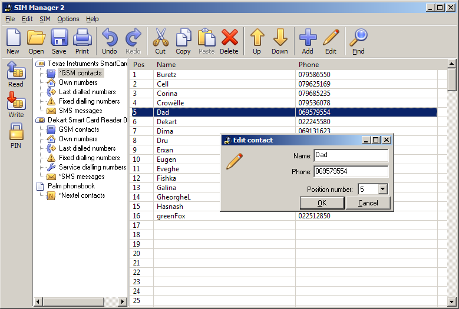
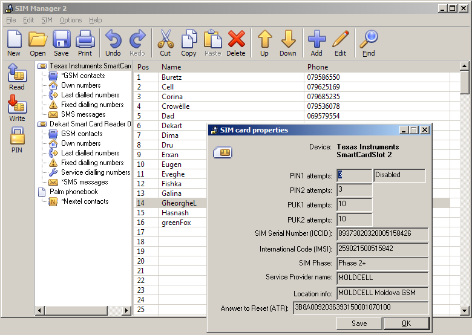

---
tags:
  - Mobile device tools
---
SIM Manager is a program designed to read the contents of a SIM card
and display it in a human readable form. It is compatible with 2G, 3G
and Nextel [iDEN](iden.md) cards.

## Feature highlights

* Read the details of the SIM card (ICCID, IMSI, ATR)
* Change PIN codes
* Undelete SMS
* Wipe SMS (so that it cannot be recovered)
* Unicode support
* Compatible with Nextel cards
* Backup and restore SIM cards
* Synchronization with Google contacts

## Requirements

* Any PC/SC compliant [smart card reader](sim_card_forensics.md#hardware).

## Screenshots

{width="200"}

<!-- pyml disable-next-line line-length -->
{width="200"}

## External Links

* [How to recover a deleted SMS using SIM Manager](https://www.youtube.com/watch?v=VaBaqZiNW4U)
  (video tutorial)
